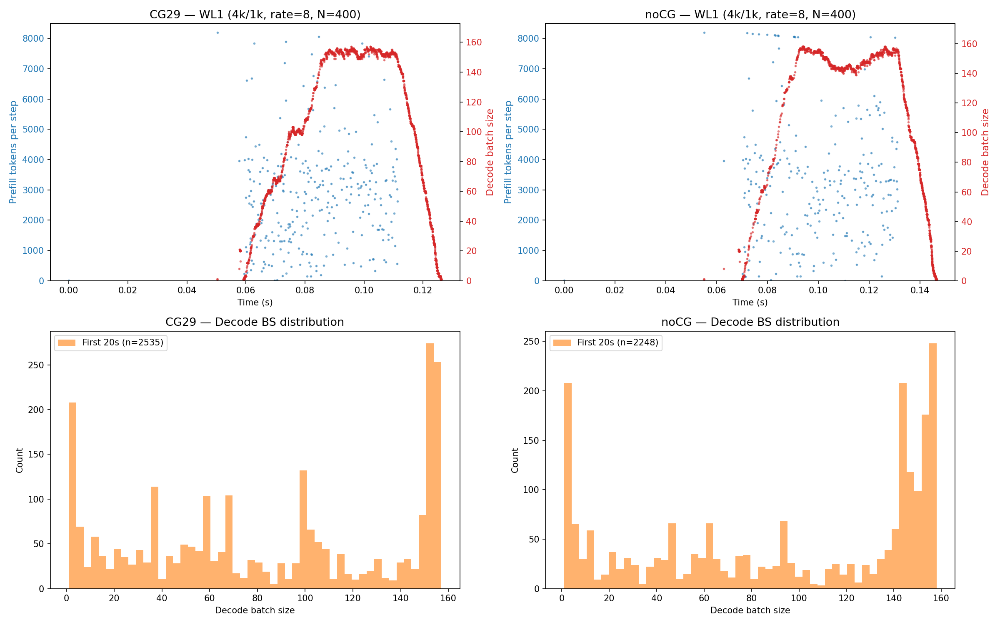

# LPT Persistent Kernel + Mixed CG Performance

## Goal
Implement and optimize LPT (Longest Processing Time) dynamic scheduler for persistent attention kernel with mixed batch CUDA graphs in SGLang flashinfer backend.

## Setup
- Model: `Qwen/Qwen3-8B`, H100/H800 80GB
- Server: `--enable-mixed-chunk --attention-backend flashinfer --mem-fraction-static 0.85 --enable-piecewise-cuda-graph`
- Env vars: `SGLANG_FLASHINFER_USE_PERSISTENT=1`,
  `SGLANG_EDF_PLAN_OVERHEAD_MS=auto` for the peak-load SLO-aware points
- Benchmark: `bench_serving --dataset-name random --request-rate 8 --num-prompt 400`
- Profile logs: `tasks/debug_kernel_server_perf/profile_logs/`
- gpu_keepalive MUST be stopped before benchmarks (corrupts results — cooperative launch is especially sensitive to SM contention)
- **Baseline runners MUST set `SGLANG_FLASHINFER_USE_PERSISTENT=0` explicitly.**
  It defaults to **1**, so a "BatchPrefill baseline" that omits it silently runs
  the persistent kernel for mixed batches and the comparison becomes
  persistent-vs-persistent. This contaminated every H800 DMC baseline between
  2025-11-14 and 2026-07-30; those results have been removed from this file and
  `realistic_workload_analysis.md` (git history retains them). The honest
  baseline is 6.1–10.7% *faster* than the contaminated one, so the bug
  understated both sides.

## Sync-free plan + measured mixed-kernel gate (2026-07-30)

Goal: eliminate the low-concurrency regressions of the persistent overlap
kernel (LPT planning + cooperative-launch overhead) and guarantee zero
regression via server-side kernel selection. sglang `9bbc82e28`+, flashinfer
`f4d2a80`. Sweep scripts and data are inventoried in the cost-surface
section below; the gate table is built by `build_mixed_kernel_gate_table.py`.

### Overhead diagnosis (H800, Qwen2.5-7B heads 28/4)

- `BatchAttention.plan()` ran three D2H copies + `torch.cuda.synchronize()`
  per mixed step. With ~40 ms of queued GPU work the plan call stalls
  **56.5 ms**; this serialization (not cooperative launch) was the dominant
  serving overhead. Fix: host-built indptrs from `seq_lens_cpu` +
  double-buffered pinned staging fenced by CUDA events (the pinned-buffer
  reuse race is why earlier naive sync removals hung). Plan wall time with a
  busy GPU: **0.47 ms**, outputs bitwise identical
  (`tasks/debug_kernel_server_perf/test_syncfree_plan.py`).
- Persistent `run()` CPU dispatch is **cheaper** than BatchPrefill
  (16 µs vs 26 µs/call); cooperative launch is not a CPU-side cost.
  `persistent_attn_forward` now reuses out/lse buffers (was 2 allocs/layer).

**Post-mortem: why that D2H cost 56.5 ms, and where the pattern still lives.**
*Our plan path no longer does any D2H.* It passes host tensors only —
`plan_qo_indptr`/`plan_kv_indptr`/`plan_kv_lens` are built by NumPy cumsum
from `seq_lens_cpu`/`extend_prefix_lens_cpu` — so flashinfer's device-tensor
branch never runs. Verified in the mixed-tenancy captures: that branch ends in
`torch.cuda.synchronize()`, and `cudaDeviceSynchronize` appears **once** in
279 s (startup), so neither it nor the `seq_lens_cpu is None` fallback ever
fired. What follows is the mechanism behind the old 56.5 ms, measured on the
copies that remain *elsewhere* in the stack (2026-09-14, sglang `368f5e6fe`,
flashinfer `c6d2a00`; full-run nsys captures of the `agent_plus_shortchat`
scenario, 279 s span, one CUDA-issuing thread — 0.8–1.2 GB SQLite exports kept
as local artifacts, not checked in; reproduce by joining
`CUPTI_ACTIVITY_KIND_MEMCPY` to `CUPTI_ACTIVITY_KIND_RUNTIME` on
`correlationId` and grouping by `copyKind`/`dstKind`).

- **`non_blocking=True` is a no-op for a D2H copy, and the cost is a pipeline
  drain, not a copy.** `.to(torch.device("cpu"), non_blocking=True)` allocates
  a *pageable* destination; `cudaMemcpyAsync` D2H into pageable memory is
  synchronous with respect to the host, so the call returns only after
  everything already queued on the stream has run. Pinned destinations in the
  same runs take the async fast path:

  | run | D2H dest | n | avg bytes | avg host-blocked |
  |-----|----------|--:|----------:|-----------------:|
  | LPT | pageable | 46,064 | 65 | 3,607 µs (max 564 ms) |
  | LPT | pinned | 23,331 | 107 | **6.9 µs** |
  | DMC | pageable | 36,175 | 102 | 4,910 µs |
  | DMC | pinned | 16,909 | 146 | **7.2 µs** |

- **All of the cost is the first copy in a group.** These pageable copies
  arrive back-to-back (92% in pairs), and position, not size, decides:

  | run | pairs | 1st copy mean / median | 2nd copy mean | total 1st vs 2nd |
  |-----|------:|-----------------------:|--------------:|-----------------:|
  | LPT | 20,443 | 8,104 / 5,060 µs | **14.4 µs** | 165.7 s vs 0.3 s (562×) |
  | DMC | 14,334 | 12,361 / 5,054 µs | **15.5 µs** | 177.2 s vs 0.2 s (795×) |

  Same direction, same pageable destination, same size class, 560–800× apart:
  the first call absorbs the queue, the rest are free. Applied to the old plan
  path, essentially all of the 56.5 ms was the **first** `.to("cpu")`; copies
  2–3 and the following `torch.cuda.synchronize()` were ~15 µs each. (Measured
  on other call sites in the same server, not on plan() itself — the mechanism
  is CUDA's, not the call site's.)

- **A blocking readback does not necessarily starve the GPU.** Steady-state
  20 s window, union of all kernel intervals across 12 streams:

  | run | kernels | GPU busy | host blocked in pageable D2H | GPU idle *while* host blocked |
  |-----|--------:|---------:|-----------------------------:|------------------------------:|
  | LPT | 244,225 | **93.6%** | 74.7% of wall | 0.64% of wall (10% of idle) |
  | DMC | 230,612 | **94.0%** | 74.6% of wall | 0.64% of wall (11% of idle) |

  The host thread genuinely stops for three quarters of wall time, yet the GPU
  stays ~94% busy: already-queued run-ahead covers the wait. So such a copy
  hurts only when it removes run-ahead the GPU needs — which is exactly the
  old plan() case (it blocked *before* issuing the step's own work, for data
  that was available host-side all along), and is not the case for the
  scheduler's end-of-step token readback (it waits for a result that genuinely
  is not ready). This is also why removing the plan sync was worth more at low
  concurrency than at saturation.

- **Block duration measures queue depth, not overhead** — so it must not be
  read as an arm-vs-arm cost comparison. Medians are identical (5,060 vs
  5,054 µs) and blocked wall fraction is identical (74.7% vs 74.6%); LPT's
  lower mean is a thinner tail spread over 43% more readbacks (more completed
  steps), i.e. the signature of the faster server, not of lower overhead.

- **Where the residual copies are.** Sized `bs+1` then `bs` int32 — the
  signature of flashinfer's stock `plan()` (`decode.py:941-942`
  `indptr.to("cpu")`/`last_page_len.to("cpu")`, and `prefill.py:1711-1719`),
  which sglang still triggers by passing device tensors to `begin_forward()`
  without `max_token_per_sequence`/`max_sequence_kv`. So the BatchPrefill and
  decode paths still pay per step what the persistent path no longer does;
  exact attribution needs a capture with `--cudabacktrace`. See Open TODOs.

### The cost surface: where the persistent kernel wins, and why

Serving-matched composition (the non-causal cached-prefix part of a mixed
batch), `bench_gpu_time` medians, BatchPrefill fa2 vs both persistent
schedules. Three sweeps, all checked in, which together are the deployed
1,316-point gate table:

| sweep | n | decode rows | decode KV/row | **chunk tokens** | **chunk prefix** |
|-------|--:|-------------|---------------|------------------|------------------|
| uniform | 479 | 1–128 (all equal) | 2K–98K | 128, 512, 1K, 2K, 4K, 7K, 8K | 512, 2K, 4K, 8K, 16K, 32K, 64K, 80K |
| fresh-prefix extension | +477 | 1–128 (all equal) | 2K–98K | 128, 512, 2K, 4K, 8K | **0, 128, 256** (+32K/64K controls) |
| blended pools | 360 | 2–88 (**mixed lengths**) | 2K–64K within one batch | 512, 2K | 0, 4K |

| sweep | script | data file |
|-------|--------|-----------|
| uniform | `gate_sweep3.py` | `gate_sweep3_qwen25_h800.json` (gqa4: `gate_sweep3_qwen3_h800.json`) |
| fresh-prefix extension | `sweep_fresh.py`, `probe_fresh_qwen25_h800.json` | merged with the above into `gate_sweep_merged_qwen25_h800.json` (956) |
| blended pools | `sweep_blend.py` | `gate_sweep_blend_qwen25_h800.json` |

The fresh-prefix extension is the one that mattered: the uniform sweep never
sampled a chunk prefix below 512, so the entire fresh-arrival region — where
the kernel is worth 8–28× — was invisible to it. The blended sweep is the only
one whose decode rows have *different* lengths within a batch, which is what a
real co-tenancy pool looks like and what the KV-concentration feature keys on.

Peak speedup is **21.0×** in the uniform sweep and **28.2×** once fresh
prefixes are sampled.

**Do these sweeps represent peak server load?** They are isolated-kernel
benchmarks (`bench_gpu_time`: warmup + L2 flush, one kernel at a time on an
idle GPU), so this was checked rather than assumed (2026-09-18, against the
mixed-tenancy captures):

- **Kernel isolation is the serving condition, not an artifact.** In a
  steady-state 20 s window, exactly one kernel is resident for **93.25%** of
  wall; two overlap for 0.36% and three or more for 0.00%. sglang issues
  essentially everything on one stream, so an attention kernel gets the whole
  GPU in serving just as it does in the bench. The sweep is not measuring an
  unrealistically quiet device.
- **Serving sits inside the swept envelope.** Sweep covers total decode KV
  2K–6.3M tokens with BP 0.019–28.6 ms and persistent 0.019–25.7 ms; measured
  in serving, BP kernels run 0.007–16.6 ms and persistent 0.055–2.26 ms
  (p50 0.209 ms). No serving composition lands outside the sampled range.
- **The predicted routing shows up in serving.** BatchPrefill's p90 kernel
  time is **0.267 ms in the gated arm vs 0.906 ms in the DMC arm** — same
  kernel, same workload, differing only in that the gate moved the
  compositions the sweep flagged as pathological onto the persistent kernel.

What the sweeps do *not* reproduce, in rough order of concern:

- **Contiguous KV pages.** `Bench` uses `kv_indices = torch.arange(...)`,
  while a long-lived server's radix allocator hands out fragmented pages. Both
  kernels gather through that array, but they gather differently (persistent
  splits one row's KV across CTAs; BP streams long runs from few CTAs), so
  fragmentation need not penalise them equally. Untested.
- **Sustained-load clocks.** The bench is short bursts on a cool GPU; serving
  holds ~94% occupancy for minutes. No clock telemetry was captured.
- **L2 residency.** `bench_gpu_time` flushes L2; in serving attention inherits
  a dirty L2 from the preceding GEMM. Immaterial for long rows (working set
  >> 50 MB) but potentially material for the small-batch compositions where
  the measured 0.57–0.70× losses live.
- **Eager launch vs CUDA-graph replay** (kernel time is the same; launch path
  is not), and a **shared** GPU (MPS or a co-tenant process) would change
  cooperative-launch timing specifically — both sweeps and serving runs assume
  a dedicated device.

The load-bearing defence is not that the microbenchmark is realistic, but that
the table is only ever used as a *decision* rule whose decisions were then
validated end to end: parity controls, paired repeats, and the mixed-tenancy
A/Bs below are what would expose a bench-to-serving mismatch.

**The batch mixtures, though, are a grid — not the realized distribution.**
This is the weaker part of the methodology. The sweeps enumerate a Cartesian
product of (decode rows × per-row KV × chunk tokens × prefix); a real scheduler
emits a narrow, correlated cluster that differs per workload. Parsed from the
`Prefill batch` log lines of the gated runs (sampled at the decode log
interval, so tens of steps per run, not all):

| scenario | chunk tokens p50 (p90) | decode rows p50 | total decode KV p50 | gate → persistent |
|----------|-----------------------:|----------------:|--------------------:|------------------:|
| agent+shortchat (the win) | **386** (532) | 46 | 189K | 1,046/1,901 = **55%** |
| shortchat_only (control) | 382 (496) | 25 | 11K | 6/2,566 = 0.2% |
| multiturn_slo_clean | 2,151 (8,173) | 5 | 87K | — |
| TraceLab g16 (parity) | 8,182 (8,191) | 10 | 904K | 18/500 = 3.6% |

Three mismatches follow:

- **Density.** The chunk grid is {128, 512, 1K, 2K, 4K, 7K, 8K}, but the win
  scenario operates at 380–530 tokens — between the two lowest grid points —
  while most sweep points sit at 2K–8K, where that scenario essentially never
  runs. Realized decode rows (46) likewise fall between grid points 32 and 64.
  k-NN interpolates, but both its accuracy and the out-of-support radius are
  set by local sample density, which the grid, not the workload, determines.
- **Correlation.** In serving the chunk is the token budget *left over* after
  decodes are scheduled, so chunk size and decode count are strongly
  anti-correlated (46 decodes → 386-token chunks; 10 decodes → 8.2K chunks).
  The Cartesian sweep treats them as independent and spends points on
  combinations the scheduler cannot produce.
- **Heterogeneity.** Only the 360-point blended sweep has rows of differing
  lengths inside one batch, and it covers just chunk ∈ {512, 2K} ×
  prefix ∈ {0, 4K}. Every real decode pool is heterogeneous.

So the leave-one-out worst-case of 1.000 is generalization *within the grid*,
not to the serving distribution — the serving-level parity controls are what
cover the latter, and they are the reason the zero-regression claim is
defensible despite this. Measurement caveat: `#cached-token` is the radix hit
at admission, so it is a valid prefix proxy only for a request's first chunk;
for continued chunks the attended prefix is the already-processed portion and
is not in the log line, which is why no prefix column appears above.

**Mechanism (corrected 2026-08-06; arithmetic re-verified against flashinfer
source 2026-09-19).** BatchPrefill's split-KV works on its own — a decode-only
batch of 8 rows @64K runs in 0.366 ms through it, matching the persistent
kernel. The failure is a planner coupling that appears only in mixed batches,
and both halves of it are exact, not approximate, for this configuration
(H800: `num_sm`=132, `num_kv_heads`=4, `gqa_group_size`=7):

- **(a) One chunk flips the batch-wide CTA tile.** `scheduler.cuh:549-550`
  computes `avg_packed_qo_len = sum_packed_qo_len / batch_size` and calls
  `FA2DetermineCtaTileQ`, which returns 128 above 64, 64 above 16, else 16
  (`utils.cuh:303`). Eight decode rows contribute 7 each; a 1,024-token chunk
  contributes 7,168, so the mean is 802 and the tile is 128 — for *every* row,
  including the decode rows that wanted 16. (This is the non-graph path, which
  is what the sweeps and the mixed BatchPrefill path use. With
  `enable_cuda_graph` the planner instead keys on `max_qo_len`
  (`scheduler.cuh:534-537`), which a chunk raises just as surely.)
- **(b) The same chunk exhausts the split budget.**
  `max_batch_size_if_split = max_grid_size / num_kv_heads`, where
  `max_grid_size = num_blocks_per_sm * num_sm = 2 × 132 = 264`
  (`scheduler.cuh:716-718`) — so the budget is exactly **66 work units per KV
  head**. `PrefillBinarySearchKVChunkSize` (`scheduler.cuh:101-130`) searches
  for the smallest `kv_chunk_size` with
  `Σ ceil(packed_qo_len_i / cta_tile_q) × ceil(kv_len_i / chunk) ≤ 66`. The
  chunk's own q-tiles alone are `ceil(7168 / 128)` = exactly **56** of those
  66. Splitting the eight decode rows even two ways would cost 16 more
  (56 + 16 = 72 > 66), so the search terminates at `kv_chunk_size = max_kv_len`
  and the decode rows are not split at all.

Eight rows × 4 KV heads then stream 32 MB each (64K tokens × 128 dim × 2 bytes
× K and V) from 32 CTAs while ~100 of the 132 SMs idle: BP plateaus near
3.1 ms for any chunk ≥1,024 tokens, while the chunk's own attention work is
negligible.

The persistent planner has no such coupling. It sizes its KV split from the
*total* work rather than from a fixed unit budget:
`kv_len_limit = f(ceil_div(total_kv_lens × num_kv_heads, num_clusters))` with
`cluster_size = 1`, `num_clusters = num_sm = 132` (`scheduler.cuh:1148-1149`,
`1195`) — i.e. work per SM, ≈ `total_kv_lens / 33` for this head config, and
halved again for the prefill tile class (`1196-1199`). Every row is then
partitioned into (tile, head, kv-chunk) units regardless of batch
heterogeneity, so it stays bandwidth-bound (~0.38 ms).

*Caveat:* the 0.366 ms decode-only figure comes from an ad-hoc probe during the
2026-08-06 investigation; every checked-in sweep point has a chunk, so that one
number is not reproducible from saved artifacts.

**This is the whole win region in one table.** Chunk held fixed at **2,048
fresh tokens (prefix 0)**, decode rows @96K each, sweeping the pool over 64×
(`gate_sweep_merged_qwen25_h800.json`):

| decode rows @96K | total decode KV | BatchPrefill | persistent | speedup |
|-----------------:|----------------:|-------------:|-----------:|--------:|
| 1 | 98K | 2.970 ms | 0.105 ms | **28.2×** |
| 2 | 197K | 2.979 ms | 0.169 ms | 17.7× |
| 4 | 393K | 2.983 ms | 0.298 ms | 10.0× |
| 8 | 786K | 4.655 ms | 0.574 ms | 8.1× |
| 16 | 1,573K | 4.709 ms | 1.093 ms | 4.3× |
| 32 | 3,146K | 4.725 ms | 2.131 ms | 2.2× |
| 64 | 6,291K | 5.049 ms | 4.274 ms | 1.2× |

BatchPrefill is **flat** (2.97 → 5.05 ms) while the work grows 64×; the
persistent kernel is **proportional** (0.105 → 4.274 ms), i.e. bandwidth-bound
as it should be. So the headline multiple is not a separate "decode-dominant"
phenomenon — it is just this ratio read at its left edge, where BP's plateau
is divided by the smallest real workload. It follows that the multiple is
largest with *few long* rows, not many: concentration, not aggregate KV, is
the predictor, which is why the gate carries a KV-concentration feature.

**Crossover by chunk prefix** (decode pools ≥ 250K total KV tokens):

| chunk prefix | median speedup | fraction >1.5× |
|-------------:|---------------:|---------------:|
| 0 – 8K | 1.27 – 1.72× | 46 – 57% |
| 16K | 1.17× | 36% |
| ≥ 32K | 1.02 – 1.07× | 0 – 11% |

So the rule is: **persistent wins when prefill chunks attend a prefix shorter
than roughly 16K against a substantial decode pool.** Realistic anchors, from
the fresh and blended data: 8 decodes @80K plus a fresh 2,048-token chunk is
**7.92×** (`probe_fresh_qwen25_h800.json`), and blended pools of 40–56 decodes
where only 4–8 are long (@64K, rest @2K) with a fresh 512–2,048-token chunk
give **6.90–7.50×** (`gate_sweep_blend_qwen25_h800.json`, whose maximum is
15.95× at 2 long rows @64K). Only 4–8 concurrent long-context decodes are
needed; short-KV decodes flooding the batch barely dilute the gain.

**Where persistent loses**, from the same merged table: 162/956 compositions
below 1.0× and 80 below 0.95×, all of them tiny batches where fixed overhead
dominates — worst cases are 1–4 decode rows @2–8K KV with a 512-token chunk
(0.57–0.70×, e.g. 0.027 ms vs 0.048 ms). Distribution over the merged sweep:
p10 = 0.97×, median = 1.24×, p90 = 4.88×, with 345/956 at ≥1.5×. These are the
compositions the gate must decline, and the reason its label margin is 1.10
with an out-of-support guard rather than a threshold rule.

**Work ordering.** The old flip heuristic (`total_kv < bs*32768`) is wrong on
this composition: mean 6.1% loss, worst 1.52×, 228/479 cases >5% off.
Non-flipped is better on 336 of the 368 cases where the schedule matters ≥5%,
so the gate learns the flip from the same neighbors.

**What this explains.** Pure TraceLab replay is the *worst* case for the
kernel: every chunk is a session continuation attending a 32–100K prefix —
the ≥32K row above, i.e. parity — and causal replay rarely has a prefill and
decodes pending at once. That is the whole reason the early serving results
were null, and why the win had to be looked for in composition rather than in
the kernel. Favourable and common in production: fresh arrivals into a busy
decode pool (chat + coding agent on one node), reasoning/thinking traffic
where decode KV grows from generated tokens while prompts stay short, and
cache-miss RAG/document traffic whose early chunks still have small prefixes.

How much of this is temporal prefill/decode overlap versus heterogeneity-
robust scheduling is separated in **Overlap attribution** below: overlap is
1.2–1.26× in the balanced band, scheduling supplies the rest. Part of the
scheduling gap is an fa2 planner limitation upstream could shrink (lift the
split budget, per-row tiles), which would narrow the decode-row penalty but
not supply dual tiles or overlap; the gate re-measures if the baseline
improves.

### Overlap attribution (2026-08-06)

`bench_overlap_attribution.py` isolates temporal prefill/decode overlap from
planner effects by comparing, with the same persistent kernel and planner,
the mixed launch against the two parts run separately:
`ovl_eff = (T_decode + T_prefill) / T_mixed`.

- Overlap contributes up to **1.26x**, only where the chunk's compute time
  balances the decode pool's memory time (T_p/T_d in roughly [0.5, 3]):
  2-4K short-prefix chunks against 16-32 long-context decodes. It decays to
  ~1.0 on both flanks (chunk-dominated or decode-dominated batches).
- The remainder of the mixed-batch win over BatchPrefill (up to ~2.4x at the
  same points, 8x at decode-dominated ones) comes from heterogeneity-robust
  scheduling, which upstream fa2 planner fixes could partially reclaim.
- Framing: the fused persistent formulation is what makes kernel-level
  overlap possible (dual tile classes co-resident in one launch; BP has one
  tile class per batch and cannot overlap by construction); the planner
  robustness is its prerequisite. An overlap-aware chunk-size controller
  (choose chunk so T_p ~ T_d against the live decode pool) would hold serving
  inside the 1.25x band instead of sampling it, and is the natural next step.

### The cost model is kernel-level; only its wrapper is server-level

Worth stating explicitly, because the model's *use* (EDF chunk control) is
server-level while its *fit* is not. `overlap_cost_model.py` is two layers:

| layer | form | constants | fit from | error |
|-------|------|-----------|----------|-------|
| decode attention | `T_d = a_d·decode_kv + c_d` | 2 | kernel times (`overlap_attribution.json`, n=35) | 2.04% MAPE, 4.8% max |
| chunk attention | `T_p = a_p·(n·prefix + n²/2) + c_p` | 2 | same, n=30 with a chunk | 3.47% MAPE, 7.0% max |
| **mixed composition** | `T_attn = max(T_p,T_d) + β·min` | 1 (β=0.5285) | same | **3.10% MAPE / 9.1% max in-sample; 3.22% / 9.7% leave-one-out** |
| step wrapper | `T_step = c0 + c1·tokens + L·T_attn` | 2 | **not fit** — derived from hardware (15.2 GB weights ÷ 3.35 TB/s + 0.6 ms; 2·params ÷ 600 TFLOP/s) | one serving anchor: 15.1 ms predicted vs 15.75 ms measured mean ITL |

So the kernel layer is measured, fit, and cross-validated (LOO barely moves the
error, so the one-parameter law is not overfit); the server layer is an
analytic roofline with a single sanity check.

**Only `predict()` is consumed** — `attn_layer_ms()` has exactly one caller
(line 114 of the same file), and the EDF controller asks only for whole-step
ms. So there is one model in use, not two; the kernel law is its interior.
That interior is doing three jobs:

1. **It is why the model needs no training.** The MLP it replaced had to learn
   `T_step(n_p, r_p, r_d, decode_bs)` end to end from **25,444 profiled
   configs** per model/GPU. The analytic model needs **35 kernel
   measurements** because the composition rule is known rather than learned —
   the structure does the work the data used to. Re-fitting for a new GPU is
   an afternoon, not a profiling campaign.
2. **It is where the paper's predictability claim is even visible.** "The
   split-kernel baseline has no closed form" is a *kernel-level* statement
   (fitted β=2.19; 13.3%/43% for the best parts-based fit). At step level the
   `c0 + c1·tokens` term is large enough to mask the attention pathology, so
   measuring only whole steps would hide exactly the effect being claimed.
3. **It is what an overlap-aware chunk controller would need.** Choosing a
   chunk so `T_p ≈ T_d` (holding serving inside the 1.2–1.26× overlap band
   instead of sampling it) requires the two terms *separately*, which the
   step total does not expose. Not implemented — see Open TODOs.

**Is BatchPrefill just hard for *that form*? (learned-model check, 2026-09-19.)**
Fitting `max + β·min` is a strong assumption, so the claim was re-tested with
flexible learners on the **same 1,316 sweep compositions, same 6 gate features,
same model class per row**, 5-fold CV × 3 seeds, log-target
(`fit_learned_cost_model.py`):

| features | model | target | MAPE | p95 | max |
|----------|-------|--------|-----:|----:|----:|
| composition (6) | MLP (128,64,32) | BatchPrefill | 9.9% | 27.2% | 85.3% |
| composition (6) | MLP (128,64,32) | persistent | **5.7%** | 15.4% | 40.7% |
| composition (6) | GBDT (400) | BatchPrefill | 10.1% | 30.5% | 102.7% |
| composition (6) | GBDT (400) | persistent | **3.3%** | 11.0% | 62.8% |
| + planner vars (10) | GBDT (400) | BatchPrefill | 8.6% | 25.7% | 101.1% |
| + planner vars (10) | GBDT (400) | persistent | **3.5%** | 11.2% | 60.5% |

Three conclusions, one of which corrects the earlier wording:

- **"Unmodelable" was too strong.** An MLP reaches 9.9% MAPE on BatchPrefill,
  better than the 13.3% of the best parts-based affine fit, so part of that
  13.3% was the functional form, not the kernel. The defensible claim is the
  *relative* one: on identical data, features and model class, BatchPrefill is
  **1.7–3× harder to predict** than the persistent kernel, with a far worse
  tail (85–103% max error vs 41–63%).
- **The planner variables recover only part of it.** Adding the batch-average
  packed-qo length and the CTA tile it implies — the exact quantity
  `FA2DetermineCtaTileQ` branches on — moves GBDT from 10.1% to 8.6% and
  leaves persistent unchanged. So the tile flip is a real but partial
  explanation; the residual is consistent with `PrefillBinarySearchKVChunkSize`
  depending on the full per-row KV vector, which no batch aggregate can carry.
  Replicating the planner, not fitting a smoother function, is what would close
  it — i.e. a simulator of one kernel version, not a portable model.
- **Fitting BP well would cost exactly what the analytic model saves.** These
  numbers need 1,316 measured compositions per GPU/model; the analytic law
  needs 35. And at 8.6–10% MAPE with 25–30% p95, a controller binary-searching
  chunk size against a 100 ms ITL budget would systematically over- or
  undershoot, where 3.3%/11% is workable.

Two scope limits:

- **It models the persistent kernel only.** There is deliberately no
  BatchPrefill equivalent — its mixed cost is super-additive in its parts
  (fitted β=2.19; best parts-based affine fit 13.3% MAPE / 43% max), which is
  why kernel *selection* needs a measured table rather than comparing two
  formulas.
- **Its fit grid is small and sits above the realized operating point**:
  decode rows {8, 12, 16, 32}, per-row KV {32K, 40K, 64K}, chunk {2K, 4K, 8K},
  prefix {0, 8K, 16K, 32K}. The SLO runs it actually drove operated at chunk
  p50 2,151 (inside) but decode rows p50 5 and total decode KV 87K (both
  *below* the grid) — extrapolation of a linear roofline below its fit range,
  which is the benign direction but is extrapolation. Same grid-vs-realized
  gap as the gate table above.

### Measured k-NN gate

Deployed version (v2, 2026-08-05, built by `build_mixed_kernel_gate_table.py`):
1,316 measured compositions, features `[log1p(decode_kv),
log1p(prefill_work=Σe·c), log1p(prefill_tokens), log1p(decode_bs),
3·D/(D+P+1), log1p(kv_concentration=Σkv²/Σkv)]`, k=5, persistent only on
unanimous neighbors labeled `bp/pa_best ≥ 1.10`, flip by neighbor majority,
plus an out-of-support guard (query farther than `max_nn_dist_sq` from every
table point → BatchPrefill). Leave-one-out: worst-case regression **1.000**,
win capture 81%, mean speedup 2.71× on accepted batches. The original v1
(479 points, 5 features, k=3, label ≥1.05, LOO worst 1.028) is what the
2026-07-30 validation screens below ran; v2 adds the fresh-prefix and
blended-pool sweeps and is what every mixed-tenancy run uses. Deployed as
`python/sglang/srt/layers/attention/mixed_kernel_gate_h800_gqa7.json`
(+gqa4 for Qwen3-8B) behind `SGLANG_MIXED_ATTENTION_KERNEL=auto` with
forced `persistent`/`batch_prefill` overrides. Decision latency on the
current 1,316-point/k=5 table (re-measured 2026-08-13): ~39 µs for the core
k-NN, 52–69 µs for the full entry point including feature computation from
per-request CPU lists (batch 16→256); once per mixed step, CPU-side, ~12x
cheaper than the 0.47 ms sync-free plan it precedes.

### Validation screens (TraceLab decode-heavy, N=100, 2026-07-30)

sglang `313b97611`, flashinfer `c6d2a00`. Command:
`TRACELAB_MIN_OUTPUT_LEN=512 TRACELAB_NUM_GROUPS=<g> NUM_PROMPTS=100
LPT_CHUNKED_PREFILL_SIZE=6656 METHODS_SPEC="DMC_CG LPT"
bash tasks/realistic_workload_analysis/run_tracelab_claude.sh`, results in
`tasks/realistic_workload_analysis/h800_tracelab_decodeheavy512_gated_g{10,16}_n100/`.
These screens ran the v1 gate (479 points/k=3); their zero-regression
conclusion was re-confirmed under the v2 gate by the mixed-tenancy controls.
DMC is a true BatchPrefill baseline here (explicit
`SGLANG_FLASHINFER_USE_PERSISTENT=0`, see Setup).

The first g10 LPT run exposed a mid-replay JIT compile of the second
flipped-schedule module variant (18.3 s global stall freezing all nine active
sessions; both variants' cached_ops rebuilt at 19:16/19:19 in the server
process). Fixed by prewarming both variants at backend init
(flashinfer `c6d2a00` + sglang `313b97611`); the polluted run is archived in
the session scratchpad and was re-run.

| Screen | Method (cap) | Total tok/s | Mean/P99 TTFT | Mean ITL | pooled P99 ITL | reqmax P99 |
|--------|--------------|------------:|--------------:|---------:|---------------:|-----------:|
| g16 (conc 10.9) | true DMC (8192) | 7,882 | 31.0 / 90.2 s | 42.88 ms | 775.97 ms | 1,367 ms |
| g16 (conc 11.0) | gated LPT (6656) | **7,943 (+0.77%)** | 31.8 / 89.8 s | **42.28 ms** | **662.92 ms (−14.6%)** | **1,205 ms** |
| g10 (conc 3.2) | true DMC (8192) | 6,382 | 3.27 / 40.2 s | 17.52 ms | 31.36 ms | 1,075 ms |
| g10 (conc 3.2) | gated LPT (6656) | 6,375 (−0.11%) | 3.29 / 41.1 s | 17.57 ms | 35.01 ms (+11.6%) | **886 ms (−18%)** |
| g10 (conc 3.2) | gated LPT (8192) | **6,386 (+0.07%)** | 3.37 / **40.0 s** | **17.48 ms** | **29.41 ms (−6.2%)** | 1,072 ms |

At g16 the gate chose BatchPrefill for 482/500 mixed batches — the 6,656-token
chunks against ~80K prefixes sit in BatchPrefill's win region, so the pooled
P99 gain comes from the cap, the corrected schedule choices, and the 18
persistent picks. Both methods retokenize 100% and share one 32-s KV-pressure
outlier on a single request.

The g10 pooled-P99 gap at cap 6656 is a **cap artifact, not a kernel
artifact**: with the gate routing nearly all mixed batches to BatchPrefill,
the only remaining config difference was the LPT-only 6,656-token cap (more,
shorter interference windows). Matching the baseline cap (8192) turns the old
"+14.5% pooled P99 ITL regression at 10 sessions" into **−6.2%** with parity
on throughput/mean ITL/P99 TTFT/request-max. Cap 6656 remains the
tail-optimized point (−18% request-max at g10, −14.6% pooled P99 at g16).

At the default cap 8192, g16 gated LPT is parity on throughput/pooled P99
(−0.43%/−1.33%) with request-max P99 **−23%** (1,053 vs 1,367 ms) and no
32-s outlier; the −14.6% pooled-P99 point requires cap 6656.

### WL1 screens, Qwen3-8B / gqa4 table (N=100, `run_gain_search.sh`, 2026-07-30)

`MODEL=/opt/tiger/models/Qwen3-8B CASES_SPEC="4096:1024:8 4096:1024:2"
NUM_PROMPTS=100 METHODS_SPEC="DMC_CG LPT"`, results in
`tasks/debug_kernel_server_perf/wl1_gated_check_n100/`. Both methods
retokenize 100%.

| Rate | LPT vs true DMC |
|-----:|-----------------|
| 8 | tput +0.16%, mean TTFT −2.6%, mean ITL −0.5%, pooled P99 ITL +0.5% |
| 2 | tput −0.01%, mean TTFT −1.4%, mean ITL −0.1%, pooled P99 ITL −2.6% |

Zero regression on the Qwen3-8B head config at both loads.

### Paired repeat runs (default cap 8192, `*_cap8192_rep2_n100/`)

| Screen | Run | LPT vs true DMC |
|--------|-----|-----------------|
| g16 | 1 | tput −0.43%, mean TTFT +6.8%, pooled P99 ITL −1.3%, reqmax P99 −23% |
| g16 | 2 | tput **+2.10%**, mean TTFT **−6.0%**, pooled P99 ITL **−4.1%**, reqmax parity |
| g10 | 1 | tput +0.07%, mean TTFT +3.2%, pooled P99 ITL −6.2%, reqmax parity |
| g10 | 2 | tput −0.03%, mean TTFT −0.6%, pooled P99 ITL −0.7%, reqmax parity |

Mean TTFT at saturation swings ±6% between identical-config runs, so the
run-1 TTFT deltas were noise. Averaged, the default configuration is parity
or better on every axis at both loads.

### Conclusion

The low-concurrency regression of the persistent overlap path is eliminated
and the high-concurrency gains are retained against a strictly stronger
(honest BatchPrefill) baseline:

- **Default config** (gate auto, cap 8192): zero regression at 10 sessions
  (all axes within noise, pooled P99 ITL −0.7–6.2% better), and at 16
  sessions +0.8% mean throughput across paired runs with −1.3–4.1% pooled
  P99 ITL and up to −23% request-max P99.
- **Tail-optimized** (cap 6656): −14.6% pooled P99 ITL and +0.77% throughput
  at 16 sessions; at 10 sessions request-max P99 −18% while pooled P99 pays
  +11.6% (a cap tradeoff, not a kernel one).
- Kernel level, the gate preserves the persistent kernel's wins where they
  exist — up to 21.0× in the uniform sweep, 28.2× once fresh prefixes are
  sampled, on batches with few long decode rows and a short-prefix chunk —
  while capping any composition's regression (v1 gate: 2.8% leave-one-out;
  deployed v2: 1.000, i.e. none). WL1 on Qwen3-8B is parity at both rates
  with 100% retokenization everywhere.

Mechanically, the three fixes were: (1) sync-free double-buffered planning
(56.5 ms pipeline stall → 0.47 ms), (2) the measured per-batch kernel +
schedule gate replacing always-persistent and the wrong flip heuristic, and
(3) startup prewarm of both persistent module variants (a mid-replay JIT
build froze all sessions for 18 s). Every number below is against an honest
BatchPrefill baseline (see Setup).

**Phase 2 (2026-08-04..06), the current headline results:**

- **Mixed tenancy is the win scenario** (`run_mixed_workloads.py
  agent_plus_shortchat`, honest baseline, identical tokens, 100% retok):
  coding tenant **+36.5% throughput** (188→138 s wall), chat tenant
  **−42% mean ITL / −23% P99 / −37% TTFT**; `shortchat_only` control at
  parity with the gate declining persistent on 2,560/2,566 mixed batches.
  Details in `tasks/realistic_workload_analysis.md`.
- **The win region is lawful**: per-request KV concentration × chunk prefix
  (< ~16K) decide it; the gate table is 1,316 points with a KV-concentration
  feature and an out-of-support guard (LOO worst regression 1.000).
- **Overlap attribution**: temporal PD overlap contributes 1.2–1.26× in the
  balanced band T_p ≈ T_d; the rest of the mixed-batch win is
  heterogeneity-robust scheduling (BP's planner collapses under one chunk:
  tile flip + split-budget exhaustion, 3.1 ms plateau).
- **Analytic cost model** (`SGLANG_EDF_LATENCY_MODEL=analytic`):
  `T_attn = max(T_p,T_d) + 0.53·min` at 3.1% MAPE/9% max, 7 physical
  constants, no training; BP's best parts-based fit is 13.3%/43% with
  fitted β=2.19 (super-additive). Predictable cost is what SLO scheduling
  consumes; the fused kernel is what makes cost predictable.

## Open TODOs

- [ ] **Remove the baseline's own plan() drain** (makes DMC strictly
  stronger *and* speeds the gate's BatchPrefill picks): sglang calls
  `wrapper_paged.begin_forward(qo_indptr, kv_indptr, ...)` with device
  tensors and no `max_token_per_sequence`/`max_sequence_kv`, so
  `prefill.py:1711-1719` does pageable `.to("cpu")` per mixed step. All the
  inputs exist host-side already (`seq_lens_cpu`, `extend_prefix_lens_cpu`).
  Scale of the opportunity, from the same captures: the persistent kernel ran
  on only 29,484/28 ≈ 1,053 steps of the LPT run (the gate declines most
  compositions), while BatchPrefill kernels account for ~544k launches — so
  ~95% of steps still go through the stock plan, and the run shows 22,141
  blocking D2H groups. The sync-free plan fix covers only the persistent
  slice; this TODO covers the rest.
- [ ] **The whole `fast_decode_plan` path is dead code** (corrected
  2026-09-14; supersedes the 2026-04-12 "it is shadowed" note). It is not
  shadowed — it does not exist: `flashinfer.fast_decode_plan` is absent from
  the pinned build, so `getattr(...)` at `flashinfer_backend.py:57` yields
  `None`, the `partial` binding at :928 never runs, and
  `wrapper_uses_fast_decode_plan` (:1581) is always False. Consequence per
  decode step: sglang allocates `global_override_indptr_cpu`, host-cumsums
  `seq_lens_cpu` into it (:1573-1577), never reads it (its only consumer is
  the dead branch at :1604), resets it to None (:1630) — and then stock
  `BatchDecodeWithPagedKVCacheWrapper.plan()` does the pageable D2H
  (`decode.py:941-942`) anyway. Note the D2H runs on graph-replayed decodes
  too, since replay still calls `indices_updater_decode.update()`. Fix by
  passing host `indptr`/`last_page_len`, as the BatchAttention path already
  does; the 2026-04-12 class-alias analysis (`begin_forward = plan` at
  `decode.py:1092`, `prefill.py:1915/2773`) stays true and would matter again
  if the symbol returned.
- [ ] **Re-test the persistent kernel for pure-decode batches.** It was used
  for decode (and decode CUDA graphs) until `b91b5afaf` (2026-03-25), removed
  because `BatchAttention.plan()` ran per decode step with no fast path. That
  reason is now obsolete — the sync-free host plan is 0.47 ms with a busy GPU.
  The commit's supporting number ("B200 WL1 18,847 tok/s vs ~13K before fix on
  H100") is **cross-machine and not a valid A/B**, and no sweep has ever
  compared persistent against `BatchDecode` (gate_sweep3 and sweep_fresh both
  use BatchPrefill as the baseline), so the removal currently rests on
  mechanism alone. Needs: kernel-level persistent-vs-BatchDecode sweep over
  decode-only compositions, then a matched serving A/B.
- [ ] **Confirm the copy-vs-sync split on plan() itself** (needs a GPU; none
  visible in the 2026-09-14 session). The positional result above already
  measures the mechanism (1st pageable D2H in a group: 5-8 ms median; 2nd:
  14 µs), so only the on-plan() reproduction is outstanding: time the three
  `.to("cpu", non_blocking=True)` lines with and without the following
  `torch.cuda.synchronize()` under ~40 ms of queued work.
- [ ] **Rebuild the gate table from realized serving compositions.** The
  current table is a uniform Cartesian grid, while the scheduler emits a
  narrow correlated cluster per workload (see the cost-surface section): the
  flagship win scenario runs at ~386-token chunks against 46 decode rows,
  a region the grid samples with two points. Plan: log every mixed batch's
  true composition (including the *attended* prefix, which `#cached-token`
  does not give for continued chunks), then importance-sample the sweep from
  that empirical distribution instead of the product grid. This should raise
  win capture (fewer out-of-support declines) and make the leave-one-out
  number mean generalization to serving rather than to the grid.
- [ ] **Overlap-aware chunk sizing (the one use that needs the kernel layer
  directly).** The EDF controller currently sizes chunks against a whole-step
  latency budget, so it *samples* the overlap band rather than aiming at it.
  `attn_layer_ms` already computes `T_p` and `T_d` separately: pick the chunk
  where `T_p ≈ T_d` against the live decode pool (subject to the SLO budget)
  and serving would sit inside the measured 1.2–1.26× band instead of
  drifting through it. This is the only consumer that would call the kernel
  layer on its own rather than through `predict()`.
- [ ] **Reduce β (non-overlappable fraction, 0.53)**: NCU a balanced
  composition to attribute the unrealized half of the overlap (reduction
  pass, queue-switch granularity, or L2 interference); each point of β is
  direct overlap efficiency.
- [ ] **Gate table: sample long-prefix chunks over blended pools** (the one
  remaining unswept region) and refresh gqa4 with the blended sweep; also
  root-cause the storm-phase retraction cascade archived in
  `h800_mw_agent_plus_shortchat/run1_regressed/`.
- [ ] **Remaining mixed-workload suite scenarios**: `rag_plus_agent`,
  `long_cot`, `agent_plus_chat` (`run_mixed_workloads.py`) to complete the
  workload matrix.
- [ ] **GPU-side LPT plan kernel** [DEPRIORITIZED 2026-08-06]: the sync-free
  host plan removed this from the critical path (plan is hidden by
  overlap-scheduler run-ahead); revisit only if nsys shows plan CPU cost
  bounding step rate.
- [x] **EDF end-to-end A/B with the analytic model**: done 2026-08-11
  (`multiturn_slo_clean`, both tenants rate-limited, node throughput matched
  to four digits across arms): kernel alone codex pooled P99 ITL −28.3%;
  adding the analytic-model controller pins turns pooled P99 at 100.24 ms
  against the 100 ms budget and cuts request-max P99 −60% on both tenants.
  See `tasks/realistic_workload_analysis.md`.
- [x] Realistic workload analysis — see `tasks/realistic_workload_analysis.md`

---

## Historical results (H100, Qwen3-8B, 2026-03/04 — pre-gate stack)

The two sections below predate the sync-free plan, the measured kernel
gate, and the H800 phase. They ran on H100 with Qwen3-8B at older sglang/
flashinfer commits, and their runner (`run_one_config.sh`) set
`SGLANG_FLASHINFER_USE_PERSISTENT` explicitly, so the DMC baselines here
are honest. They are retained as machine-specific history; current
paper-facing results are in the section above and in
`tasks/realistic_workload_analysis.md`.

## Kernel-Level Results (H100 era)

### LPT vs POD vs Static Persistent 3-way comparison
(H100 80GB, Qwen3-8B heads: num_kv=8 num_qo=32 dim=128, `bench_mixed_attention.py`, 100 decode each)

| Case | Workload | POD (ms) | LPT (ms) | Static (ms) | LPT over POD | LPT over Static |
|------|----------|----------|----------|-------------|-------------|-----------------|
| 1 | 100d@kv2k + 1p@512 | 0.30 | 0.31 | 0.30 | 0.97x | 0.97x |
| 2 | 100d@kv2k + 1p@1536 | 0.32 | 0.36 | 0.37 | 0.89x | 1.03x |
| 3 | 100d@kv2k + 2p@2048 | 0.44 | 0.48 | 0.52 | 0.92x | **1.09x** |
| 4 | 100d@kv2k + 1p@2048 | 0.34 | 0.38 | 0.42 | 0.89x | **1.11x** |
| 5 | 100d@kv4k + 1p@4096 | 0.81 | 0.82 | 0.97 | 0.99x | **1.18x** |
| 6 | 100d@kv8k + 1p@4096 | 1.28 | **1.24** | 1.51 | **1.03x** | **1.22x** |
| 7 | 100d@kv8k + 1p@6000 | 1.85 | 1.89 | 2.18 | 0.98x | **1.15x** |
| **8** | **95d@kv2k+5d@kv24k+1p@2k** *(split-KV decode)* | 0.69 | **0.64** | 0.71 | **1.08x** | **1.11x** |
| **9** | **100d@kv2k+1p@kv24k,q4k** *(split-KV prefill, ratio≥2→static)* | 4.56 | 4.67 | 4.67 | 0.98x | **1.00x** |
| 10 | 100d@kv2k+1p@kv12k,q4k *(ratio≥2→static)* | 2.14 | 2.17 | 2.17 | 0.99x | **1.00x** |

(Cases 1-8: flashinfer `a74bb2d4`, `bench_mixed_attention.py`. Cases 9-10: ratio threshold auto-fallback to static.)

### LPT vs BatchPrefill (DMC's kernel) — the ACTUAL comparison that matters
(flashinfer `cfca7c6f`, `bench_mixed_attention.py`, no keepalive, 2026-04-13)

The original table compared LPT vs POD vs Static (all persistent variants). But DMC uses `BatchPrefillWithPagedKVCacheWrapper` — a different kernel entirely. Here is the direct comparison:

| Case | Workload | BatchPrefill (ms) | LPT (ms) | LPT speedup |
|------|----------|-------------------|----------|-------------|
| 1 | 100d@kv2k+1p@512 | 0.32 | 0.32 | 1.00x |
| 2 | 100d@kv2k+1p@1536 | 0.34 | 0.36 | 0.94x |
| 3 | 100d@kv2k+2p@2048 | 0.56 | 0.49 | **1.14x** |
| 4 | 100d@kv2k+1p@2048 | 0.46 | 0.38 | **1.21x** |
| 5 | 100d@kv4k+1p@4096 | 1.11 | 0.83 | **1.34x** |
| 6 | 100d@kv8k+1p@4096 | 1.75 | 1.27 | **1.38x** |
| 7 | 100d@kv8k+1p@6000 | 2.49 | 1.91 | **1.30x** |
| 8 | split-KV decode | 1.42 | 0.63 | **2.25x** |
| 9 | split-KV prefill 24k | 4.67 | 4.62 | 1.01x |
| 10 | split-KV prefill 12k | 2.34 | 2.21 | 1.06x |

**LPT is 14-38% faster on Cases 3-7 and 2.25x on split-KV decode.** (The server-level gap that motivated this table was later resolved: the plan()-synchronize stall and the win-region composition — see the sync-free plan + gate section.)

Speedup = baseline_time / LPT_time (>1x = LPT faster). **LPT wins Cases 6,8 over POD.** LPT beats static by 1.03-1.22x on Cases 2-8. **Cases 9-10: ratio threshold kicks in → static, 1.00x (zero regression).** Still loses to POD on Cases 2,4 (0.89x) — cause TBD (not cooperative launch overhead; single CUDA stream means all SMs available).

**POD gap on Cases 2,4 (0.89x)**: LPT kernel=362μs vs POD=340μs. NOT from cooperative launch (single stream). NCU Case 4 stall breakdown (flashinfer `d9c01c81`):

| Stall reason | Cycles/instr | % of total (10.42 cyc) |
|-------------|:---:|:---:|
| **wait (grid.sync)** | **1.78** | **17.1%** |
| long_scoreboard (DRAM) | 1.62 | 15.6% |
| no_instruction | 1.28 | 12.3% |
| short_scoreboard (smem) | 1.14 | 10.9% |
| barrier (__syncthreads) | 0.84 | 8.1% |

**grid.sync() is the #1 stall — 17% of kernel time** (under NCU instrumentation). Attempted fix: replaced grid.sync with per-output-row semaphore barriers (flashinfer `a6ae8e32`). **Result: NO improvement** — barrier kernel matches cooperative exactly on all cases. The 17% NCU stall is likely inflated by instrumentation replay, or barrier reset + acquire-release overhead equals grid.sync cost. **The POD gap is inherent to the fused two-runner architecture** (shared memory reuse, runner switching, reduction overhead), not to any sync mechanism.

### LPT Load-Balance Profiling
Script: `flashinfer/profiler/profile_lpt_balance.py`. Uses `bench_gpu_time` (warmup + L2 flush). Qwen3-8B heads (8/32/128). flashinfer `daf646c3`, H100 80GB. Verified ±1-2% match with `bench_mixed_attention.py`.

| Case | Workload | Static kernel | LPT kernel | LPT speedup | Static max sync | LPT max sync |
|------|----------|-------------|----------|---------|----------------|-------------|
| 1 | 100d@kv2k + 1p@512 | 0.302ms | 0.310ms | 0.97x | 26μs | 30μs |
| 2 | 100d@kv2k + 1p@1536 | 0.368ms | 0.355ms | 1.04x | 21μs | 17μs |
| 3 | 100d@kv2k + 2p@2048 | 0.519ms | **0.478ms** | **1.09x** | 25μs | **13μs** |
| 4 | 100d@kv2k + 1p@2048 | 0.423ms | **0.377ms** | **1.12x** | 23μs | 20μs |
| 5 | 100d@kv4k + 1p@4096 | 0.969ms | **0.822ms** | **1.18x** | 42μs | **16μs** |
| 6 | 100d@kv8k + 1p@4096 | 1.507ms | **1.245ms** | **1.21x** | 88μs | 112μs |
| 7 | 100d@kv8k + 1p@6000 | 2.175ms | **1.885ms** | **1.15x** | 1,510μs | **52μs** |
| **8** | **95d@kv2k+5d@kv24k+1p@2k** *(split-KV decode)* | 0.708ms | **0.665ms** | **1.06x** | 176μs | 150μs |
| **9** | **100d@kv2k+1p@kv24k,q4k** *(split-KV prefill)* | 4.335ms | 4.736ms | 0.92x | 121μs | 1,933μs |

(Max sync converted from clock cycles at 1.83 GHz.)

**Key findings**: LPT wins Cases 3-7 (9-21% speedup). Split-KV decode (Case 8) gets 6%. Split-KV prefill (Case 9) regresses 8%.

**Case 9 regression investigation**:
- Consistent ~8% across kv12k/16k/24k (0.92x, 0.93x, 0.92x vs static)
- FA3-style stride sweep (commit `1fe946aa`, flashinfer `persistent_overlap_`):

  Auto-stride = gridDim.y/2 static initial tiles (FA3-style, `is_first_runner` from per-SM `cta_counter`, predicated `atomicAdd(counter, 0/1)`). Zero improvement — atomic contention is not the bottleneck.
- NCU: same instructions (0.3% diff), SM Busy 51.8% vs 55.9%, Warp Cycles/Instr 6.45 vs 5.99. grid.sync() max wait 940K vs 225K cycles.
- Perfetto traces: `profile_logs/case9_lpt.perfetto-trace`, `case9_static.perfetto-trace`
- Realistic split-KV prefill sweep (single + multi-request, commits `1fe946aa`..`e1d28595b`):

| Config | Static (ms) | LPT (ms) | LPT speedup |
|--------|------------|----------|-------------|
| 100d@kv2k+1p@kv8k,q4k | 1.415 | 1.471 | 0.96x |
| 100d@kv2k+1p@kv12k,q4k | 2.083 | 2.252 | 0.92x |
| 100d@kv2k+1p@kv12k,q8k | 3.223 | 3.331 | 0.97x |
| 100d@kv2k+1p@kv16k,q8k | 4.813 | 5.017 | 0.96x |
| 100d@kv2k+4p@q2k,kv{2k,4k,8k,12k} | 2.320 | 2.488 | 0.93x |
| 100d@kv2k+2p@q4k,kv{4k,12k} | 2.474 | 2.657 | 0.93x |
| 100d@kv2k+8p@q1k,kv{1k..8k} | 1.787 | 1.937 | 0.92x |
| 100d@kv4k+4p@q2k,kv{2k,4k,8k,12k} | 2.575 | 2.662 | 0.97x |
| 100d@kv4k+2p@q4k,kv{4k,12k} | 2.729 | 2.806 | 0.97x |

- **Root cause & fix**: Compute-bound prefill makes dynamic scheduling overhead pure loss. When prefill compute dominates, LPT's atomicAdd + tile mapping adds overhead with no load-balance opportunity to recoup it.
  - **Fix** (commit `a74bb2d4`): When `prefill_kv_compute / decode_kv_compute >= 2.0`, set `flipped_schedule=false` (static for both tasks). Threshold found empirically:
    - ratio ≤ 0.92 → LPT wins (1.03-1.22x)
    - ratio ~2.0 → neutral (0.99x)
    - ratio ≥ 3.5 → LPT loses (0.91-0.97x)
  - **Result** (commit `a74bb2d4`, script: inline python with `bench_gpu_time`):

| Config | Static (ms) | Auto (ms) | Mode | Speedup |
|--------|------------|----------|------|---------|
| Case1: 100d@kv2k+1p@512 | 0.303 | 0.310 | LPT | 0.98x |
| Case2: 100d@kv2k+1p@1536 | 0.368 | 0.356 | LPT | 1.03x |
| Case3: 100d@kv2k+2p@2048 | 0.518 | 0.477 | LPT | **1.09x** |
| Case4: 100d@kv2k+1p@2048 | 0.423 | 0.379 | LPT | **1.12x** |
| Case5: 100d@kv4k+1p@4096 | 0.968 | 0.822 | LPT | **1.18x** |
| Case6: 100d@kv8k+1p@4096 | 1.506 | 1.239 | LPT | **1.22x** |
| Case7: 100d@kv8k+1p@6000 | 2.174 | 1.876 | LPT | **1.16x** |
| Case8: 95d@kv2k+5d@kv24k+1p@2k | 0.707 | 0.694 | LPT | 1.02x |
| Case9: 100d@kv2k+1p@kv24k,q4k | 4.663 | 4.666 | static | **1.00x** |
| 100d@kv2k+1p@kv8k,q4k | 1.446 | 1.440 | static | 1.00x |
| 100d@kv2k+1p@kv12k,q4k | 2.171 | 2.171 | static | 1.00x |
| 100d@kv2k+1p@kv12k,q8k | 3.400 | 3.411 | static | 1.00x |
| 100d@kv2k+1p@kv16k,q8k | 5.151 | 5.163 | static | 1.00x |
| 100d@kv2k+4p@q2k,kv{2k,4k,8k,12k} | 2.484 | 2.487 | static | 1.00x |
| 100d@kv2k+8p@q1k,kv{1k..8k} | 1.909 | 1.911 | static | 1.00x |
| 100d@kv4k+4p@q2k,kv{2k,4k,8k,12k} | 2.671 | 2.683 | static | 1.00x |

**Prefill-heavy sync regression (39μs→80μs)**: With 1 prefill@16k, LPT assigns largest causal tiles first → early CTAs get top q_tiles (16K KV each), late CTAs get bottom q_tiles (~32 tokens). Kernel time tied (13.95 vs 14.0ms) — compute dominates.

### Split-KV A/B Comparison
Split enabled vs disabled within LPT, 2x kv_limit. Speedup = (nosplit - split) / nosplit.

| Case | Split | No-split | Split speedup |
|------|-------|----------|---------|
| 3d@64k+1p@2k | **0.681ms** | 1.659ms | **59%** |
| 5d@32k+1p@4k | 1.228ms | 1.223ms | 0% |
| 10d@16k+1p@4k | 1.298ms | 1.303ms | 0% |
| 20d@8k+2p@2k | 0.932ms | 0.931ms | 0% |
| 100d@2k+2p@2k | 1.036ms | 1.030ms | 0% |

Split-KV with 2x kv_limit: 59% speedup on severe imbalance (3d@64k), zero regression on balanced workloads. NCU confirms zero overhead when split not triggered (INT_MAX sentinel).

### Kernel CG Overhead Analysis
Profiled persistent kernel at 1k-8k tokens (90% decode@kv512 + 10% prefill):

| Tokens | Kernel | CG saves ~50μs |
|--------|--------|----------------|
| 1024 | 0.68ms | **7.4%** |
| 2048 | 1.27ms | **3.9%** |
| 4096 | 5.05ms | 1.0% |
| 8192 | 10.07ms | 0.5% |

CG overhead savings meaningful at ≤2048 tokens. At 4k+, kernel dominates.

---

## Server-Level Results (H100 era)

### WL1-6 Throughput (mixed rates, N=400, CG25)
LPT+CG = persistent LPT kernel + mixed CG25 (25 sizes, max 4096, ~1.79GB). All runs same session, `--mem-fraction-static 0.85`.

| WL | Input | Output | Rate | LPT+CG total | LPT noCG total | trueDMC total | CG benefit | LPT+CG vs DMC |
|----|------:|-------:|-----:|-------------:|---------------:|--------------:|-----------:|---------------:|
| 1 | 4096 | 1024 | 8 | **15,439** | 13,459 | 12,974 | **+14.7%** | **+19.0%** |
| 2 | 8192 | 2048 | 4 | **10,610** | 10,584 | 10,304 | +0.2% | **+3.0%** |
| 3 | 12000 | 1024 | 4 | **15,425** | 15,354 | 14,705 | +0.5% | **+4.9%** |
| 4 | 16384 | 1024 | 3 | **15,121** | 15,009 | 14,171 | +0.7% | **+6.7%** |
| 5 | 4096 | 4096 | 6 | **6,507** | 6,480 | 6,375 | +0.4% | **+2.1%** |
| 6 | 6000 | 6000 | 3 | **4,720** | 4,714 | 4,645 | +0.1% | **+1.6%** |

**Latency (CG25, mixed rates):**

| WL | LPT+CG TTFT med | LPT noCG TTFT med | trueDMC TTFT med | LPT+CG Mean ITL | trueDMC Mean ITL | LPT+CG P99 ITL | LPT noCG P99 ITL | trueDMC P99 ITL |
|----|----------------:|-----------------:|-----------------:|-----------------:|-----------------:|----------------:|-----------------:|----------------:|
| 1 | **303ms** | 3,600ms | 6,306ms | **34ms** | 44ms | **180ms** | 485ms | 527ms |
| 2 | **25,934ms** | 26,618ms | 28,513ms | **33ms** | 35ms | **218ms** | 202ms | 229ms |
| 3 | **22,065ms** | 23,233ms | 25,409ms | **43ms** | 46ms | 320ms | **244ms** | 266ms |
| 4 | **41,464ms** | 41,838ms | 48,489ms | **45ms** | 48ms | 301ms | **265ms** | 291ms |
| 5 | 50,422ms | 50,937ms | 53,150ms | **27ms** | 28ms | 116ms | **101ms** | 116ms |
| 6 | 105,056ms | 105,539ms | 108,174ms | **29ms** | 29ms | **113ms** | **98ms** | 119ms |

**Key findings:**
1. **LPT+CG beats true DMC on ALL workloads**: WL1 +19.0%, WL4 +6.7%, WL3 +4.9%, WL2 +3.0%, WL5 +2.1%, WL6 +1.6%.
2. **Mixed CG is the main WL1 win**: CG benefit = +14.7% throughput. Without CG, LPT still beats DMC (+3.7%).
3. **WL1 TTFT 21x better than DMC**: 303ms vs 6,306ms. Mixed CG eliminates Python run() overhead.
4. **Mean ITL**: LPT+CG lower on all workloads (27-45ms vs 28-48ms).
5. **P99 ITL**: LPT+CG wins big on WL1 (180ms vs 527ms). WL3 slightly worse (320ms vs 266ms) — CG padding: 51/200 replays pad 3073-4095 tokens to 3584/4096 (10-13% waste). Inherent CG tradeoff.

**NOTE**: Previous "DMC" benchmarks were invalid — mixed CG capture always used `BatchAttention` (persistent kernel) regardless of `use_persistent` flag. Fixed by using `SGLANG_DISABLE_MIXED_CG=1` for true DMC baseline.

### ShareGPT Benchmark
(Qwen3-8B, `--reasoning-parser qwen3`, `--sharegpt-output-len 4096`, N=400, rate=4)

| Config | Total tok/s | Out tok/s | TTFT med | Mean ITL | P99 ITL |
|--------|------------|-----------|----------|----------|---------|
| LPT+CG25 | **4,962** | **4,325** | **40,767ms** | **36ms** | **67ms** |
| DMC | 4,794 | 4,178 | 53,298ms | 41ms | 96ms |

LPT+CG vs DMC: +3.5% throughput, -23.5% TTFT, -12% mean ITL, -30% P99 ITL.

### Mixed CG Size Optimization

**CG19 → CG25 → CG29 progression:**

CG19 (19 sizes, ~1.51GB): `[1,4,8,16,32,64,128,256,384,512,768,1024,1280,1536,1792,2048,2560,3072,4096]`

Data-driven optimization: instrumented `_replay_prepare_mixed` with `SGLANG_LOG_MIXED_CG_PADDING=1`, collected 200 mixed CG replays per WL. Greedy selection by real waste reduction:

| Rank | Size | Waste saved | Reason |
|------|------|-------------|--------|
| 1 | **3584** | 72,704 (28%) | Splits 3072→4096 gap (1024) |
| 2 | **2816** | 18,688 (7%) | Splits 2560→3072 gap (512) |
| 3 | **2304** | 13,056 (5%) | Splits 2048→2560 gap (512) |
| 4 | 640 | 4,992 (2%) | Splits 512→768 gap (256) |
| 5 | 1408 | 4,736 (2%) | Splits 1280→1536 gap (256) |
| 6 | 1920 | 4,736 (2%) | Splits 1792→2048 gap (256) |

CG25 = CG19 + {3584, 2816, 2304, 640, 1408, 1920} = 25 sizes, ~1.79GB. Padding: 11% → 6.5%.
CG29 = CG25 + {3200, 3456, 3712, 3968} = 29 sizes, ~1.98GB. Fills 3072-4096 with 128-token granularity. Padding: 6.5% → 4.3%.

**CG evolution** (all measured at rate=8 except CG19/CG25 which used mixed rates):
- CG19 (19 sizes, ~1.51GB, padding 11%) → CG25 (+6 sizes, ~1.79GB, padding 6.5%) → **CG29** (+4 more in 3072-4096, ~1.98GB, **padding 4.3%**)
- CG24 experiment (no 4096): hurt WL1 by -6%. 4096 needed for large mixed batches.

### Server Stress Test Results: LPT+CG29 vs DMC (H100 80GB, Qwen3-8B, rate=8 all WLs)

* **DMC** = default mixed chunk with batch prefill kernel (no persistent, no mixed CG).
* **CG** = CUDA graph (CG29 = 29 sizes, max 4096, ~1.98GB, padding 4.3%).
* Commit: sglang `090b86f5`, flashinfer `02b068f0`. Script: `run_one_config.sh` / manual `bench_serving` at rate=8, N=400.

**Throughput (tok/s):**
| WL | Input | Output | LPT+CG29 total | LPT noCG total | DMC total | CG benefit | CG29 vs DMC |
|----|------:|-------:|----------------:|---------------:|--------------:|-----------:|------------:|
| 1 | 4096 | 1024 | **15,507** | 13,515 | 13,022 | **+14.7%** | **+19.1%** |
| 2 | 8192 | 2048 | **10,755** | 10,692 | 10,393 | +0.6% | **+3.5%** |
| 3 | 12000 | 1024 | **15,629** | 15,597 | 14,912 | +0.2% | **+4.8%** |
| 4 | 16384 | 1024 | **15,218** | 15,054 | 14,251 | +1.1% | **+6.8%** |
| 5 | 4096 | 4096 | **6,602** | 6,531 | 6,431 | +1.1% | **+2.7%** |
| 6 | 6000 | 6000 | **4,728** | 4,719 | 4,671 | +0.2% | **+1.2%** |

**Latency:**
| WL | CG29 TTFT med | noCG TTFT med | DMC TTFT med | CG29 Mean ITL | noCG Mean ITL | DMC Mean ITL | CG29 P99 ITL | noCG P99 ITL | DMC P99 ITL |
|----|---------------:|--------------:|-------------:|--------------:|--------------:|-------------:|-------------:|-------------:|------------:|
| 1 | **284ms** | 3,469ms | 5,511ms | **34ms** | 42ms | 44ms | **173ms** | 468ms | 536ms |
| 2 | **47,196ms** | 47,382ms | 49,826ms | **34ms** | **34ms** | 35ms | 231ms | **216ms** | 235ms |
| 3 | **43,542ms** | 43,134ms | 46,415ms | **44ms** | **44ms** | 46ms | 318ms | **244ms** | 263ms |
| 4 | **81,765ms** | 82,433ms | 88,004ms | **45ms** | **45ms** | 48ms | 296ms | **266ms** | 292ms |
| 5 | **57,874ms** | 58,435ms | 59,637ms | **28ms** | **28ms** | 28ms | 122ms | **103ms** | 117ms |
| 6 | **137,571ms** | 138,779ms | 140,771ms | **29ms** | **29ms** | 29ms | 114ms | **104ms** | 119ms |

**Key findings:**
1. **LPT+CG29 beats DMC on ALL workloads**: +19.1% (WL1), +6.8% (WL4), +4.8% (WL3), +3.5% (WL2), +2.7% (WL5), +1.2% (WL6).
2. **WL1 TTFT: CG29 284ms vs noCG 3,469ms = 12.2x improvement.** Mixed CG eliminates Python run() overhead (~2.4ms per mixed batch) for chunked prefill steps. nsys shows 3,132 plan() calls eliminated by CG replay.
3. **Mean ITL**: CG29 lower than DMC on all WLs (27-45ms vs 28-48ms).
4. **P99 ITL tradeoff**: CG29 wins WL1 (173ms vs noCG 468ms, DMC 536ms). noCG has lower P99 on WL2-6 (216-266ms vs CG's 231-318ms) — CG padding adds 10-13% extra compute on worst-case steps. The throughput gain outweighs this on average.

**ShareGPT (thinking, rate=4, max_out=4096, N=400):**
| Config | Total tok/s | TTFT med | Mean ITL | P99 ITL |
|--------|------------|----------|----------|---------|
| LPT+CG25 | **4,962** | **40,767ms** | **36ms** | **67ms** |
| LPT+CG29 | **4,975** | **40,756ms** | **36ms** | **67ms** |
| trueDMC | 4,794 | 53,298ms | 41ms | 96ms |
| **Δ CG29 vs DMC** | **+3.8%** | **-23.6%** | **-12%** | **-30%** |

CG25≈CG29 (identical within noise). First CG29 run was outlier from cold JIT cache.

**WL1-6 rerun** (flashinfer `d9c01c81` with ratio threshold, same sglang): all within 2% of previous results. Ratio threshold has zero measurable server overhead.
(CG25: sglang `090b86f5`, flashinfer `02b068f0`. CG29: flashinfer `d9c01c81`.)

### POD+CG vs LPT+CG29 (WL1, WL3, rate=8, N=400)

POD = `SGLANG_FLASHINFER_USE_POD=1` (separate prefill+decode kernels) + `--enable-piecewise-cuda-graph`.
flashinfer `d9c01c81`.

| WL | Config | Total tok/s | TTFT med | Mean ITL | P99 ITL |
|----|--------|:-----------:|:---------:|:---------:|:---------:|
| 1 | LPT+CG29 | **~15,400** | **291ms** | **34ms** | **174ms** |
| 1 | POD+CG | ~13,300 | 5,390ms | 43ms | 437ms |
| 3 | LPT+CG29 | **~15,400** | **42,236ms** | 43ms | 298ms |
| 3 | POD+CG | ~14,500 | 46,394ms | 45ms | **284ms** |

**LPT+CG29 dominates WL1**: 18x better TTFT (mixed CG eliminates per-batch Python plan() overhead for chunked prefill), 2.5x better P99. **WL3**: LPT has better throughput (+6%), POD has slightly better P99 (284 vs 298ms). POD's main overhead: double plan() calls + GPU-CPU sync for index splitting in pod_forward per layer.

**nsys overhead analysis** (WL1, 50 prompts, `pod_server.nsys-rep` vs `lpt_cg29_wl1.nsys-rep`):

| Metric | LPT+CG29 | POD+PCG | Note |
|--------|-----------|---------|------|
| Attention GPU time | 694ms (618 persistent + 76 paged) | 427ms (237 prefill + 113 POD-decode + 77 paged) | POD 38% less |
| cudaDeviceSynchronize | **2,812ms** (1,869 calls) | 1,162ms (2,448 calls) | plan() GPU→CPU sync |
| cudaStreamSynchronize | 0ms | **2,360ms** (3,334 calls) | **POD plan() GPU-CPU sync per layer** |
| cudaMemcpyAsync | 2,650ms | 3,312ms (+25%) | POD double plan indexing |
| Total sync overhead | 2,812ms | 3,522ms | POD 25% more total |

**POD's cudaStreamSynchronize (2,360ms) = 553% of its attention GPU time.** This is the dominant bottleneck — POD splits `qo_indptr_buf` into separate prefill/decode index arrays (cumsum, slice, `.to(device)`) per layer, requiring GPU-CPU sync each time. LPT reads the same `qo_indptr_buf` but passes it directly to the fused kernel without splitting — no per-layer sync needed.

### Nebius-SWE-like workload (random in=9053, out=3726, N=200)

flashinfer `d9c01c81`. Nebius-SWE median: 9K input, 3.7K output (2.4:1 prefill-heavy).

| Config | Rate | Throughput | TTFT med | Mean ITL | P99 ITL |
|--------|-----:|:---------:|:---------:|:---------:|:---------:|
| LPT+CG29 | 2 | 0.99 req/s | 340ms | 27.40ms | 155ms |
| DMC | 2 | 0.99 req/s | 340ms | 27.37ms | 155ms |
| PP+PCG | 2 | 0.98 req/s | 330ms | 27.58ms | 153ms |
| LPT+CG29 | 4 | 1.02 req/s | 11,014ms | 28.67ms | 164ms |
| DMC | 4 | 1.02 req/s | 11,046ms | 28.68ms | 164ms |
| PP+PCG | 4 | 1.02 req/s | 11,310ms | 28.81ms | 169ms |
| LPT+CG29 | 8 | 1.03 req/s | 18,575ms | 28.95ms | 184ms |

**All configs identical** — Nebius-SWE (9K+3.7K) is compute-bound at ~1 req/s. Scheduling strategy has no effect when prefill dominates and the system is fully saturated. Differences emerge only with shorter prefills (WL1-6) where decode overlapping matters.

### P99 ITL Lifecycle Analysis (WL1, 200 prompts, rate=8)

Per-request decode step tracking via `SGLANG_LOG_REQUEST_LIFECYCLE=1`. Compares batch conditions during P99-hitting steps vs normal steps.

| | LPT+CG29 P99 steps | LPT normal | PP+PCG P99 steps | PP normal |
|--|:---:|:---:|:---:|:---:|
| P99 ITL threshold | 133ms | — | 191ms | — |
| decode_bs | **91** | 55 | 88 | 87 |
| prefill_tokens | **5,153** | 3,476 | 2,893 | 2,896 |
| new_token_ratio | 0.160 | 0.240 | 0.143 | 0.144 |
| is_mixed (%) | **37%** | 1% | 0% | 0% |

**LPT P99 is driven by mixed batches with high decode_bs + high prefill_tokens** — 37% of P99 steps are mixed (vs 1% normal). High prefill admission (low ntr 0.16 vs 0.24) causes decode pressure. **Confirms CG over-admission hypothesis.**

**PP P99 steps have identical batch conditions to normal steps** — decode_bs, prefill_tokens, and ntr are the same. PP's higher P99 (191ms) is NOT from scheduling but from chunked prefill blocking decode within each step (no mixed-chunk overlap).

### PP WL3 P99 Regression Root Cause (lifecycle tracking)

| | LPT+CG29 WL3 | PP+PCG WL3 |
|--|:---:|:---:|
| P99 ITL | 306ms | **720ms** |
| Max ITL | 473ms | **21,644ms** |
| P99 decode_bs | 59 | 59 |
| P99 prefill_tokens | 4,420 | 4,185 |
| Worst spike cause | decode_bs=66, prefill=7677 | **decode_bs=64, prefill=259, ntr=0.632** |

**PP's worst spikes (21.6s!) happen early** (ntr=0.632) from decode starvation: after a request gets TTFT, the scheduler goes back to prefilling a backlog of newly-arrived requests (rate=8 × 12K input = continuous prefill work). Decode only runs when no prefills are pending, so already-prefilled requests starve for 21.6s while the scheduler drains the prefill queue. LPT's mixed chunk interleaves decode tokens within each prefill step, keeping max ITL at 473ms.

**Why PP works on WL5-6 but not WL3-4**: WL5-6 have 4K-6K input (≤1 chunk per request). The prefill backlog clears quickly, so decode starvation is brief. WL3-4 have 12K-16K input (2-3 chunks per request) — at rate=8, new prefill work arrives faster than the scheduler can clear it, causing prolonged decode starvation.

---

### Closed investigations (H100 era)

- [x] **Mixed CG padding threshold [INFEASIBLE]**: Swept `SGLANG_MIXED_CG_PADDING_PCT`=5/8/10% (clean rerun, no keepalive, rate=8).

  | WL | CG29 total | noCG P99 | pct=10% total | pct=10% TTFT | pct=10% P99 | pct=8% total | pct=8% P99 | pct=5% total | pct=5% P99 |
  |----|-----------|---------|--------------|-------------|------------|-------------|-----------|-------------|-----------|
  | 1 | **15,507** | 468ms | 14,380 (-7%) | 5,306ms (19x↑) | **215ms** ✓ | 14,021 (-10%) | **236ms** ✓ | 13,651 (-12%) | 499ms ✗ |
  | 2 | **10,755** | 216ms | 10,704 | 48,210ms | 223ms ✗ | 10,789 | 221ms ✗ | 10,780 | **216ms** ✓ |
  | 3 | **15,629** | 244ms | 15,890 | 42,357ms | 299ms ✗ | 15,916 | 294ms ✗ | 15,724 | 290ms ✗ |
  | 4 | **15,218** | 266ms | 15,181 | 81,509ms | 296ms ✗ | 15,131 | 299ms ✗ | 15,099 | 296ms ✗ |
  | 5 | **6,602** | 103ms | 6,559 | 58,713ms | 123ms ✗ | 6,540 | 123ms ✗ | 6,534 | 124ms ✗ |
  | 6 | **4,728** | 104ms | 4,710 | 138,526ms | 113ms ✗ | 4,718 | 112ms ✗ | 4,721 | 115ms ✗ |

  **All thresholds fail both constraints.** WL1 TTFT regresses 18-19x (CG skipped for prefill-heavy batches). WL2-6 P99 still exceeds noCG at every threshold — the padding is only 6% (CG29) but mixed-chunk scheduling inherently delays decode steps within padded batches. **Fundamental conflict**: TTFT needs CG for the same batches that cause P99 spikes.

  **Scheduler analysis** (`--plot-chunk-size`, WL1 only, rate=8 N=400): CG29 completes in ~76s vs noCG ~91s (17% faster). Prefill chunks: CG29 mean 2,781 vs noCG 3,200 tokens. `new_token_ratio` decays faster with CG29 in both wallclock and step-count space — CG processes more decode steps per second, each applying one decay. noCG shows a plateau at ratio ~0.4 (steps 75-120) where fewer decode steps occurred. CG29 reaches `min_new_token_ratio` (0.098) sooner → scheduler admits more prefill earlier → possible over-admission causing decode pressure. **TODO**: track P99-hitting requests to confirm over-admission is the mechanism (see task below).

  

- [x] **Unify LPT profile workloads**: Done — Cases 1-9 (100 decode), split-KV decode/prefill.
- [x] **nsys profile LPT+CG29 vs trueDMC** (WL1, 50 prompts, rate=8):
  Files: `profile_logs/lpt_cg29_wl1.nsys-rep` (40MB), `profile_logs/trueDMC_wl1.nsys-rep` (35MB).

  | CUDA API | LPT+CG29 | trueDMC | Note |
  |----------|----------|---------|------|
  | cudaDeviceSynchronize | **2,812ms** (1,869 calls) | 1,181ms (2,176 calls) | plan() GPU→CPU sync (more calls in LPT due to mixed batches) |
  | cudaMemcpyAsync | 2,650ms (4,538 calls) | 2,639ms (5,036 calls) | ~same |
  | cudaLaunchKernel | 663ms (70,286 calls) | 670ms (56,213 calls) | LPT more launches, same total |
  | cudaGraphInstantiate | 997ms (1,624 calls) | 752ms (1,997 calls) | LPT has more CG instantiations (29 mixed + decode) |

  | Kernel | LPT+CG29 | trueDMC |
  |--------|----------|---------|
  | PersistentKernelTemplate | 618ms (2,088 calls, avg 296μs) | — |
  | BatchPrefillWithPagedKVCache | 76ms (2,592 calls, avg 29μs) | (included in nvjet totals) |
  | nvjet GEMM total | ~2.8s | ~1.6s |

  **Key finding**: LPT's `cudaDeviceSynchronize` (2.4x more than DMC) is from `plan()` GPU→CPU sync (`torch.cuda.synchronize()` in `attention.py:200` to copy qo_indptr/kv_indptr/kv_len_arr to CPU). NOT from cooperative launch (single CUDA stream → all SMs available). Mixed CG helps by skipping `plan()` entirely for cached batch sizes.
- [ ] **Investigate CG P99 ITL over-admission hypothesis**: CG's faster decode steps cause `new_token_ratio` to decay faster (more decay events per second) → scheduler admits more prefill sooner → decode pressure. Track requests that hit P99 ITL in CG29 vs noCG: log per-request lifecycle (admit time, each ITL, batch size at each step, prefill chunk size at each step). Determine if P99-hitting requests correlate with periods of high prefill admission (low `new_token_ratio` + large decode BS).

- [x] **Barrier-reverted HEAD runs 35% faster on TTFT than pure `d9c01c81` — ROOT CAUSE DIAGNOSED**

  **Three flashinfer commits involved:**
  1. **A = `d9c01c81`** — pre-barrier; kernel uses `grid.sync()` + `cudaLaunchCooperativeKernel`. Reference for the WL1-6 table above.
  2. **B = `a6ae8e32`** — "integrate barrier-based persistent kernel"; kernel uses per-output-row GmemBarrier semaphores; `Params` struct +32 bytes (4 extra pointer fields); host-side adds 15 MB `cudaMemcpyAsync` barrier reset per kernel launch. **Hangs on variable-length sharegpt/code-feedback workloads** due to a CG-invariance bug in the `barrier_vec` allocation.
  3. **C = `cfca7c6f`** on top of B — reverts `persistent.cuh` + `persistent_template.cuh` to `d9c01c81`, keeps the host-side barrier scaffolding (Params struct, memcpy reset, extra int allocations), and bumps `int_workspace_buffer` 8→32 MB.

  **Kernel-level (standalone, fixed input: 4 prefill@4096 + 16 decode@2048, 100 iters, torch.cuda.Event):**

  | Build | kernel GPU median |
  |---|---|
  | A `d9c01c81` grid.sync | **1785 μs** |
  | B `a6ae8e32` barriers | **1773 μs** |
  | C `cfca7c6f` dead scaffolding | **1792 μs** |

  All three within 1% noise. **The kernel itself runs at the same speed across all three builds** — confirming the `a6ae8e32` commit message that said the barrier approach gave "NO improvement over cooperative version".

  **plan() wall-clock (standalone, 200 iters, two modes):**

  | Build | plan() no-CG | plan() `enable_cuda_graph=True` |
  |---|---|---|
  | A `d9c01c81` | 1299 μs | **188 μs** |
  | C `cfca7c6f` | 5862 μs (+4.5×) | **4623 μs (+24×)** |

  C's plan() is **24× slower** in CG mode (which is what sglang uses at runtime). Cause: my `merged_barrier_idx.resize(barrier_max, 0)` and `barrier_vec.resize(barrier_max, 0)` in scheduler.cuh each pad to ~608K uint32_t (~2.4 MB), followed by two `CopyToPageLockedBuffer` calls into the pinned buffer. Plus the 32 MB `int_workspace_buffer` and the expanded `HolisticPlanInfo` serialization (5 extra fields) add CPU overhead.

  **Server-level sglang bench (WL1 4096/1024 rate=8 N=400, SGLANG_FLASHINFER_USE_PERSISTENT=1, 3 runs each, warm GPU):**

  | Build | Median TTFT (3 runs) | Mean ITL | P99 ITL | Throughput |
  |---|---|---|---|---|
  | A `d9c01c81` pure | 275, 290, 289 → **289 ms** | 32.9 ms | 187 ms | 6.02 req/s |
  | C `cfca7c6f` scaffolded | 171, 195, 197 → **195 ms** | 30.6 ms | 164 ms | 6.20 req/s |

  C is 32% faster on TTFT, 7% lower mean ITL, 12% lower P99 ITL, 3% higher throughput. Reproducible across runs.

  **Re-verification (5 runs each with 3-run warmup, tight variance):**

  | Build | Throughput | Median TTFT (5 runs) | Mean ITL (5 runs) | P99 ITL (5 runs) |
  |---|---|---|---|---|
  | A `d9c01c81` pure | 6.01 req/s | 249,281,286,301,302 → **286** | 31.5,32.9,32.9,33.0,33.0 → **32.93** | 168,168,181,186,199 → **181** |
  | V1 = A + int_workspace 8→32 MB only | 5.99 req/s | 255,295,297,327,334 → **297** | 31.8,33.1,33.2,33.2,33.2 → **33.17** | 188,190,190,200,190 → **190** |
  | C `cfca7c6f` scaffolded | 6.23 req/s (**+3.7%**) | 154,175,177,179,181 → **177** (**-38%**) | 29.2,30.4,30.4,30.4,30.4 → **30.40** (**-7.7%**) | 142,153,154,154,165 → **154** (**-15%**) |

  **V1 (d9c + workspace bump alone) is essentially = A** → the speedup at C is NOT from the `int_workspace_buffer` bump. It comes from the scheduler.cuh / batch_attention.cu / jinja changes (barrier infrastructure in host code).

  **Backpressure hypothesis DEBUNKED**: checked decode_bs distributions in the actual scheduler logs:

  | Build | Decode batches | Mean decode_bs | Max decode_bs |
  |---|---|---|---|
  | A | 417 | 58.77 | 154 |
  | C | 428 | 56.62 | 153 |

  C's batches are slightly SMALLER, not larger. Throughput is 3.7% HIGHER. Backpressure from slow plan() would reduce throughput — but it's higher. Original hypothesis is invalid.

  **ROOT CAUSE DIAGNOSED** (2026-04-12, sglang `081970b20`, flashinfer A=`d9c01c81` vs C=`cfca7c6f`):

  The speedup comes from **C's host-side barrier scaffolding in scheduler.cuh and batch_attention.cu**, NOT from the Params struct layout alone. Diagnosed via sync/CPU split timing AND a padding-only ablation.

  **Split timing** (inserting `torch.cuda.synchronize()` before plan() to separate GPU-drain wait from CPU plan work):

  | Build | sync median | cpu median | sync mean | cpu mean | bench throughput |
  |---|---|---|---|---|---|
  | A3 `d9c01c81` run2 (warm JIT) | ~8000 μs | 476 μs | 16750 μs | 508 μs | 5.99 req/s |
  | C4 `cfca7c6f` | 6051 μs | 2808 μs | 10805 μs | 5070 μs | 6.25 req/s |

  **Padding-only ablation** (flashinfer `padding_only` branch: A + 4 void* padding fields in PersistentParams + 32 MB workspace, NO scheduler.cuh or batch_attention.cu changes):

  | Build | Throughput | Median TTFT | Mean ITL | P99 ITL |
  |---|---|---|---|---|
  | A `d9c01c81` | 5.99 req/s | 286 ms | 32.9 ms | 181 ms |
  | Padding-only (A + struct pads + 32MB) | 6.01 req/s | 280 ms | 33.3 ms | 180 ms |
  | C `cfca7c6f` full scaffolding | 6.22 req/s | 175 ms | 30.8 ms | 165 ms |

  **Padding alone ≈ A.** The struct layout change is NOT the cause. The speedup comes from C's host-side changes:
  - **scheduler.cuh**: Extra barrier_vec allocations + CopyToPageLockedBuffer calls change int_workspace data patterns
  - **batch_attention.cu**: `cudaMemcpyAsync` D2D barrier reset (~2KB) before cooperative kernel launch acts as stream warmup
  - These changes alter the GPU execution pipeline timing for CG-replayed forward passes, reducing per-step latency by ~6ms

  The mechanism is likely: the D2D memcpy before `cudaLaunchCooperativeKernel` primes the DMA engine and ensures any residual stream state is flushed, reducing cooperative launch latency. The extra plan work (barrier_vec allocation) also changes the pinned-memory copy pattern, reducing DMA contention on subsequent H2D transfers.

  **Additional finding: `fast_decode_plan` is broken.** sglang assigns `decode_wrappers[i].plan = partial(fast_decode_plan, wrapper)` (line 712), but `call_begin_forward` calls `wrapper.begin_forward()` which resolves to the CLASS method (not the instance partial) because `begin_forward = plan` is a class-level alias. Fix: change line 712 to `decode_wrappers[i].begin_forward = partial(...)`.

  **Verification at C (2026-04-12, flashinfer `cfca7c6f`, sglang `364241dc6`):**

  **WL1-6 (LPT+CG, rate=8, N=400, `run_one_config.sh`):**
  | WL | In | Out | A req/s | C req/s | A TTFT med | C TTFT med | A P99 ITL | C P99 ITL |
  |----|---:|----:|--------:|--------:|-----------:|-----------:|----------:|----------:|
  | 1 | 4096 | 1024 | 5.99 | **6.24** | 284ms | **167ms** | 174ms | **169ms** |
  | 2 | 8192 | 2048 | 2.09 | 2.10 | 47196ms | 47128ms | 231ms | 232ms |
  | 3 | 12000 | 1024 | 2.39 | **2.48** | 43542ms | **41839ms** | 298ms | 286ms |
  | 4 | 16384 | 1024 | 1.75 | 1.75 | 81765ms | 81416ms | 296ms | 295ms |
  | 5 | 4096 | 4096 | 1.62 | 1.62 | 57874ms | **55125ms** | 122ms | 102ms |
  | 6 | 6000 | 6000 | 0.79 | 0.79 | 137571ms | 136761ms | 114ms | 101ms |

  C wins WL1 (+4.2% tput, -41% TTFT) and WL3 (+3.8% tput). WL2/4/5/6 compute-bound — no meaningful difference.

  **Kernel microbench** (`bench_mixed_attention.py`, 10 cases, no keepalive): all within 1-2% noise of A reference. C's kernel binary is identical in performance — the server-level speedup is purely from host-side scaffolding.

  **Action**: Use C (`cfca7c6f`) as the optimal kernel version for Pareto sweeps. The barrier scaffolding is dead code that happens to improve performance; stripping it to just padding does NOT preserve the speedup.

- [x] **LPT_CG vs DMC SLO attainment investigation** (2026-04-13)

  LPT_CG appears to lag DMC on SLO% at some operating points (e.g. SWE rate=12: DMC 100% vs LPT 69%). Full analysis:

  **Aggregate**: LPT wins 4 rates, DMC wins 4 rates, TIE on 13 across all 21 rate points (3 datasets × 7 rates). **They are essentially equal on aggregate.**

  **Root cause of specific losses**: Both methods produce exactly the same number of spiky decode steps (e.g. SWE rate=12: both have 31 steps >130ms). DMC's spikes peak at 149.9ms (0.1ms below 150ms SLO), LPT's at 157.1ms (7ms above). The 7ms gap = persistent kernel host-side overhead (plan CPU + cooperative launch + D2D memcpy).

  **Latency models**: LPT and DMC models predict within 0.1ms of each other — NOT the cause.

  **Chunk control can't fix this**: The overhead is per-step (constant ~7ms regardless of chunk size). Reducing chunk sizes just creates MORE steps, each with the same overhead. Tested PLAN_OVERHEAD_MS=7: made SLO WORSE (60% vs 69%) because more aggressive chunking increased step count without reducing per-step overhead.

  **Conclusion**: The ~7ms per-step overhead from barrier scaffolding is the inherent cost of the CG-replay speedup (which gives +4% throughput, -41% TTFT). At operating points where DMC is at 149ms (1ms below SLO), any per-step overhead pushes LPT over. At other operating points, LPT's throughput/TTFT advantage compensates (e.g. sharegpt rate=24: LPT 100% vs DMC 69%). No fix needed — the methods are competitive on aggregate.


## Implementation Details

### Design: FA3-style Runtime Dynamic Scheduler (v3)

1. `atomicAdd(tile_counter, 1)` → get global `tile_idx`
2. `tile_idx_to_work_tile(tile_idx)`: batch lookup via warp_prefix_sum → L2-aware LPT head/block mapping
3. Queue switching via FlippedSchedule: even CTAs start prefill, odd start decode
4. Split-KV: `(seq, head, chunk)` layout with per-q_tile chunk counts. INT_MAX sentinel for zero overhead when no split needed.

**Key files:**
- `flashinfer/include/flashinfer/attention/persistent.cuh` — `tile_idx_to_work_tile()`, split-KV code paths
- `flashinfer/include/flashinfer/attention/scheduler.cuh` — `TwoStageHolisticPlan`, kv_limit, split-KV planner
- `flashinfer/csrc/batch_attention.cu` — C++ run() path
- `sglang/python/sglang/srt/model_executor/cuda_graph_runner.py` — mixed CG capture/replay

### LPT Scheduler Fixes
1. Removed `|| enable_cuda_graph` — dynamic scheduler only with `flipped_schedule`
2. Merged two for-task loops into single loop with if/else
3. Fixed causal kv_end clamping
4. CG forces `flipped_schedule=true` in C++ plan
5. Zero work_indptr for dynamic tasks prevents CG deadlock
6. Added `enable_cuda_graph` + `cuda_graph_max_bs` to `plan()`

### Split-KV Implementation
- **Tile layout**: `(seq, head, chunk)` with per-q_tile chunk counts
- **Key bugs fixed**: unsigned wrap in num_kv_chunks, kv_end not clamped to causal effective KV, num_m_blocks from wrong source, partial_o_offset per-sequence vs per-q_tile, stale JIT cache
- All 6 test cases pass

### Decode Overhead Fix
nsys profiling found `BatchAttention.plan()` running on every decode step when `use_persistent=True`, plus no `fast_decode_plan` optimization. Fix: decode steps use regular `BatchDecodeWithPagedKVCacheWrapper`.

### Mixed CG Bugs Fixed (6 total)
1. Missing kv_indices copy in CG plan()
2. plan_info[-1] wrong field after adding dyn_scalars_offset
3. Module auto-switch breaks CG replay
4. Padding overflow in `_replay_prepare_mixed`
5. Shared indptr too small for large mixed CG
6. LPT CG pointer initialization

### How CG works with BatchAttention
- **Frozen at capture**: Pointers to workspace buffers, kv_indices, q, out, lse, tile_counter, dyn_scalars
- **Updated at replay**: Data at fixed addresses updated by `plan()` before `graph.replay()`
- **Workspace layout invariant**: `max_total_num_works = 65536` (constant)
- **LPT at runtime**: Kernel reads `dyn_scalars[0]` (num_seqs) — mixed batch → LPT, pure decode → static

---

## Historical Debugging Notes

### Early Findings (pre-LPT)
1. **Decode path using persistent kernel unnecessarily** (commit 637d3889): Fixed — only use persistent for mixed batches. +7.2% throughput.
2. **torch.arange allocation** (commit 34d5c728): Cached buffer.
3. **POD attention launch overhead** (commit 6244007a): Cached kv_indices, reused extend_lens. +3.3% throughput, -31% TTFT.
4. **POD vs DMC server throughput**: POD ~0.4% slower despite faster kernel — double plan(), GPU-CPU sync per layer, extra index computation, cudaMemsetAsync per layer.
5. **Why prefill-prio has lowest P99 ITL**: Separation of concerns — pure decode steps are fast and consistent. Mixed-chunk makes every step slow.

### GPU Launch Gap Analysis
| Config | Gap % |
|--------|-------|
| Default | 65.7% |
| Persistent (fixed) | 62.6% |
| POD (fixed) | 85.4% |

### v1/v2 Progress
- v1 (static LPT atomic): Cases 6-7 improved ~10%
- v2 (LPT sorting + relaxed FlippedSchedule): +4-27% over baseline, still 2x slower than POD → led to v3

### Issues
1. v2 static LPT + FlippedSchedule hurts small workloads
2. Tile counter needs cudaMemsetAsync before each run()
3. Non-contiguous sequences need separate dyn_qo_len array
4. GPU preempted during B200 development

### Questions & Answers
1. KV splitting: pre-compute partial output slots per (seq, head, chunk) triple
2. atomicAdd stride: sequential `atomicAdd(counter, 1)` optimal (tested FA3 pattern, worse)
3. FlippedSchedule + dynamic: FlippedSchedule controls queue start order, dynamic fetches via atomicAdd
4. L2 budget: query `cudaDevAttrL2CacheSize` at runtime
5. L2-aware grouping: essential (user confirmed)
6. 2 CTAs/SM: shared memory constraint

## GPU Keepalive
```bash
bash ../VibeCUDA/scripts/gpu_keepalive.sh start   # hold GPU during setup
bash ../VibeCUDA/scripts/gpu_keepalive.sh stop    # STOP before benchmarks!
bash ../VibeCUDA/scripts/gpu_keepalive.sh start   # restart after benchmarks
```
**IMPORTANT:** gpu_keepalive corrupts benchmark results. Cooperative launch (persistent kernel) is especially sensitive to SM contention.

## Profiling Configurations (legacy)
| Config | nsys trace | sqlite |
|--------|------------|--------|
| Default | `default_bt.nsys-rep` | `default_kernel.sqlite` |
| Persistent | `persistent_bt.nsys-rep` | `persistent_kernel.sqlite` |
| POD | `pod_bt.nsys-rep` | `pod_kernel.sqlite` |
