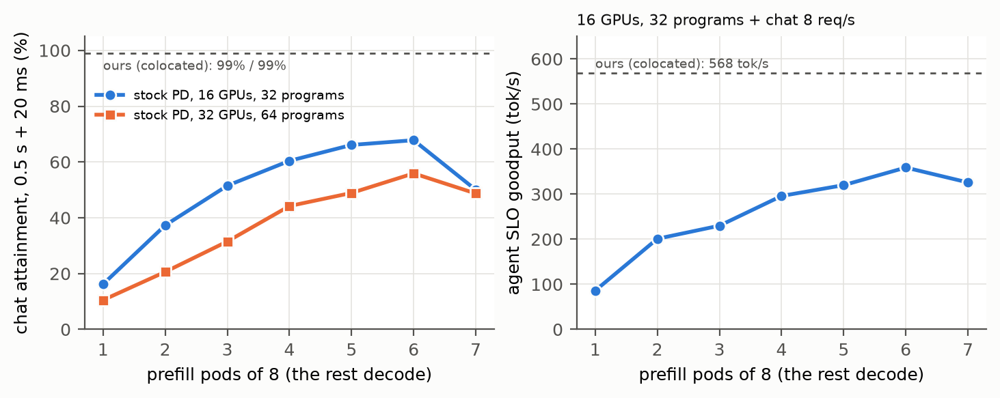
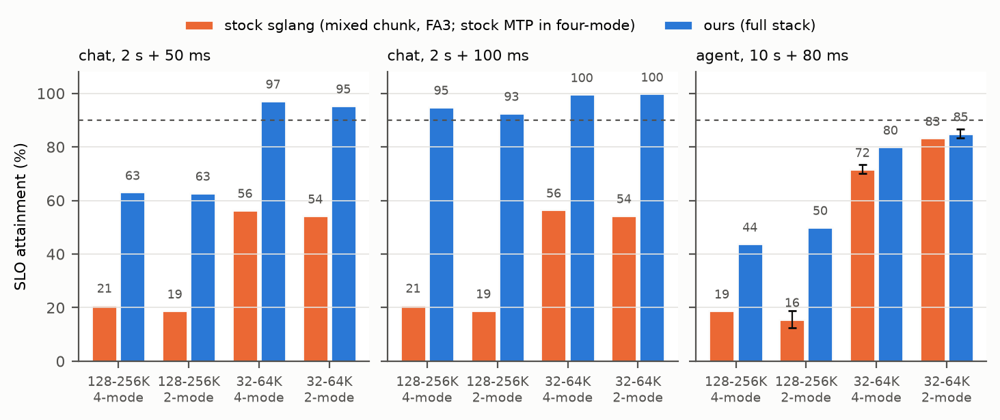
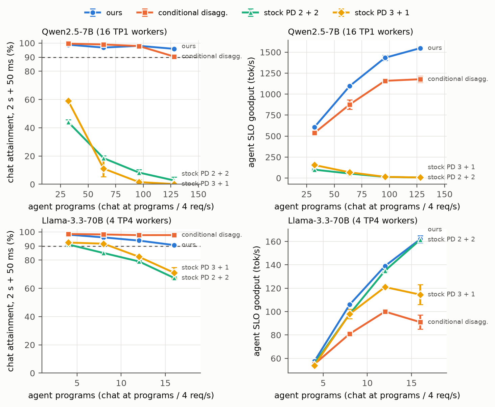
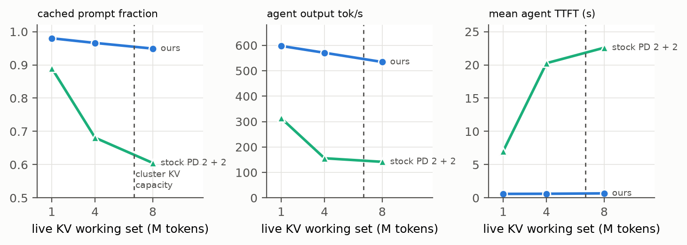
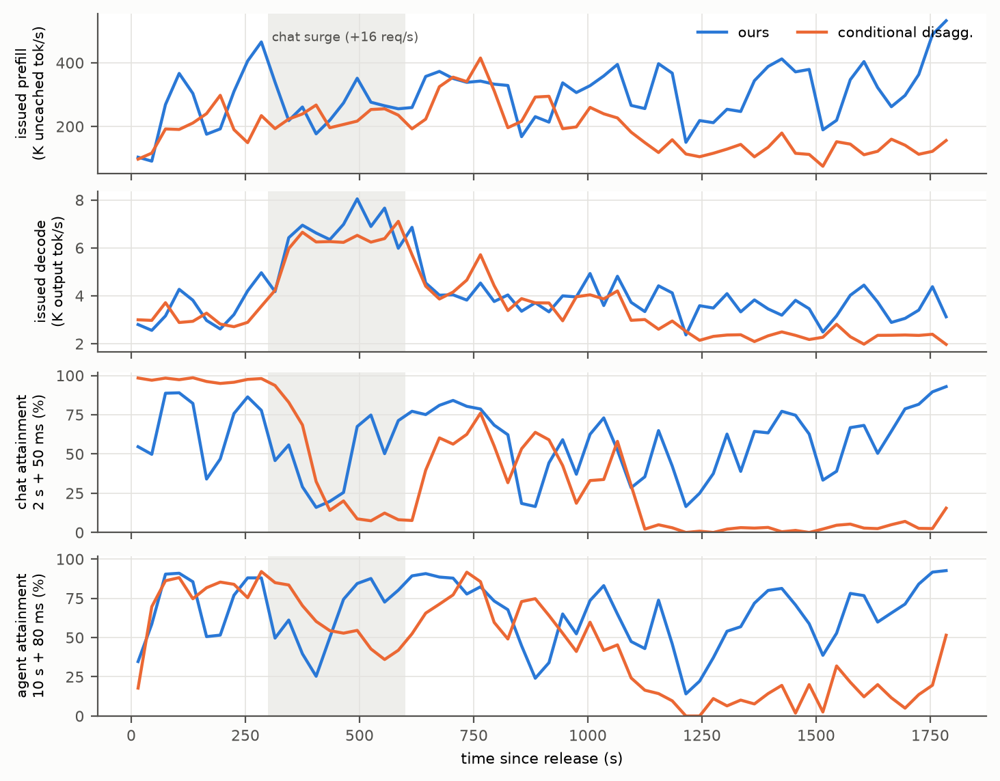

# AttentionFuse: Towards Flexible and Optimal Throughput-Latency Tradeoffs in Distributed LLM Serving

## Paper Outline (10/24)

- goal - meet per-tenant SLOs while maximizing throughput for mixed chat + agent LLM workloads, without a fixed
  prefill:decode node ratio
- motivation
  - mixed-chunk prefill (sglang on FA3) - every decode / verify row pays prefill-width attention tiles in the one
    varlen call; chat waits behind long agent prefills (chat TTFT 4.5-23 s on one H200)
  - prefill prioritized - decode stalls behind prefill; TBT blows up
  - pd disaggregation - re-ships each agent round's prefix KV from prefill to decode (decode pods hold 52-55 requests
    in KV transfer at 64 agent programs on 16 H20s), leaves decode compute idle, needs a tuned P:D ratio
  - pd multiplexing - no CPU-GPU overlap schedule, CUDA graphs multiplied by SM groups; a baseline only
- design
  - kernel: a unified fine-grained tile dispatcher for the mixed step - ONE CPU-side plan assigns every work tile of
    the batch to an executor and a tile class (FA2 classes of 16, 32 and 64 packed query rows for decode / verify
    rows, FA3 for prefill rows and rows of more than 64 packed queries), orders them longest first, splits
    KV where it balances the SMs, and in the same pass fixes the merge schedule:
    which tiles of a row are partials, and which tile merges them inside the launch, so no separate merge kernel runs
  - the executors are stock FA3 and FA2's BatchPrefill body (one CTA per plan item, both tile classes in one launch),
    chained by PDL; FA2 runs second and reduces every split row, FA2's and FA3's, in its epilogue, which removes the FA2-merge
    and FA3-combine launches that two separately planned kernels need; the plan and that merge, not either kernel, are the contribution
  - 4-mode step: prefill chunk + speculative verify rows in one forward
  - why does this help? rows stop paying prefill-width tiles, and the step time becomes a function of shape that a
    model can predict
- distributed inference
  - symmetric colocated nodes; the router sends each request to the highest-cache-hit node that can still meet its
    SLO, from a step model and the EDF queue ahead of it
  - EDF on every worker, deadlines from uncached tokens, per-tenant SLOs; demote-on-miss under overload
  - the KV pool is sglang's hierarchical cache over Mooncake (reused, not ours); the router predicts how much of a
    missing prefix a node pulls from it while the request waits, so routing away from the best holder is priced
- evaluation (three stages, three models: Qwen2.5-7B, Llama-3.3-70B, GLM-4.5-Air, all shown in every stage)
  - kernel: faster mixed-step attention than naive FA3 + FA2 (stock FA3 on the prefill rows, stock flashinfer FA2 on
    the decode / verify rows, each with its own plan) and than sglang's single FA3 call, on steps sampled from real
    serving traces, 2-mode and 4-mode
  - single node: higher SLO attainment for both tenants than sglang mixed chunk (+/- MTP)
  - multi node: more load at SLO than PD disaggregation, scaling 16 -> 32 GPUs, under load spikes and mixture shifts
  - fault tolerance

- story, one stage per section of the evaluation; each stage's claim, the gain we need, what is measured, and the
  figures that show it (filled in as results land)
  - stage 1, kernel (C1; sections 5.1, 6.2, 7)
    - claim: one plan per mixed step (tile classes, KV splits, LPT order, in-launch merge, FA3 / FA2 overlap by PDL)
      makes mixed-step attention faster than sglang's single FA3 call and than naive FA3 + FA2, the obvious two-kernel
      split, in which stock FA2 picks one query tile for all of its rows
    - bar: faster than naive FA3 + FA2 on every model, with FP32-exact output; the step stays predictable for the
      router and EDF
    - measured on the H200, 96 fresh Qwen2.5-7B captures: **1.040-1.087x over naive FA3 + stock FA2**, which is the
      claim, and 1.86-2.92x over sglang's single varlen FA3 call, which is mostly the role split and not ours; the
      same comparison on rank-0 captures replayed for Llama-3.3-70B gives 1.028-1.058x and for GLM-4.5-Air
      1.020-1.028x over the naive role split; step model 2.0% held-out MAPE vs 1.9% for the single FA3 call (per-step-type split [pending:
      re-fit with the corrected tracer])
    - figures: time-weighted speedup per (model, context, mode) with 95% CI vs sglang FA3 and v3; per-item timeline
      of one step; ablation bars: FA2 / FA3 overlap by PDL 2.2-6.1% of the step, longest-first order <= 0.7%,
      persistent vs hardware dispatch -0.2..-1.3%, JIT release of merges (ready queue) -1.8..+0.5% vs the same loop with ticketed merges (H200,
      Qwen2.5-7B) [pending: Llama-3.3-70B]
  - stage 2, single node (C2 + C3 on C1; sections 5.2-5.3, 6.3)
    - claim: the 4-mode step (prefill chunk + speculative verify) under per-tenant deadline order with demote-on-miss
      protects both tenants on one node
    - bar: >= 30% better TTFT and ITL (or their SLO attainment) and >= 10% throughput vs stock sglang (mixed chunk on
      FA3, stock MTP), per model
    - measured (final configuration, paper SLOs): Qwen2.5-7B (H200) chat attainment +38..+74 points (to 93-100% at
      2 s / 100 ms); at 128-256K agent attainment 13-19 -> 44-50% and agent tok/s +8..+11%; at 32-64K agent tok/s
      -3.6..+2.7%; GLM-4.5-Air (one 4-GPU H20 node, overloaded) four-mode throughput +27-28% for both tenants, agent
      TPOT -32%, chat TTFT -71%; Llama-3.3-70B (one 4-GPU H20 node) chat TTFT -73..-86%, agent TPOT -17..-46%, agent
      tok/s +4..+9%; the 10% throughput bar is met for GLM-4.5-Air and for Qwen2.5-7B 128-256K two-mode only
      [pending: Llama-3.3-70B and GLM-4.5-Air on H200s]
    - figures: per-tenant SLO attainment vs request rate; throughput vs tok/s/user Pareto with p10-p90 bars; TTFT / ITL
      distributions per tenant [pending: rate sweeps]
  - stage 3, multi node with SLO control (C3's router on C1-C3 workers; sections 5.2-5.4, 6.4, 6.5)
    - claim: symmetric colocated nodes with SLO-checked cache-first routing, sglang's Mooncake KV pool and the stage-2 workers
      carry more load at SLO than PD disaggregation at its best P:D ratio, and than conditional disaggregation
    - bar: >= 30% on TTFT / ITL attainment and >= 10% throughput (SLO goodput) vs the best baseline
    - measured (16 H20s, Qwen2.5-7B, fan-out agents + chat, full stack): at 64 programs + 16 chat/s, chat attainment
      93.6% and agent SLO goodput 1100 tok/s vs 13.1% / 80 for stock PD at its best split and 96.0% / 821 for
      conditional disaggregation at Dynamo's defaults (+34% goodput); against conditional disaggregation +12..+37%
      agent SLO goodput at every load (32-128 programs, two repeats) and +21-24% under a load spike, chat attainment
      within 2.4 points through 96 programs and +7.7 points at 128; Llama-3.3-70B (4 TP4 replicas, two
      repeats): vs stock PD's best split +3..+23 points chat attainment at -2..+7% agent SLO goodput; vs conditional
      disaggregation +4..+94% agent SLO goodput at -0.3..-7.1 points chat attainment; superposed TraceLab replay
      (demand shift): +57% agent SLO goodput and +14 points chat vs conditional disaggregation at alpha 3, +90% and
      +21 points under a chat surge, stock PD collapsing; fault (one node of four killed): ours -9% goodput with no
      attainment dip, stock PD -1/3 [pending: 32 GPUs]
    - figures: per-tenant attainment and SLO goodput vs load, the 90% capacity marked per system; P:D sweep; load-spike
      time series; fault-tolerance windows

## Abstract

Large language model (LLM) serving increasingly mixes two tenants on one cluster: interactive chat, with short
prompts and tight latency targets, and coding agents, which re-read 32-256K-token contexts on every round and add a
few hundred tokens each time. Every request first runs prefill, which turns the prompt into the key-value (KV) cache
and is compute-bound, and then decode, which generates one token per step and is memory-bound. Production systems
serve the two phases in one of two ways. Colocation under a chunked-prefill schedule runs a prefill chunk and the
decode rows in one attention call, so every decode row pays for prefill-width attention tiles and chat waits behind
long agent prefills. Disaggregation places prefill and decode on separate nodes, so every agent round re-ships its
prefix KV from a prefill node to a decode node, and the ratio of prefill to decode nodes (the P:D ratio) must be tuned
to the workload.

We present AttentionFuse, a colocated serving system with three contributions. The first is a unified tile dispatcher: one
CPU-side plan per mixed step assigns every attention tile to FlashAttention-3 (FA3) or to a row-sized FlashAttention-2
(FA2) tile class, balances the tiles across the GPU's streaming multiprocessors (SMs), and schedules the merge of
split-KV partial results in the same plan, so the partials are reduced inside the FA2 launch instead of by separate
merge kernels. The second fuses speculative decoding into colocation: because every row gets a tile of its own size,
a prefill chunk and the speculative (MTP / EAGLE) verify rows of the running requests run in one forward, the
four-mode step. Prior colocation systems, POD-Attention and PD multiplexing among them, do not support speculative
decoding, which frontier models are served with. The third is SLO control without disaggregation, which replaces the
phase isolation disaggregation buys with fixed roles. Each worker orders prefills by deadline and demotes those that
have already missed. Across symmetric nodes, a router predicts each request's TTFT and TPOT on every node and sends it
to the node with the most cached prefix that can still meet its SLOs and those of the requests already there.

On 96 mixed steps sampled from Qwen2.5-7B serving traces and replayed on an H200, mixed-step attention is 4.0-8.7%
faster, with FP32-exact output, than stock FA3 and stock FA2 run as two separately planned kernels -- the fair
baseline, since splitting sglang's single varlen call by role is itself an obvious engineering step worth 1.8-2.8x.
The same margin over the naive role split is 2.8-5.8% on Llama-3.3-70B and 2.0-2.8% on GLM-4.5-Air. On one node, SLO attainment rises for both tenants: on Qwen2.5-7B, chat attainment
rises by 38-74 points, and at 128-256K contexts agent attainment rises from 13-19% to 44-50% with 8-11% more agent
throughput; on GLM-4.5-Air, throughput rises 27-28% for both tenants. On 16 H20s, at 64 agent programs plus chat, AttentionFuse keeps 93.6% chat
attainment with 1100 tok/s of agent SLO goodput, where PD disaggregation at its best P:D ratio reaches 13.1% and
80 tok/s; against conditional disaggregation it carries 12-37% more agent SLO goodput at every load (two repeats) and 21-24% more under
a load spike. On a replay of real coding-agent traces whose prefill / decode demand swings within minutes, it
carries 57% more agent SLO goodput than conditional disaggregation with 14 points more chat attainment, and 90% more
with 21 points more under a chat surge; stock PD collapses at the same load. With Llama-3.3-70B on the same 16 GPUs,
it holds 3-23 points more chat attainment than stock PD at its best split, at equal agent goodput (-2..+7%), and
4-94% more agent goodput than conditional disaggregation.

## 1. Introduction

**Setting.** LLM services now carry two kinds of traffic at once. Chat requests have short prompts and tight
service-level objectives (SLOs) on time to first token (TTFT) and time per output token (TPOT). Coding agents run many
rounds over 32-256K-token contexts and add a few hundred new tokens per round; they tolerate a longer TTFT but still
need steady decoding. The problem we address is to meet each tenant's SLO at the highest possible load, without
dedicating nodes to one phase of inference.

**Why colocation under chunked prefill falls short.** sglang's mixed-chunk schedule runs the prefill chunk and all
decode rows through one variable-length FA3 attention call. FA3 tiles every row at prefill width, so a decode or
verify row of a few queries occupies a 128-row tile; at long context that padded work is most of the step. The
schedule is also first-come-first-served, so a chat request that arrives behind a 64K-token agent prefill waits for
it.

**Why disaggregation falls short.** Prefill-decode (PD) disaggregation removes the interference by giving each phase
its own nodes, but an agent's prefix KV then moves from a prefill node to a decode node on every round. We find that
this transfer queue, not the prefill queue, is what limits the system: putting the prefill nodes in deadline order
changes nothing (30.5 vs 31.2% chat attainment). NVIDIA Dynamo's conditional disaggregation avoids most of these
re-ships by prefilling short appends locally on the decode worker, but it has no SGLang implementation; Dynamo's
documentation lists SGLang as unsupported for it.

**Key insights.** Three observations drive the design. First, the two roles want different attention tiles: decode
and verify rows are best served by small, row-shaped FA2 tiles, while prefill stays on FA3. Second, colocation keeps a
session's KV on the node that computed it, so routing can follow cache hits instead of node roles. Third, a fused
step has a predictable duration, so the router and the per-worker deadline scheduler can price a request before
admitting it.

**Contributions.**

- C1, kernel: a unified tile dispatcher. One CPU-side plan per step covers FA2 tiles (classes of 16, 32 and 64 packed query rows)
  and FA3 tiles, orders work longest first, and builds the split-KV merge schedule into the same plan, so FA2 and FA3
  partial results are reduced inside the FA2 launch and no merge launch runs. Stock FA3 and FA2's BatchPrefill body
  execute the plan, overlapped by programmatic dependent launch (PDL).
- C2, speculative decoding inside colocation: because the dispatcher gives each row a tile class of its own size, a
  prefill chunk and the MTP / EAGLE verify rows of the running requests run as one target forward, the four-mode step,
  with the verify rows on 32-row FA2 tiles and the chunk on FA3. Prior colocation designs do not support speculative
  decoding: POD-Attention overlaps a prefill chunk with one-token decode rows inside an FA2 kernel, and PD multiplexing
  (MuxWise, sglang's pdmux) runs the prefill split across iterations without the draft model's state. Frontier models
  are served with speculative decoding, so this is what makes a colocated schedule practical for them.
- C3, SLO control without disaggregation. Disaggregation meets TPOT by isolating decode on its own nodes; colocation
  must instead keep each tenant within its SLOs by deciding where and when every prefill runs. C3 does this at two
  levels.
  - *Per worker: deadline scheduling of the colocated step.* Each prefill's deadline comes from its uncached tokens,
    read by a prefix match at enqueue, so a cached agent round gets a chat-like deadline. Prefills run in deadline
    order, and a prefill that has already missed its deadline is demoted behind those that can still meet theirs. A
    Ordering and demotion are the whole mechanism: we also built preemption of an in-progress chunked prefill
    (parking it with its computed prefix kept in the cache) and reservation of chunk budget for earlier deadlines,
    measured both, and dropped them (sections 5.2.3 and 7). A prefill the step model predicts will miss its deadline
    is demoted rather than any running request being preempted.
  - *Per cluster: an SLO-checked router over symmetric nodes.* For each request and node, from state the router keeps
    itself, it predicts:
    - TTFT: the deadline-ordered work queued ahead of the request, the cost of its uncached tokens on top of the
      cached prefix (a calibrated prefill curve), minus the prefix pages the node can pull from the cluster pool while
      the request waits;
    - TPOT: the rows that will decode beside the request.

    It sends the request to the highest-hit node that passes four checks: the request's own TTFT and TPOT, the
    deadlines of requests queued behind it, and the TPOT of requests already decoding there (section 5.2.1). Routing
    is therefore an admission decision priced in SLO terms, not just cache affinity plus load balance.

*What we reuse.* The cluster KV pool is sglang's hierarchical cache over the Mooncake distributed store, with sglang's
selective write-through and timeout prefetch; we add only the router-side mirror of its contents that prices a pull.
The serving engine is upstream sglang at a pinned commit, and both attention executors are stock kernels (FA3 from
flash-attention, FA2's BatchPrefill body from flashinfer).

**Results.** On trace-sampled steps on an H200, the kernel is 4.0-8.7% faster than naive FA3 + FA2 on Qwen2.5-7B
(2.8-5.8% on Llama-3.3-70B, 2.0-2.8% on GLM-4.5-Air), and 1.86-2.92x faster than sglang's single FA3 call, of which
the role split alone accounts for 1.76-2.80x. On one node, Qwen2.5-7B chat attainment
rises by 38-74 points under the paper's SLOs, agent attainment at 128-256K rises from 13-19% to 44-50%, and
GLM-4.5-Air throughput rises 27-28%. On 16 GPUs with the full stack, AttentionFuse holds 93.6% chat attainment and
1100 tok/s agent SLO goodput at 64 agent programs, against 13.1% / 80 for the best stock PD configuration and
96.0% / 821 for conditional disaggregation, and carries 12-37% more agent SLO goodput than conditional
disaggregation from 32 to 128 programs. On a replay of the TraceLab trace with shifting prefill / decode demand, it
carries 57% more agent SLO goodput than conditional disaggregation (90% under a chat surge) with 14-21 points more
chat attainment, and it loses no requests and no attainment when a quarter of the cluster fails. With
Llama-3.3-70B, it holds 3-23 points more chat attainment than stock PD at equal agent goodput, and 4-94% more agent
goodput than conditional disaggregation. [32 GPUs pending]

## 2. Background

### 2.1 LLM Serving

Prefill processes all prompt tokens in parallel and is compute-bound. Decode produces one token per request per step
and is bound by memory bandwidth, since each step reads the request's whole KV cache. Speculative decoding (here
EAGLE3, or the model's own next-token-prediction layer for GLM-4.5-Air) drafts several tokens and verifies them in one
forward pass, turning a one-token decode row into a 4-token verify row. We call this multi-token prediction (MTP)
serving.

Grouped-query attention (GQA) shares one KV head among several query heads. An attention kernel can pack those query
heads into the rows of one tile, so the number of rows a verify row occupies is the token count times the number of
query heads per KV head. A 4-token verify row packs 28 rows on Qwen2.5-7B (tensor parallelism 1, TP1), 32 on
Llama-3.3-70B (TP4) and 48 on GLM-4.5-Air (TP4). These packed sizes are what C1's tile classes are sized against: 16,
32 and 64 rows, with rows above 64 packed queries sent to FA3. The counts follow from each model's head configuration
and need no experiment.

Table 1: packed query rows per 4-token verify row, per model and TP degree.

| model (TP) | packed rows per 4-token verify row |
|---|---:|
| Qwen2.5-7B (TP1) | 28 |
| Llama-3.3-70B (TP4) | 32 |
| GLM-4.5-Air (TP4) | 48 |

### 2.2 Decode-prioritized, Prefill-prioritized, and Chunked Prefill Schedules

sglang offers several stock schedules. Mixed-chunk prefill runs one variable-length FA3 call over the prefill chunk
and the decode rows. The default prefill-prioritized schedule runs prefill batches ahead of decode, which stalls the
tokens of running decodes. sglang with Mooncake runs PD disaggregation, with roles fixed per node and KV shipped per
request. PD-Multiplexing partitions the SMs into groups with green contexts and runs prefill and decode in different
groups; it has no CPU-GPU overlap schedule and needs a CUDA graph set per SM group, so we use it only as a baseline.

No stock schedule protects both tenants; each moves latency from one tenant to the other. On one H200 serving
Qwen2.5-7B on sglang's FA3 backend, with chat at 8 req/s and an agent program concurrency of 8 (two repeats), stock
mixed chunk gives a chat TTFT mean of 579.5 ms and an agent inter-token latency (ITL) p99 of 417.8 ms. Stock
prefill-prioritized brings chat ITL p99 down to 27.3 ms but makes chat TTFT worse. This motivates C3. The same
comparison for Llama-3.3-70B and GLM-4.5-Air is [pending].

Figure 1: per schedule (mixed chunk, prefill-prioritized, each with and without MTP), per tenant: TTFT mean, ITL p99
and SLO attainment; one H200, Qwen2.5-7B, chat 8 req/s + agent concurrency 8. Llama-3.3-70B / GLM-4.5-Air [pending].

### 2.3 PD Disaggregation

DistServe and Mooncake split prefill and decode onto separate nodes. NVIDIA Dynamo adds conditional disaggregation:
the decode worker prefills locally when the effective uncached length is small, and sends the rest to a prefill
worker; Dynamo implements this only for vLLM and TRT-LLM. The resource split is static, so it cannot follow the
tenant mix, and decode nodes leave their compute idle.

Disaggregation therefore needs a tuned P:D ratio, and even the best ratio misses the chat SLO. On 16 H20s (8 pods of
2 GPUs) serving Qwen2.5-7B without speculation, with stock sglang PD and the KV pool on, we swept the number of prefill
pods from 1 to 7 of 8 at 32 agent programs plus chat at 8 req/s. Chat attainment rises from 16.2% with one prefill pod
to 67.8% with six (the best), and falls to 50.0% with seven. This motivates colocating across the cluster instead
(section 6.4). The sweep for Llama-3.3-70B and
GLM-4.5-Air is [pending].

Figure 2: stock PD disaggregation against its P:D ratio, Qwen2.5-7B without speculation, KV pool on. Left: chat
attainment (0.5 s + 20 ms) against the number of prefill pods out of 8, on 16 H20s at 32 agent programs + 8 chat req/s
and on 32 H20s at 64 programs + 16 req/s. Right: agent SLO goodput on 16 H20s. Dashed: ours, colocated, at the same
loads. The best ratio (6 prefill pods) reaches 68% / 56% chat attainment against ours' 99%. Llama-3.3-70B /
GLM-4.5-Air [pending]. Source: `tasks/paper_figures/fig02_pd_sweep.py`.

### 2.4 KV-cache centric scheduling

Multi-round agents re-read 32-256K-token prefixes, so cache-aware routing and KV pooling decide their TTFT. The hard
case, studied by ThunderAgent, is thrashing: the working set of active prefixes is larger than one node's KV
capacity. On 16 H20s at an agent program concurrency of 32, we swept the working set over 16, 64 and 128 tasks with
64K-token prefixes (about 1M, 4M and 8M KV tokens, against about 6.7M tokens of capacity). The cached-prefix fraction
of PD disaggregation falls from 0.890 to 0.605, while ours falls from 0.980 to 0.949. This motivates colocation with
cache-first routing; Figure 23 (section 6.4) plots it.

## 3. Challenges and motivation

### 3.1 Attention computation time ratio

At 32-256K contexts, attention dominates the mixed step, and in our traces most mixed steps carry a prefill chunk
beside decode or verify rows. Attention speed therefore decides step time at long context, which motivates C1. We
will break down per-layer time of real serving steps at 32-64K and 128-256K, in two-mode steps (prefill chunk plus
decode rows) and four-mode steps (prefill chunk plus speculative verify rows), for all three models, and count step
composition (prefill chunk with rows, rows only, prefill only) from the same traces. Step census, measured on the
87 932 steps of the cluster replay (Qwen2.5-7B, median cached prefix 119K): steps that carry a prefill chunk beside
rows are **11.6% of steps but 67.2% of GPU time**; rows-only steps are 83.9% of steps and 27.6% of time; prefill-only
steps are 4.5% and 5.1%. The step that matters is therefore the mixed one, rare by count and dominant by time.
Attention share of a long-context mixed step is close to all of it: a 2 048-token chunk over a 128K-token prefix is
1.08x10^14 attention FLOP, about 0.73 s on an H20, against a measured step of 0.727 s. (This is an arithmetic
estimate; the per-layer attention / GEMM split of Figure 3 is [pending].)

Figure 3: stacked bars of attention, GEMM and other time per context bucket (32-64K, 128-256K) and mode, three models
[pending].

Figure 4: fraction of steps that are prefill chunk + rows, rows only, or prefill only, from the same traces [pending].

### 3.2 PD Disaggregation underutilizes resources

Under disaggregation, each agent round re-ships its prefix: about 3.7 GB of KV per 64K-token round on Qwen2.5-7B. On
16 H20s with stock PD at its best split (6 prefill and 2 decode pods), at 64 agent programs plus chat at 16 req/s,
each decode pod holds 52-55 requests waiting on KV transfer (at most 108) while running only about 7, at 63-68% KV
usage. The decode pods are neither compute- nor memory-full; they wait for KV. Putting the prefill pods in deadline
order instead of first-come-first-served (FCFS) moves chat attainment from 31.2% to 30.5%. The limit of disaggregation is the
per-round KV transfer, not the prefill queue, which motivates colocating across the cluster. The same measurement for Llama-3.3-70B and
GLM-4.5-Air is [pending].

Figure 5: decode-pod time series of requests waiting on transfer, running requests and KV usage, with chat
attainment under FCFS and under deadline order on the prefill pods; 16 H20s, stock PD 6 + 2 pods, 64 agent programs
+ chat 16 req/s, Qwen2.5-7B. Llama-3.3-70B / GLM-4.5-Air [pending].

### 3.3 Chunked Prefill cannot adhere to SLOs

An agent burst of 32 requests within 60 s at 32-64K context holds chat TTFT at 4.5-13.9 s under stock mixed chunk on
one H200 (Qwen2.5-7B, ShareGPT chat at 8 req/s). Deadline order alone does not fix this. Under overload, plain
earliest-deadline-first (EDF) serves the agent prefills that are already late, because their deadlines are earliest,
and so makes chat late too; per-tenant deadlines alone change nothing (section 7). Deadline order needs a rule that
demotes requests that have already missed, which motivates C3. Llama-3.3-70B / GLM-4.5-Air: [pending].

Figure 6: chat TTFT over time around the agent burst, and per-tenant attainment for stock mixed chunk, per-tenant
deadlines alone, and deadlines with demotion of missed prefills; one H200, Qwen2.5-7B. Llama-3.3-70B / GLM-4.5-Air
[pending].

### 3.4 Mixed-chunk prefill reduces throughput

A single attention call uses one tile shape for both roles, so decode and verify rows are padded to the prefill
chunk's 128-row query tiles. Splitting the call by role, with FA3 on both sides, already gives 1.40-1.49x attention
speed on the trace-sampled captures of section 6.2. The obvious next step, stock FA2 for the rows, still picks one
query tile for all of them from their average packed length, so a batch of 4-token verify rows beside one-token
decode rows pays either a 64-row tile per decode row or three 16-row tiles per verify row. Rows need tiles of their
own size, under one plan that also balances and merges them. That is C1.

**Which work maps to which tile.** A four-mode step carries up to four kinds of work -- a prefill chunk,
speculative verify rows, one-token decode rows, and the draft model's own steps -- and each kind's size in *packed
rows* is its token count times the model's grouped-query ratio. The tile a work item needs is therefore a property
of the model and the mode, not a tuning choice.

Table 2: tile class per model and mode. Packed rows = tokens x grouped-query heads; verify rows carry 4 draft
tokens.

| tile | executor | what lands here | Qwen2.5-7B | Llama-3.3-70B | GLM-4.5-Air |
|---:|---|---|---:|---:|---:|
| 16 | FA2 | one-token rows: every decode row, every draft step | decode, 7 | decode, 8 | decode, 12 |
| 32 | FA2 | verify rows of 7-8-head models | verify, 28 | verify, 32 | -- |
| 48 | FA2 | verify rows of wide grouped-query models | -- | -- | verify, 48 |
| 64 | FA2 (boundary) | a chunk's remainder tile; verify rows above 48 | remainder | remainder | remainder |
| 128 | FA3 | the body of a prefill chunk | chunk | chunk | chunk |

Items above 64 packed rows go to FA3, so 64 is the largest FA2 class and the only tile size whose executor is
genuinely in question: 64 rows is `wgmma`'s native tile, while FA2 must build it from four 16-row blocks. Section 7
measures both sides of that boundary.

Table 3: measured tile mix on the mixed long-context TraceLab replay (87 932 steps, load factor 3, median cached
prefix 119K tokens; share of all query tiles issued). Only the verify class moves between models, because only the
grouped-query ratio changes.

| model | 16 | 32 | 48 | 64 | 128 |
|---|---:|---:|---:|---:|---:|
| Qwen2.5-7B | 69.3% | 13.5% | 0.1% | 1.2% | 16.0% |
| Llama-3.3-70B | 69.3% | 13.5% | 0.1% | 1.2% | 16.0% |
| GLM-4.5-Air | 69.3% | 0.1% | 13.5% | 1.2% | 16.0% |

Table 3 is the central tension of the dispatcher, and it sets the reader's expectation for section 6.2: **16-row
tiles are 69% of all tiles and 128-row chunk tiles only 16%, yet at a 119K prefix the chunk carries essentially all
of the step's attention work** -- a 2048-token chunk over a 128K prefix is 0.73 s of a 0.73 s step on an H20. The
dispatcher spends most of its tiles on the cheapest work, which is why removing the row classes' padding is worth a
few per cent rather than a factor, and why we keep this part of the paper short in proportion. The tile mix is also
set by the scheduler rather than by the trace: a round appends a median of 875 uncached tokens over that 119K
prefix, but chunked prefill splits the append across steps, and the rule of section 5.2.3 chooses between 192 and
16 384 tokens according to the resident rows' slack -- one or two chunk tiles at the low end, 128 of them at the
high end.

**Why we do not fuse the two roles into one kernel.** POD-Attention interleaves a prefill chunk with one-token
decode rows inside a single FA2 kernel. That depends on both roles issuing Ampere's warp-level `mma.sync` over a
small tile, so warps from several CTAs share an SM and the kernel has slack to interleave. Hopper's `wgmma` and
Blackwell's `tcgen05.mma` make the opposite trade -- warpgroup- and CTA-level instructions over large tiles, driven
by warp specialisation -- so one throughput-tuned CTA is sized to fill the SM, and the slack POD needs is not
there. We measured each consequence rather than assuming it: the prefill role must leave FA2 (the role split is
worth 1.76-7.7x, section 6.2, while running rows on FA3 costs 15-25 points of agent inter-token latency);
co-compiling both mainloops into one kernel required disabling FA3's register protocol and ran 2-6x slower; and
launch-level overlap is then nearly empty, with programmatic dependent launch worth 1.4-6.2% and two streams worth
nothing at a 2048-token chunk. Because POD's structure is portable to Hopper -- FA2 runs there -- we ran it rather
than ruling it out, and it is 3.45-3.69x our attention time (section 6.2, Table 6). The conclusion is architectural
and the opposite of POD's: on Hopper and later the gain comes from giving each role the executor its tile shape
deserves, not from fusing them, and because CTAs occupy more of the SM with each generation, designs that need
spare SM capacity should age badly.

One intra-CTA variant remains open rather than closed: hosting the 16-row row mainloop in a warpgroup of the
chunk's own CTA, which needs no spare SM capacity because the CTA is already resident. Its ceiling is small --
at most 1.1-2.3% of the step at a 128K prefix, 4.5-10.2% at 32K, measured by giving every row tile a free ride --
so it cannot change the paper's claims either way; section 7 reports where the implementation stands.

Figure 7: per-step attention time of the single FA3 call vs the role split, and the fraction of row tiles that are
padding; 96 captures, Qwen2.5-7B. Padding fraction [pending].

### 3.5 Can we increase request capacity while maintaining SLOs?

Yes, if rows get their own kernel tiles, chat is not queued behind prefills that can no longer meet their deadlines,
and nodes stay symmetric so that routing follows the cache. C1-C3 are that answer. We measure it as the load
each system holds at >= 90% per-tenant attainment (Figure 20). With the scheduler alone on 16 GPUs, ours holds 64
agent programs against 16 for PD disaggregation (section 6.4). With the full stack, ours keeps >= 90% chat attainment
through 96 programs plus 24 chat/s, where stock PD at its best split holds no measured load point (Table 16).

## 4. AttentionFuse Design

## 4.1 Problem Formulation

Each tenant has its own SLO, taken from prior work (section 6.1): chat, math and code requests 2 s TTFT and 50 ms
(tight) or 100 ms (loose) mean TPOT [JITServe, SLOs-Serve]; agent rounds 10 s TTFT, doubled to 20 s for prefills of
more than 200K uncached tokens, and 80 ms mean TPOT. Earlier runs were scored at a stricter chat SLO (0.5 s TTFT,
20 ms TPOT); the tables that use it say so. A sweep of the SLO scale over 0.8-1.5x is [pending]. A request attains its
SLO if it meets both of its tenant's targets. The objective is the load a system holds while each tenant keeps at
least 90% attainment, not mean latency. Agent load is the number of concurrent agent programs; chat load is the
request rate.

The design acts at three levels against that one objective. Per step (C1, C2), one plan assigns every attention tile to
FA3 (prefill rows and rows of more than 64 packed queries) or to an FA2 tile class of 16, 32 or 64 rows, and fixes
the merge schedule for split rows, and the verify rows of speculative decoding ride in the same forward as a prefill chunk. Per worker (C3), prefills are ordered by deadlines computed from their uncached tokens, and a prefill
whose deadline has passed is demoted. Per cluster (C3's router), a request goes to the node with the highest prefix-cache hit
that is predicted to meet its SLO; if that is not its best cache holder, the node pulls the prefix from the cluster
pool.

Every serving experiment reports this objective: load is swept on agent program concurrency and chat request rate,
and per-tenant attainment is recorded at each point (Figure 20). It is measured at 16 and 32 GPUs for the scheduler
alone and at 16 GPUs for the full stack (section 6.4); single-node capacity from rate sweeps is [pending].

## 5. Implementation

### 5.1 Fused Kernel for Fine-Grained Tile Dispatch

This section describes the kernel in three parts: what one mixed step asks of attention, the plan that decides how
it is computed, and how the two executors run that plan in two launches with one merge.

**What one mixed step asks of attention.** A four-mode step's batch holds three kinds of rows:
- a prefill chunk: hundreds to thousands of query tokens over a long cached prefix;
- decode rows of one query token;
- speculative verify rows of a few tokens (4 with a 3-step draft).

Under grouped-query attention, a row of q tokens on a model with G query heads per KV head becomes q x G "packed"
query rows against one KV head:
- Qwen2.5-7B (G = 7): a decode row packs 7 rows and a verify row 28;
- Llama-3.3-70B at TP4 (G = 8): a verify row packs 32;
- GLM-4.5-Air at TP4 (G = 12): a verify row packs 48.

FA3's tile is 128 packed rows, so sglang's single call fills 22% of each verify-row tile on Qwen2.5-7B and 5% of each
decode-row tile. Decode and verify rows also read KV that is 10-100x longer than their queries, so they are
memory-bound, while the prefill chunk is bound by the tensor cores.

**The plan.** Once per step, on the CPU, the dispatcher builds one plan that every layer reuses. It makes four
decisions.
1. *Tile class per row.* A row of p packed queries goes to the smallest FA2 tile class that holds it (16, 32 or 64
   rows). Rows of more than 64, which includes every prefill chunk, go to FA3. On Qwen2.5-7B a verify row then fills
   28 of 32 rows (88%) and a decode row 7 of 16 (44%).
2. *KV split.* Each (row, KV head) pair's keys are cut into chunks so that the step's FA2 work fills the SMs. The
   chunk length is a multiple of 256 keys, so the last chunk of a row is never a sliver. FA3's prefill rows get the
   split the plan chooses for them, run by stock FA3.
3. *Placement.* The work items, one per (row, KV head, chunk), are sorted by cost (packed rows x keys) and placed
   longest-processing-time first (LPT): each goes to the least-loaded execution slot.
4. *Merge schedule.* Every row that was split becomes a merge group, holding its chunks' partial outputs, their
   log-sum-exp (LSE) values and a counter. The plan appends one merge item per group behind the compute items.

The plan costs 48-78 us of host time per step (mean over 44 serving geometries). It is built while the previous step
runs on the GPU; that overlap on serving shapes is [pending].

**Two launches, one merge.**
- *First launch: stock FA3* (flash-attention's paged-KV mainloop) over the prefill rows. Its split rows write FP32
  partial outputs and LSEs.
- *Second launch: FA2* (flashinfer's BatchPrefill body). Programmatic dependent launch (PDL) starts it while FA3
  drains, so FA2's memory-bound rows fill the SMs that FA3's tail leaves idle. It runs one thread block (CTA) per plan
  item:
  - a compute item stores its partial and checks in on its group's counter (fence, then atomic increment);
  - a merge item reduces its group once every member has checked in, one warp per row, eight chunks in parallel per
    warp, and writes BF16 output straight into the batch's output tensor;
  - FA3's split rows are reduced by merge items after `griddepcontrol.wait`, which orders them behind the whole FA3
    grid.

No merge kernel runs for either executor. sglang's single FA3 call and naive FA3 + FA2 both pay at least one extra
merge or combine launch per split.

**Worked example.** One Qwen2.5-7B four-mode step on an H200:
- a 2048-token prefill chunk on a 48K-token prefix, and 32 verify rows with 30-60K-token KV;
- the chunk goes to FA3;
- the 32 verify rows x 4 KV heads become 128 (row, KV head) pairs on 32-row FA2 tiles, each cut into KV chunks;
- the LPT order puts the longest rows' chunks first, so they do not set the end of the step;
- the merge items reduce each row's chunks inside the FA2 launch, as soon as its last chunk checks in.

Per-step timing of such steps is Figure 15.

**What is fused, and why there.** The fusion is in the plan and the reduction, not in the instruction stream.
Prefill rows want Hopper's warpgroup MMA (`wgmma`) on multiples of 64 rows behind a warp-specialized producer;
decode and verify rows want small `mma.sync` tiles over long KV. On Hopper and Blackwell the MMA instruction is
issued per warpgroup and fixes that warpgroup's shape, so one warpgroup cannot interleave the two. What the roles do
share is complementary hardware demand -- FA3 tiles are tensor-core bound, FA2 rows bandwidth bound -- so the plan
places the rows to run beside FA3's tail through programmatic dependent launch, worth 2.2-6.1% of the step
(section 7). One merge serves both executors, inside the FA2 launch and scheduled by the same plan, so no separate
merge or combine launch runs; it costs under 1% of trace-sampled steps and 6-13% of synthetic 64-256-row decode
steps, where reduction actually matters (section 7).

**Portability.** The executors stay stock kernels behind a small interface: the prefill executor writes split-KV
partials where the plan says, and the small-tile executor reads its compute and merge items from the plan. On
Blackwell, FlashAttention-4 (`tcgen05`) replaces FA3 for the prefill rows while FA2's `mma.sync` kernels run
unchanged, so the tile classes and the in-launch merge carry over; a single-kernel design would have to be rewritten
for each generation's MMA instructions. The Blackwell port is [pending].

**Why not one kernel for FA2 and FA3.** One `__global__` function has one block size, so a fused kernel launches
every CTA at FA3's 384 threads (one producer and two consumer warpgroups, one CTA per SM, about 98 KB of shared
memory). FA2's 4-warp row tiles then either leave 256 of those threads idle or are re-laid-out over 12 warps, which
they cannot fill. ptxas also gives one register budget per kernel, so the two inlined bodies spill against each
other (Table 4). The consequence is measured: the co-compiled kernel ran **2.16x slower** than FA2 alone on every
input (155.9 against 72.3 us, both numerically correct), while two launches of the same executors at their own
layouts were 1.21x faster. Sharing SMs between two separate launches is a different question, and also loses: giving
FA3 a subset of SMs beside FA2 gains 18% only where the two roles take comparable time, and is bounded at about 1.2%
of serving GPU time on the TraceLab traces. So the executors are separate launches chained by dependent launch, and
what they share is the plan.

Table 4: registers and spill per build, H200, per-function ptxas reports.

| build | registers | spill |
|---|---:|---:|
| FA3 alone | | 52 B |
| FA3 in the fused kernel | | 33 676 B |
| fused kernel, FA2 outlined: FA3 / FA2 | | 64 B / 17 500 B |
| FA2 at FA3's geometry (384 threads x 1 CTA) | 168 | 1 136 B |
| FA2 at its own geometry (128 threads x 2 CTAs) | 255 | 0 B |

FA2 at FA3's geometry gets 168 registers against 255 at its own, for the same SM-wide budget (255 x 256 = 170 x 384),
so the loss is the idle threads rather than a hardware floor. The same one-budget effect appears *inside* the FA2
executor: a single persistent kernel holding the 48-, 32- and 16-row runners spilled 1 436 B because of the 48-row
runner alone, so the third class is instead a 64-row tile launched as its own instantiation, which keeps the smaller
classes' register use down.

A persistent FA2 executor, cluster-scheduled reduction over distributed shared memory, an L2-ordered item sweep, KV
multicast and intra-CTA row hosting were all built and measured; none beats the default, and section 7 reports each
with its numbers.

**Baselines for this design.** The baseline is naive FA3 + FA2: stock FA3 on the prefill rows and stock flashinfer
FA2 on the decode and verify rows, two kernels with two plans, each splitting KV and merging its own way. Stock FA2
picks one query tile for the whole launch from its rows' average packed length (16, 64 or 128 rows), so it either
pads one-token decode rows into 64-row tiles or runs 4-token verify rows on 16-row tiles. C1's
mandatory parts are the one plan and the split-KV reduction of FA2 and FA3 partials in the FA2 launch with no merge
launch.

**Correctness and plan cost.** The planner is exact on 44 captured geometries, with plan time 48-78 us mean. On the 96
captures, the previous build's FP32 worst relative error was 0.0067. Plan time on serving shapes of all three models
is [pending].

Figure 8: host plan time per step (mean and p99) vs batch size, on captured serving geometries of all three models
[pending: serving shapes].

### 5.2 Router and resource sharing

#### 5.2.1 Router design

The router is a streaming proxy in front of the workers, and every node serves both prefill and decode. For each
request it picks the node that reuses the most cached prefix while still meeting the request's TTFT and TPOT SLOs,
and the SLOs of the requests already on that node. It decides from state it keeps itself, so no worker is queried on
the request path. This is C3's cluster level.

**What the router knows about each node.**

- *Prefix index.* A radix tree flattened at 256-token blocks. Block k's key hashes its tokens together with block
  k-1's key, the chained-page scheme of sglang's HiCache storage keys, so one key names the whole prefix up to block
  k. The hit x_i on node i is the walk to the first missing key. Each node's key set is bounded by its KV capacity
  (LRU) and updated when a request is routed there. A second key set mirrors the cluster KV pool and is updated as
  finished requests are written through to it.
- *In-flight table.* For every request routed to node i: its uncached tokens, prompt length, deadline, routing time,
  first-token time and decode tokens left. The response stream updates it: the first chunk ends the prefill, and each
  later chunk is one token.
- *Calibrated cost curves of the node type.* These are measured once per model on one worker before the run:
  - the cold-prefill TTFT T(n) at 4K-48K prompt tokens (Qwen2.5-7B on one H20: 0.46 s at 4K, 8.7 s at 48K;
    Llama-3.3-70B at TP4: 1.2 s and 20.4 s);
  - a decode grid G(k, c), the per-token ITL at k concurrent rows of mean context c. It is timed on a second, fully
    cached pass, so that no prefill runs inside the timed steps.
- *Online corrections* learned from finished requests:
  - an exponentially weighted moving average (EWMA) of the observed per-token decode time;
  - an EWMA of pool pull bandwidth, from the worker-reported cached tokens against the router's own hit estimate;
  - optionally, a per-node EWMA of the speculative acceptance length.
- *Piggybacked node load (optional).* Each worker can publish, every scheduling iteration:
  - its decode rows and their KV tokens;
  - its acceptance length and its measured decode-step time;
  - its prefill queue, as (deadline, uncached, prefix) entries.

  A report fresher than 0.5 s replaces the router's own table, plus whatever the router has routed there since the
  report. It also anchors the TPOT prediction to the measured step time; the grid then only supplies how the step
  grows from the rows decoding now. The full-stack runs of section 6.4 use the router's own table. Routing on node
  reports alone is [pending].

**Predicting a request's TTFT and TPOT on node i.** A request r of n prompt tokens gets the deadline D_r = now + 10 s
+ 1 s for every 5000 tokens beyond 4096, the same length-scaled form the workers use (section 5.3). The 10 s base is
loose for chat; chat's 2 s target is protected by the workers' deadline order, whose base is 2 s.

1. *Uncached work.* u_i = n - x_i.
2. *Pool pull.* If the pool holds more of the prefix than node i (x_pool > x_i), the missing m_i = x_pool - x_i tokens
   are prefetched while r waits in i's queue. The tokens that arrive are g_i = min(m_i, W_i x B / b), where W_i is
   the queue wait (step 4), B the learned pull bandwidth and b the KV bytes per token. Under sglang's timeout prefetch
   policy, the wait stretches up to the smaller of the full pull time and 1 s + 0.25 s per 1K missing tokens. An EWMA
   of pulled over predicted tokens scales g_i.
3. *Prefill cost.* P(u, n) = T(n) - T(n - u): the cold cost of the whole prompt minus that of its cached prefix. A
   cached prefix therefore still costs attention for the appended tokens: a 4K append on a 60K prompt costs 1.27 s
   this way, against 0.82 s at one blended token rate.
4. *Queue wait.* Under EDF, only work with an earlier deadline runs ahead of r. W_i is the sum of P(u_q, n_q) over
   the requests q on node i that have D_q <= D_r and have not started decoding.
5. *TTFT.* TTFT_i = W_i + P(u_i - g_i, n).
6. *TPOT.* r will decode beside the rows decoding on i now and the rows queued ahead of it: k_i rows with K_i KV
   tokens in total. TPOT_i = G(k_i + 1, (K_i + n) / (k_i + 1)), divided by the node's acceptance length when that is
   tracked. Rows queued behind r are not counted. Counting them read the grid at 40-60 rows (210-250 ms) where
   35-59 ms was measured, and left 56-63% of decisions with no feasible node.

**Feasibility.** Node i is feasible for r when four checks pass:

- *r's TTFT:* now + TTFT_i <= D_r.
- *r's TPOT:* TPOT_i <= r's ITL SLO. The SLO the router routes against adapts to load: 2.5x the EWMA of observed
  per-token decode time, floored at 10 ms.
  - A fixed SLO is best at 15 ms under light load and at 20-30 ms under heavy load; a tight SLO under heavy load
    moves requests off their cached prefix for no TPOT gain.
  - The 2.5x rule tracks both optima within 1-8%.
- *Later-deadline requests queued on i:* admitting r delays each of them by r's prefill. For every q with D_q > D_r
  that has not started, now + W_i(D_q) + P(u_r) <= D_q must hold.
- *Requests already decoding on i:* r costs a resident twice, once through r's prefill chunks riding in its steps
  and again through r decoding beside it afterwards. For every resident q, the following must stay within q's ITL
  SLO:

  (decode time spent so far + remaining steps x step time with r + min(r's chunks, remaining steps) x chunk cost)
  / q's total tokens.

  One chunk's added step time is a measured 1.08x (Qwen2.5-7B) or 1.12x (Llama-3.3-70B) of its share of r's cold
  prefill time.

**Choice.** Nodes are ordered by hit length in 1024-token buckets, then by in-flight requests, then at random. A
session's next round therefore goes to the node that holds its context, and near-equal holders share the pulls. The
router takes the first feasible node in this order, which is the highest-hit node that can still meet the SLOs. If
no node is feasible, it takes the node with the most TTFT slack. It forwards r with priority D_r, so the node's EDF
orders r by the same deadline.

**Accuracy and what each check buys.** These were measured on 8 H20s with the scheduler only, in earlier settings.

- *TTFT prediction.* Over 13 200 requests, measured / predicted TTFT has a median of 1.04-1.12 and a p90 of
  2.25-2.36: unbiased but wide. A conformal margin, the per-class q-quantile of that ratio, changed nothing beyond
  noise and is off.
- *Pull prediction.* On the 37 moved requests with a pool hit beyond the local one, 81% of the predicted pull
  arrived, and the learned bandwidth settled at 0.75 GB/s.
- *SLO check vs cache affinity alone:*
  - at 32 agent programs: agent throughput +24%, agent ITL -23% and chat ITL -32%, at +10% TTFT;
  - at 16 programs without a pool: neutral to worse, since a moved request recomputes its prefix;
  - on a hot shared-prefix mix with the pool: chat throughput +21% and chat TTFT -90%, at -5..-8% agent throughput.
- *Resident check:* cuts chat ITL a further 32%, at +26% agent TTFT.
- *Variants that did not help:*
  - a tighter ITL SLO for chat-length requests: at that load agent prefill runs on every node, so there is no
    prefill-free node to keep chat decode on;
  - soft prefill / decode roles for nodes.

The same comparison with the full stack on 16 H20s, for all three models, is [pending].

Figure 9: per-tenant attainment vs load and cached-prefix fraction, per routing policy (cache-first + SLO check,
cache-only, round-robin); 16 H20s, three models [pending].

#### 5.2.2 Performance model

One model predicts the fused step's time. Its inputs are the prefill tokens, the prefix length, the number of decode
and verify rows and their KV lengths, and the predicted speculative acceptance length, tracked per worker as an
EWMA. The model is fit on logged serving steps of the current kernel, per model, and scored on held-out steps. Its
purpose is to show that the fused step is predictable enough to price admission. In the measured runs, the router
prices with the calibrated curves of section 5.2.1, and the worker's EDF orders by deadline without a cost model.
Pricing with this step model in the router is [pending].

On Qwen2.5-7B on an H200 in four-mode serving, fit on one repeat and scored on the other, held-out mean absolute
percentage error (MAPE) is 2.0% for our kernel vs 1.9% for the stock single FA3 call (Table 5): over all steps, the
fused step is as predictable as the stock one.

The per-type split must be read with care. The step tracer that produced Table 5 classified rows by token count, so a
four-mode step's 4-token verify rows were logged as prefill rows. The merged prefill + verify steps therefore fall in
the "prefill" row, where ours is less predictable (8.7% vs 7.5%). The "mixed" row holds only prefill chunks beside
one-token decode rows.

With the tracer corrected (verify rows counted as decode rows), the per-type split is clean. On the trace replay at
alpha 3 (Qwen2.5-7B, 16 H20 workers, about 2,500 merged steps per worker), a model fit on the first half of four
workers' traces and scored on the second half has these held-out errors:

| step type | linear (lin4mode) | MLP with acceptance | GBT |
|---|---:|---:|---:|
| merged prefill chunk + verify rows | 2.8-4.2% | 3.4-4.0% | 2.8-3.6% |
| prefill | 5.6-6.2% | 4.6-5.5% | 6.9-7.8% |
| decode | 34-38% | 18-23% (short steps of about 10-20 ms) | 21-25% |

On the merged steps every model lands within about a point of the others: the linear model is as accurate as the
MLP there, and the analytic overlap form (2.4-4.4%) is no worse. The models separate only on decode-only steps, where
the linear model's 34-38% is the cost of its missing nonlinearity in a short, launch-dominated step. The chunk rule
of section 5.2.3 sizes only merged steps, so it uses the linear model, which costs nothing in accuracy where it is
applied and gives the closed form the rule needs.

The comparison with sglang's single FA3 call on the same schedule is [pending]: the traced leave-one-out arm without
C1. A single error figure for the linear model hides where it is used: averaged over every step it misses by about 25%, but that average is set by decode-only steps, which are 84% of steps and only 10 to 20 ms long. On the chunk-carrying steps the table above applies, and there it matches the MLP. A model of the launch-to-launch gap, which includes host waits, is not fittable at all (45% error), so every model here targets GPU time. The chunk budget of section 5.2.3 therefore needs the
nonlinear model [pending]. Llama-3.3-70B and GLM-4.5-Air fits are [pending].

Table 5: held-out step-time MAPE by step type (Qwen2.5-7B, H200, four-mode serving). "prefill" includes the four-mode
merged steps (see above); "mixed" is a prefill chunk beside one-token decode rows.

| step type | ours | stock single FA3 call |
|---|---:|---:|
| all | 2.0% | 1.9% |
| decode | 1.4% | 1.2% |
| mixed | 5.9% | 7.7% |
| prefill | 8.7% | 7.5% |

Figure 10: predicted vs measured step time, per step type (decode, prefill, mixed, four-mode), per model [pending].

#### 5.2.3 Fair Resource sharing

**Chunk size is predicted, not configured.** AttentionFuse has no chunk-size constant. A constant cannot fit both
ends of the load, and it is not a policy a reader can transfer to another cluster or model: the same token count is
a different amount of work at a 32K prefix and at a 256K one, and costs the resident decode rows a different
amount again depending on how many of them there are. Prior work that sizes the chunk from predicted latency
rather than from a constant -- FlowPrefill, PD-Multiplexing and SLOs-Serve -- makes the same argument. We differ
from them in what the prediction is solved against and in how it is solved: a measured step-time model of our own
fused kernel, inverted by bisection rather than by a dynamic program.

**The rule.** A fixed chunk size cannot fit both ends of the load. When prefill
load is high and few rows are decoding, a larger chunk would finish the prefill in fewer steps, each step paying its
fixed cost and re-reading the prefix's KV once. When many rows are decoding, every chunk token lengthens every
resident's inter-token gap. We therefore size each step's chunk from the step-time model of section 5.2.2. The chunk
is the largest c whose predicted step time keeps every running decode row within its SLO, with a small headroom h:

  step(c, decode rows, their KV, the prefix, acceptance) <= (1 - h) x min over running rows r of budget_r.

- budget_r prices how much of row r's latency allowance this step may consume. Three readings of a mean-TPOT SLO
  give three different budgets, and the choice decides whether the rule helps or hurts; the next paragraphs measure
  all three and settle on the smaller of a projected mean-TPOT budget and the tenant's inter-token tail target.
- A row ahead of its target lends slack; a row behind it shrinks the budget.
- With no rows decoding, the chunk is bounded only by memory.
- The router prices a prefill's TTFT under the same rule, walking it chunk by chunk under each node's decode load.

**Why a fixed chunk is not defensible, measured.** Replaying 10,185 four-mode steps of the cluster trace through
the step model shows that a fixed 2048-token chunk takes no account of what is resident: the step it produces costs
**5.1 times** (90th percentile 8.4 times) the time one step of output is worth at the tenant's mean-TPOT target.
A constant cannot do otherwise, because the same token count costs a 32K-prefix step and a 256K-prefix step
different amounts of time, and costs the resident rows differently again depending on how many there are. What the
right bound on that step time is, is the subject of the next paragraphs, and is less obvious than it looks. The
model itself predicts those steps to **4.7% mean absolute error** (90th percentile 7.5%) at the chunk the run
actually used, so the fused step is predictable enough to size from -- the property section 5.1's single dispatcher
buys us.

**Which budget, and the negative result that decides it.** The slack a row lends depends on how the mean-TPOT
target is turned into a bound on one step, and that choice turns out to decide whether the rule helps or hurts. We
replayed the same 10,185 recorded steps under three forms of budget_r (rows decoding at 13.9 ms against a 50 ms
target, projected output 500 tokens):

| form of budget_r | what it grants per step | chunk chosen (p10 / p50 / p90) | steps admitting less than the run used |
|---|---:|---:|---:|
| per-step: target x tokens this step emits | 89-91 ms | 64 / 192 / 320 | 99.0% |
| remaining slack amortized over remaining output | 89-91 ms | 64 / 192 / 320 | 99.0% |
| projected mean TPOT at completion | 16 279 ms | 16 384 / 16 384 / 16 384 | 0% |

The per-step form is the one we first deployed, and it is a large regression on the cluster (section 6.4): it pins
nearly every step to a bare 90 ms, so a long agent prefill advances a few hundred tokens per step and misses its
TTFT target. The reason is structural rather than a bad constant. budget_r is a *minimum over resident rows*, and a
row admitted this step has banked nothing, so whatever the other rows have saved is irrelevant -- the fresh row
sets the bound. Amortizing the remaining slack over the remaining output does not escape this: its minimum is
attained at exactly that fresh row, where it equals the per-step form by construction.

The third form escapes it, because a mean is an average: one slow step raises a row's mean TPOT by only one *n*-th
of its excess, where *n* is the row's output length. Priced that way a step may run for seconds. But the bound is
then loose by exactly the margin by which the server beats its target, and that margin is large -- 13.9 against
50 ms -- so the budget is 16.3 s and the chunk saturates the server's maximum on every step. Sweeping the target
shows the usable band is about 1.5 ms wide: only a target of 14.5-16 ms, within 8-15% of the rate the rows already
get, puts the chunk in the 1-4K token range.

**So the bound that binds is the inter-token tail, and it also comes from an SLO.** Workloads state a tail target
as well as a mean, and a tail target does not evaporate when the mean is comfortable. We therefore take
budget_r as the smaller of the projected-mean-TPOT budget above and the tenant's inter-token tail target. The chunk
is still solved from the step model, so it is not a fixed token count: with no rows resident the bound is vacuous
and the chunk is the server's maximum; with many long rows it shrinks. On the same 10,185 steps, a 600 ms tail
target gives a median chunk of 2 176 tokens -- the same scale as sglang's 2048 -- while admitting *more* than the
run used on 65% of steps and less on 35%, which is the adaptivity a constant cannot express. Tighter targets move
the whole distribution down (150 ms: 192 / 384 / 640 tokens).

Banking the mean's slack must stay unlimited, because the SLO states a request's *mean* TPOT. Capping a row's bank
at a few steps' allowance silently turns the rule back into a per-token bound: measured, it holds chat's
90th-percentile TPOT to 64 ms but admits so little work that attainment falls to 7.9% and throughput to 107
tokens/s. A request that is never admitted misses its SLO too, so a rule that protects latency by refusing work is
not a solution.

The solver is three lines and a bisection -- 16 evaluations of a ten-term linear model, about 2 microseconds per
step. It needs no dynamic program, and nothing in it is specific to a workload.

**A more accurate model would not help, which is why the linear one is the design.** The rule never needs the step
time; it needs the chunk at which the step time crosses the budget, and that crossing is insensitive to the model.
Perturbing the prediction by a factor and re-solving over the same 10 185 steps moves the median chunk roughly one
for one: -5% gives 2 304 tokens and +5% gives 2 048, against 2 176 unperturbed. Replacing the linear model with the
multi-layer perceptron of section 5.2.2, which is more accurate on merged steps (3.4-4.0% against 4.7% mean
absolute error), would therefore move the chunk by about 1%, far below the run-to-run noise of any metric in
section 6. We report this because it is the reason a simple method is sufficient here rather than a compromise:
sizing a chunk is a threshold question, and thresholds tolerate error that point predictions do not.

**Preemption and parking: measured and dropped.** We built preemption of the in-progress chunked prefill (it yields
at its next chunk boundary and is parked with its computed prefix kept in the radix cache) and reservation of chunk
budget for requests due earlier. On the cluster trace replay they cost about a quarter of agent SLO goodput
(1501-1763 tok/s with them, 1912 without) and 5-9 points of chat attainment, and what they buy is only the chat TTFT
tail (p90 1.03-1.19 s with them, 2.92-4.10 s without). Under a 2 s TTFT and 50 ms TPOT SLO that trade loses, so the
final configuration runs deadline order and demotion alone (section 7).

Figure 11: per-tenant TTFT / TPOT attainment, agent throughput and the distribution of chosen chunk sizes, for fixed
2048 / 8192 / 16384-token chunks and the SLO-budgeted chunk at h = 0 / 10 / 20%, on prefill-heavy, mixed and
decode-heavy loads; predicted vs measured step time per chunk size; one node, three models [pending].

### 5.3 SLO-aware scheduling

Each worker orders prefills by deadline. Four mechanisms make up the policy (C3); the first two set and use the
deadline, the last two let a short urgent request get past a long prefill already under way.

1. *Deadlines from uncached work.* A prefill's deadline is its arrival time plus a TTFT budget that depends on its
   uncached tokens: the prompt minus the prefix already in the node's cache, read at enqueue by a read-only prefix
   match. An agent round whose 64K-token prefix is cached therefore gets a chat-like deadline instead of a cold
   prompt's. The budget comes from the tenant SLOs:
   - single-node runs: 0.5 s below 8192 uncached tokens and 10 s above;
   - multi-node runs: 2 s plus 1 s per 5000 uncached tokens beyond 4096 (a cold 64K prompt gets about 14 s).
2. *Deadline order with demotion of missed prefills.* Prefills are admitted in deadline order. A prefill whose
   deadline has already passed ranks behind every prefill that can still meet its deadline; demoted prefills keep
   deadline order among themselves. Without demotion, plain EDF serves the most overdue request first, so under
   overload each late agent prefill makes the chat behind it late too. Decodes returning from memory retraction are
   never demoted. Demotion is on in the single-node runs; the multi-node workers run deadline order without it.
3. *Parking a long chunked prefill.* sglang continues a chunked prefill with each step's whole budget. The policy
   instead parks it when a waiting request is due earlier, is short, and has less than half the parked prefill's
   remaining work. The parked request's computed prefix stays in the radix cache, so it loses no work and resumes in
   deadline order. Measured on the cluster replay this costs about a quarter of agent SLO goodput, so the final
   configuration does not park (section 7).
4. *Reserving budget for earlier deadlines.* When a chunk continues, it leaves room in the step's token budget for
   waiting requests that are due before it.

On one H200 with Qwen2.5-7B, under a 32-64K agent burst plus chat, per-tenant deadlines alone change nothing, while
adding demotion of missed prefills cuts chat TTFT by 96-98% (section 7). The same comparison on Llama-3.3-70B and
GLM-4.5-Air is [pending].

Under tensor parallelism, every TP rank must judge deadlines on the same clock, so rank 0's clock rides the
per-iteration request broadcast.

Figure 12: chat TTFT distribution and per-tenant attainment for stock, per-tenant deadlines alone, and deadlines with
demotion of missed prefills; one node per model (Qwen2.5-7B on one H200; Llama-3.3-70B and GLM-4.5-Air on four
H200s). Llama-3.3-70B / GLM-4.5-Air [pending].

### 5.4 KV Cache pooling policy

The cluster KV pool is Mooncake's distributed store. A node writes a block through to it once the block has been hit
twice there (sglang's selective write-through). The router keeps a mirror of the pool's contents, so it can price a
pull when it routes a request away from the prefix's best holder (section 5.2.1). The receiving node prefetches the
missing pages while the request waits in its queue, for up to 1 s plus 0.25 s per 1K missing tokens (sglang's
timeout prefetch policy), and recomputes whatever has not arrived.
The pool is sglang's; we add only the router's mirror of it and the pull pricing. Under the thrashing sweep of section 6.4 (working set 1M -> 8M KV tokens against a
6.7M-token pool), ours loses 10.6% throughput and 3.1 points of cached fraction, vs 55% and 28.5 points for
disaggregation, in earlier settings (Figure 23). Pool on vs off is [pending].

### 5.5 CUDA Graph support

Decode-only and verify-only steps replay sglang's decode CUDA graphs in every arm. In the measured runs, mixed steps
(a prefill chunk with decode or verify rows) run on sglang's breakable prefill graph:
- every layer's non-attention work replays from a graph;
- attention, its metadata and our plan run eagerly;
- upstream sglang requires this backend whenever mixed chunk is on.

One graph set serves the four-mode step, whereas PD-Multiplexing needs a graph set per SM group.

The eager attention costs little at long context, where GPU time hides the launches. It shows on short-prompt,
high-rate traffic: ShareGPT at 32 req/s in four-mode ran 6-7% below stock sglang with MTP.

**Full graphs for mixed steps.** We lifted upstream's restriction and run mixed steps on the full prefill-graph
backend:
- it captures the whole forward, attention included, per token-count bucket;
- it pads the batch with zero-length request slots;
- decode, verify, prefill and merged steps therefore share one graph set and differ only in how the slots are
  filled.

Merged steps replay full graphs correctly: greedy outputs agree with the breakable runs at the noise floor between
two breakable repeats. The gap stayed at 6.2%, though, so graph coverage was not the cause.

**The cause.** A per-step trace found it:
- the merged step's GPU time equals that of stock's mixed and verify steps combined (22.0 vs 21.5 ms);
- its wall time is 5.5 ms longer than its GPU time;
- the reason is that building the merge reads the running rows' sequence lengths back to the host. That read waits
  for the GPU queue to drain, which breaks the CPU-GPU overlap schedule on every merged step.

**The fix and what remains.** The fix keeps the exact lengths on the device and gives the host an upper bound (its
mirror plus the draft length); the kernels clamp to the device lengths. Still [pending]:
- the fix's measurement;
- graph capture of the unified dispatcher: static plan buffers, a fixed launch grid with early exit, KV indices
  gathered on the device;
- the bucket and slot-count sweep against graph memory.

Table 6: CUDA graph count, capture memory and decode step time, ours vs PD-Multiplexing, graphs on vs off [pending].

## 6. Evaluation

### 6.1 Settings

**Models.** Qwen2.5-7B-Instruct at TP1, extended with YaRN 4x to 128K, with a trained EAGLE3 draft head;
Llama-3.3-70B-Instruct at TP4 with a trained EAGLE3 head; GLM-4.5-Air at TP4 with its own next-token-prediction layer
as the draft. All three are evaluated in every stage. If the final version shows only two, they will be Llama-3.3-70B
and Qwen2.5-7B.

**Testbed.** One H200 for the kernel and single-node stages; H20 nodes of 4 GPUs each, 16 and 32 GPUs in total, for
the multi-node stage. Llama-3.3-70B and GLM-4.5-Air need four GPUs per replica, so their single-node results so far
come from one 4-GPU H20 node and their kernel captures from TP4 rank 0 on H20 [pending: the same runs on H200s].

**Baselines.**

- Kernel:
  - sglang's single variable-length FA3 call;
  - naive FA3 + FA2, the headline baseline: stock FA3 on the prefill rows and stock flashinfer FA2 on the decode /
    verify rows, run serially or on two streams;
  - the best single fixed FA3 configuration, and a per-step FA3 oracle;
  - the role split on FA3: FA3 for both roles, in separate calls.
- Single node: sglang mixed chunk and prefill-prioritized on FA3, with stock EAGLE3 MTP for the four-mode comparison;
  PD-Multiplexing.
- Multi node: sglang with Mooncake PD disaggregation, the P:D ratio swept at worker granularity, KV pool on. Reference
  policy: conditional disaggregation with Dynamo's default rule (remote prefill when the effective uncached length is
  at least 2048 tokens and at least 0.7 of the prompt), implemented in our router on sglang.
- Kernel used in stages 2-3: the unified dispatcher (tile-rounded KV splits, classes 16 / 32 / 64) in every
  final-configuration result (Table 11, the GLM-4.5-Air and Llama-3.3-70B final rows) and in the full-stack
  multi-node runs (Tables 16 and 17). Earlier tables used the role-split build and say so.

**Workloads.** Every workload pairs an agent tenant with a chat tenant, with agents the majority of LLM calls, plus
standalone sets that check for regressions. Agent load is the number of concurrent agent programs (each program
issues its next round when the previous one returns, after its tool gap), or for trace replay the time-compression
factor alpha; chat load is a Poisson request rate. Table 7 lists every setting.

Table 7: workloads, loads and hardware per stage.

| stage | agent tenant | chat tenant | load points | hardware |
|---|---|---|---|---|
| 1, kernel | steps captured from serving the stage-2 workloads (24 per context x mode cell) | -- | 96 steps per model | one H200 |
| 2, single node | TraceLab sessions, 32-64K or 128-256K contexts, two- or four-mode | ShareGPT with the chat template | Qwen2.5-7B: 8 programs + 8 req/s (32-64K), 4 + 4 (128-256K); Llama-3.3-70B: 2 + 0.5 (near capacity), 4 + 2 (overload); GLM-4.5-Air: 4 + 2, 8 + 8 | one H200 (Qwen2.5-7B); 4 GPUs (Llama-3.3-70B, GLM-4.5-Air) |
| 2, standalone | -- | ShareGPT, MATH-500, GSM8K, Code-Feedback, each served alone | 16 / 32, 16, 32, 16 req/s | one H200 |
| 3, cluster | fan-out coding agents: 32 tasks with 64K-token repository prefixes (8 x 32K for Llama-3.3-70B), Zipf(1.2) task popularity rotating every 180 s, 4 rounds of 1024-token appends and 128-token outputs, 5 s tool gaps | ShareGPT, C/4 req/s for C programs | Qwen2.5-7B: C = 32 / 64 / 96 / 128; Llama-3.3-70B: C = 4 / 8 / 12 / 16; spike: +C/2 programs from 300 s for 300 s | 16 H20s (4 nodes x 4) |
| 3, demand shift | TraceLab replay: the 24 busiest trace hours, superposed, each round at max(previous finish + recorded gap / alpha, trace time / alpha), over a horizon of 1.5x the scaled hour | ShareGPT 8 req/s; surge +16 req/s from 300 s for 300 s | alpha = 3 / 6 | 16 H20s |
| 3, fault | the stage-3 fan-out workload | ShareGPT 8 req/s | 32 programs; all 4 workers of one node killed at 300 s | 16 H20s |

**SLOs.**
- Chat, math and code: 2 s TTFT with 50 ms (tight) or 100 ms (loose) mean TPOT.
- Agent rounds: 10 s TTFT (20 s for prefills of more than 200K uncached tokens) and 80 ms mean TPOT.
- Earlier results also report chat at 0.5 s / 20 ms, marked where used.

**Metrics.** Throughput vs per-user tok/s (a Pareto curve) with p10-p90 bars; TTFT and ITL SLO attainment vs request
rate, per tenant; per-tenant SLO goodput, the tok/s of requests that meet both of their tenant's targets. Every
serving result shows per-request spread and per-repeat values.

**Protocol.** Both arms run on the same frozen software tree, in opposite-order pairs, two repeats each, with metrics
recomputed from raw token arrival times and CUDA graphs and overlap scheduling on. A quality gate (GSM8K and passkey
retrieval at 32-60K) is judged against a baseline-vs-baseline noise floor.

**Software.** Every arm, ours and every baseline, runs the same pinned upstream sglang main. The stock baselines run
it unmodified; ours adds an overlay with EDF, the four-mode step, the kernel hooks and the router. Conditional
disaggregation is implemented in our router on the same workers as ours, since Dynamo does not support SGLang for it.

**Attribution.** Every gain is tied to a contribution by removing that contribution alone (Table 8). The
leave-one-out arms are run on one workload and load (the cluster trace replay at alpha 3), so a contribution can
help on one workload and cost on another; where that happens Table 8 says so rather than quoting the favourable
case. Two identical configurations of that replay differ by about 5 points of attainment and 4% of agent SLO
goodput, so differences at or below that are reported as indistinguishable rather than as effects.
- At the kernel level the comparison arms remove parts of C1.
- At the single-node and cluster levels, each ablation arm runs the full stack minus one contribution, on the same
  workload and load.
- Gains against stock PD disaggregation come from colocation itself, which C1-C3 make cheap enough: the decode side
  no longer waits on a per-round KV transfer (sections 3.2 and 6.4).

Table 8: gain attribution by contribution. Removing the contribution costs what is listed; "[pending]" marks the
leave-one-out arms queued on the trace replay at alpha 3 (16 H20s) and the single-node ablation (H200).

| contribution | removed by | measured cost of removing it | where |
|---|---|---|---|
| C1 unified dispatcher | **naive role split: a stock FA3 call for the chunk and a stock FA2 call for the rows** | **4.0-8.7% of attention time** across the four capture cells (section 5.1). Against sglang's single FA3 call the same build is 1.86-2.92x, but the naive role split alone accounts for 1.76-2.80x of that, so the fair comparison is the first number. In serving without speculation the kernel alone is -6.7% TPOT at 32K and -2.8% at 128K; on the cluster replay, removing it costs 1.4% of goodput (2436 against 2471 tok/s), inside the noise floor. The gain is confined to the decode and verify rows, so it shrinks as the prefill chunk grows to dominate the step | 6.2, 6.3, 7 |
| C1 parts | PDL overlap off; enumeration instead of longest-first order; merge-free bound | 2.2-6.1%; <= 0.7%; the merge costs <= 0.9% of trace-sampled steps and 6-13% of decode-heavy batches. Running the two naive calls on separate streams rather than serially adds nothing (1.763x against 1.759x in the 128K four-mode cell), which bounds what any launch-level overlap can contribute here | 7 |
| C2 four-mode step | stock MTP steps (verify on its own step) | **The largest single-node contribution, and inert on the cluster -- for one reason.** On one H200, with the kernel held at the stock FA3 call, the four-mode step alone cuts mean TPOT from 22.9 to 14.2 ms at 32K (38%) and from 97.3 to 48.0 ms at 128K (51%). On the cluster replay it changes nothing (agent 93.8% / 2492 tokens/s without it against 94.2% / 2471 with it). The cause is its engagement rule: a step merges verify rows into a prefill chunk only once that chunk carries at least 8192 uncached tokens. The single-node stages carry 32K to 128K of uncached prefill and always clear it; on the cluster, cache affinity leaves a typical agent round with about 1085 uncached tokens, roughly seven times below the rule, so the merged step rarely forms. **The four-mode step therefore pays exactly where prefill is long and cold, and our own cache-first routing removes that condition** -- a tension we report rather than tune away, and the reason the two contributions must be evaluated on separate workloads. Short-prompt ShareGPT: the merged step's host read-back cost 6-7% (section 5.5) | 5.5, 6.3, 6.4 |
| C3 per-worker deadline scheduling | FCFS admission | single node, agent burst: demotion cuts chat TTFT 96-98%. **On the cluster replay it costs**: FCFS reaches chat 73.9% / agent 83.2% / 1922 tok/s against 65.1-68.5% / 72.6-78.7% / 1501-1763 for the full stack. It buys a TTFT tail (chat p90 1.03-1.19 vs 3.03 s) and pays in TPOT (p50 27-30 vs 21.5 ms), which a 2 s + 50 ms SLO does not reward. The H20 arms ran ordering + chunk preemption / parking and never demotion; the decomposition shows chunk preemption / parking costs the goodput (1501-1763 with it, 1912 and 1986 across two runs without it). Deadline ordering against FCFS is inside this workload's run-to-run noise floor (about 5 points of attainment and 4% of goodput, measured between two identical configurations), and demotion has not yet run multi-node: the code is gated behind the preemption flag, which those arms disabled. The final configuration drops parking. **The worker policy's own contribution is now measured in isolation** (Table 14): adding per-tenant deadline ordering to our tree with sglang's own chunk policy, changing nothing else, moves every metric by less than the noise floor at load factor 3 (chat 91.2 -> 90.9%, agent goodput 2493 -> 2481 tok/s, chat TPOT p90 29.8 -> 32.0 ms), so at capacity deadline ordering neither helps nor hurts; the overload point where a deadline is actually in danger is [pending] | 3.3, 5.3, 6.4, 7 |
| C3 router (cluster level) | sglang's own `cache_aware` router | **Our router raises chat SLO attainment by 7.3 points (90.6% against 83.3%) and cuts the chat TTFT tail by 79% (p90 0.67 s against 3.24 s), at identical agent goodput (2471 against 2482 tokens/s) and identical draft acceptance.** On the cluster trace replay at load factor 3, all arms on one tree. The mechanism is the load tie-break among workers whose prefix hit ties: `cache_aware` picks on hit length alone and piles arriving chat onto whichever worker already holds the prefix. **Caveat, measured: the SLO-checked variant of this router LOSES on these session-affine traces (chat 65.1-68.5%), because its feasibility checks move requests off their cached prefix; the contribution is the cheap tie-break, not the SLO check.** Earlier 8-H20 runs on a hot shared-prefix mix, where sessions do not pin to one worker, showed the opposite ordering for the SLO check (chat TTFT 10x, resident check worth 32% of chat ITL), so the two policies are workload-dependent and both are reported | 5.2.1, 7 |

**Status.**
- Stages 1 and 2: measured for all three models; Llama-3.3-70B and GLM-4.5-Air on H20, their H200 reruns [pending].
- Stage 3: measured on 16 H20s for Qwen2.5-7B and Llama-3.3-70B (two repeats each).
- [pending]: GLM-4.5-Air's stage 3 and the 32-GPU runs.

### 6.2 Kernel microbenchmarks

**Claim.** One plan per mixed step (tile classes, KV splits, longest-first order, the in-launch merge, FA3 / FA2
overlap by PDL) makes mixed-step attention faster than sglang's single FA3 call and than naive FA3 + FA2. The reasons:
- in one variable-length FA3 call, a 4-token verify row (28-48 packed rows) is tiled at 128 rows;
- stock FA2, run beside FA3, picks one query tile for all of its rows.

Row-shaped tiles stop that padding, LPT spreads row work of different sizes across the SMs, and one merge inside the
FA2 launch replaces each kernel's own merge.

**Bar.** Faster than naive FA3 + FA2 on every model, with FP32-exact output, while the step stays predictable
for the router and EDF (section 5.2.2).

**Setup.** We capture every Nth real mixed serving step, 24 per (context, mode) cell and 96 per model, and replay
each with its own tensors. Contexts are 32-64K and 128-256K; modes are two-mode (prefill chunk + decode rows) and
four-mode (prefill chunk + verify rows). Qwen2.5-7B runs on one H200; Llama-3.3-70B and GLM-4.5-Air run at TP4 on H20,
measured on rank 0 and replayed on the H200, so every number in this section is from one H200. Baselines are sglang's FA3 call, naive FA3 + FA2, the best fixed FA3 configuration, the per-step FA3
oracle and the role split on FA3.
We report time-weighted speedup over each cell's steps with a
bootstrap 95% confidence interval (CI), and FP32 worst relative error.

**Results on the H200.** The unified dispatcher runs one plan, stock FA3 at the plan's split, and our tuned FA2
BatchPrefill body with the chunk-parallel in-launch merge. On 96 fresh Qwen2.5-7B captures, all FP32-exact (worst
relative error 0.0082), it is 1.86-2.92x faster than sglang's FA3 call and 4.0-8.7% faster than naive FA3 + FA2
on the same captures (Table 6).

Table 9: attention time of every design we could run, relative to ours, on four workload cells (24 trace-sampled
Qwen2.5-7B captures each, time-weighted, every arm checked against an FP32 reference). Values are attention time
divided by ours, so **1.00 is our method and larger is slower**.

| method | 32K, two-mode | 32K, four-mode | 128K, two-mode | 128K, four-mode |
|---|---:|---:|---:|---:|
| sglang's single variable-length FA3 call (shipped default) | 2.11 | 2.65 | 2.92 | 1.86 |
| POD-Attention's structure: one FA2 kernel over chunk and rows | 3.69* | -- | 3.45* | -- |
| our earlier two-plan build (v3) | 1.34 | 1.92 | 1.77 | 1.37 |
| naive role split, serial: stock FA3 chunk + stock FA2 rows | 1.08 | 1.09 | 1.04 | 1.06 |
| naive role split, the two calls on two streams | 1.04 | 1.07 | 1.04 | 1.06 |
| **ours: one plan, per-row tile classes, in-launch merge** | **1.00** | **1.00** | **1.00** | **1.00** |

\* POD's structure needs both roles in one call, so it was measured in its own harness rather than on the capture
set: a 2 048-token chunk beside 32 one-token rows, giving 24.3 ms against our 7.0 ms at a 128K cached prefix and
6.1 against 1.7 ms at 32K. A repeat gave 3.49 and 3.71, so these factors reproduce to better than 1%. That shape is
the two-mode configuration; we did not run the four-mode variant, and do not expect it to change the ordering,
because the gap comes from the prefill half's instruction choice.

Two designs a reader might expect to be strong are the weakest. sglang's shipped call is 1.9-2.9x our time because
it picks one query tile for every row in the batch, so a one-token decode row is computed at the chunk's tile width.
POD's fusion is 3.5-3.7x because its prefill half must issue `mma.sync` where FA3 issues `wgmma`. Both are the same
failure: a tile or an instruction chosen for the wrong work. The strongest baseline is the naive role split, which
any implementation gets for free, and we are 4-9% ahead of it -- that margin, not the large factors, is our claim.

**The same comparison on two more models** (rank-0 captures replayed on the H200, FP32-checked):

| model | our dispatcher over the naive role split | the role split itself over sglang's single call |
|---|---:|---:|
| Qwen2.5-7B | 1.040-1.087x | 1.76-2.80x |
| Llama-3.3-70B | 1.028-1.058x | 6.7-7.7x |
| GLM-4.5-Air | 1.020-1.028x | 5.3-6.0x |

The ordering is consistent and instructive: the worse sglang's single call serves a model's verify rows, the more the
role split alone recovers and the *less* our tile classes add on top, because a stock FA2 call already tiles those
rows well. GLM-4.5-Air, whose 48-query verify rows motivated the 64-row tile class, is where our marginal gain is
smallest. We therefore claim 2-9% for the dispatcher and attribute the large factors to the role split, which is not
a contribution of this paper.

**What bounds this.** Four independent measurements explain why the dispatcher cannot do better on this workload.
A 2048-token chunk over a 128K-token prefix is 1.08x10^14 FLOP, about 0.73 s on an H20 and essentially the whole
step, and both our kernel and the baseline run that chunk through the same FA3 code -- so the share of a step we can
influence shrinks as context grows, which is exactly why our serving speedup decays from 1.147x below 8K to 1.006x
above 128K (section 6.3). Running the two role calls on separate streams instead of serially recovers nothing
(1.763x against 1.759x), and programmatic dependent launch recovers only 1.4-6.2%, so the overlap between the roles
is already nearly exhausted. Only 0.2% of decode-step wall time lies outside the traced forward, so there is no
host-side time to reclaim. And a persistent-kernel structure, cluster-level reduction through distributed shared
memory, a just-in-time ready queue and KV multicast all measured at or below parity (0.60-1.006x). The kernel's
contribution on long-context agentic serving is real but small, and we report it as such.

Measured on an H200 over 96 captures taken from real four-mode serving (24 per cell), every arm checked against an
FP32 reference (worst head relative error 0.0083). The middle column is the comparison that matters: separating the
roles into a stock FA3 call for the chunk and a stock FA2 call for the rows is worth 1.76-2.80x by itself, and is
the obvious engineering step rather than a contribution. Our dispatcher's own gain over that fair baseline is
**4.0 to 8.7%**. Running the two naive calls on separate streams instead of serially adds nothing (1.763x against
1.759x in the 128K four-mode cell), which bounds how much any launch-level overlap can be worth here.

**Results on H20.** On the H20 (78 SMs), the same build is 1.10-1.23x faster than sglang's FA3 call on Qwen2.5-7B;
there FA3 sets the step time, and the FA2 path's savings run beneath it. Llama-3.3-70B (TP4, 32-64K) is 1.38x /
1.61x sglang's FA3 call on two- / four-mode steps, and GLM-4.5-Air (TP4, 32-64K, 43 captures) 1.28x / 1.41x. These
Replayed on the H200, our dispatcher is 1.028-1.058x naive FA3 + FA2 on Llama-3.3-70B (38 captures) and
1.020-1.028x on GLM-4.5-Air (43 captures), while the role split alone is 6.7-7.7x and 5.3-6.0x sglang's call.

GLM-4.5-Air needs the third FA2 tile class. Its 4-token verify rows pack 48 queries per KV head, and sending them to
FA3 cost 28% of the four-mode step. A 64-row FA2 class, launched as its own instantiation so that it does not raise
the smaller classes' register use, recovers it. On the earlier role-split build, which has no 64-row tile, GLM-4.5-Air
runs 0.63-0.98x on four-mode steps and up to 1.35x on two-mode steps.

**Earlier build.** The role-split serving build, measured on earlier Qwen2.5-7B captures on the H200, has two plans
and two merges. It is 1.23-1.57x faster than sglang's FA3 call but only matches a well-tuned FA3 split in isolation
(Table 10). Its FP32 worst relative error is <= 0.0075, and GSM8K and passkey stay within the baseline noise floor.

Table 10: role-split serving build, Qwen2.5-7B, H200, earlier captures.

| context / mode | vs sglang's FA3 call [95% CI] | vs best fixed FA3 config | vs per-step oracle |
|---|---:|---:|---:|
| 32-64K, 2-mode | 1.35x [1.12-1.91] | 0.98x | 0.97x |
| 32-64K, 4-mode | 1.23x [1.09-1.56] | 0.99x | 0.98x |
| 128-256K, 2-mode | 1.57x [1.24-2.64] | 0.99x | 0.98x |
| 128-256K, 4-mode | 1.37x [1.16-1.89] | 0.99x | 0.99x |

**Bar status.** Judged, and not met by the kernel alone: against the strongest baseline (naive FA3 + FA2) the
dispatcher is 2-9% faster across the three models. The 30% bar has to be met at the serving level, where the
schedule acts; section 6.3 reports it.

**Figures.**

Figure 13: time-weighted speedup per (model, context, mode) with bootstrap 95% CI, against sglang's FA3 call and naive FA3 + FA2. Qwen2.5-7B (H200, four cells) and Llama-3.3-70B / GLM-4.5-Air at 32-64K (H20) measured; the
Llama-3.3-70B and GLM-4.5-Air at 32K from the H200 replay; their 128K cells were not captured.

Figure 14: CDF of per-step speedup over the 96 captures, per (context, mode), against each baseline; Qwen2.5-7B,
H200. Llama-3.3-70B and GLM-4.5-Air from the H200 replay of their rank-0 captures.

Figure 15: per-item timeline of one captured four-mode step: FA3 tiles, FA2 tiles and merge items per SM over time,
showing FA2 running beside FA3's tail under PDL [pending].

### 6.3 Single-node benchmarks

**Claim.** The four-mode step under per-tenant deadline order, with demotion of missed prefills and on the C1 kernel,
protects both tenants on one node. The kernel speeds up the step; deadline order lets chat through an agent burst;
demotion keeps already-late agents from making chat late.

**Bar.** At least 30% better TTFT and ITL (or their SLO attainment) and at least 10% higher throughput than stock
sglang (mixed chunk on FA3, with stock MTP for four-mode), per model.

**Setup.** Qwen2.5-7B on one H200; Llama-3.3-70B and GLM-4.5-Air on one 4-GPU H20 pod at TP4. Baselines: sglang
mixed chunk and prefill-prioritized on FA3, with and without stock EAGLE3 MTP, and PD-Multiplexing. The kernel is the unified
dispatcher in the final-configuration results and the role-split build in the earlier ones. Load is swept on agent program concurrency and chat request
rate, over context mixtures from 32K to a few hundred K (32-64K, 128-256K), in two- and four-mode, plus the standalone
sets (ShareGPT, math, coding, agentic web browsing) at load around capacity. SLOs are those of section 6.1. Every
result carries per-request spread and per-repeat values.

**Result: the full single-node stack against stock sglang (2026-10-28, four H200 trial).** Qwen2.5-7B on one H200,
agent concurrency 8 with chat at 8 requests per second, two repeats per arm in opposite order, with the fused path
confirmed active by its composition counter (1144 at 32K, 2478 at 128K).

| arm (mean of two repeats) | mean TPOT (ms) | mean ITL (ms) | worst-decile TPOT (ms) | agent tokens/s |
|---|---:|---:|---:|---:|
| **32K stage** | | | | |
| ours: four-mode step, unified kernel, deadline scheduler | **14.3** | **15.0** | **32.4** | 137.5 |
| stock sglang: stock MTP, single FA3 call, FCFS | 22.9 | 20.6 | 75.9 | 138.5 |
| **128K stage** | | | | |
| ours | **44.8** | **34.4** | **95.7** | **54.4** |
| stock sglang | 97.3 | 61.0 | 231.4 | 48.8 |

At 32K this is 38% lower mean TPOT, 27% lower ITL and 57% lower worst-decile tail at equal throughput; at 128K it is
54% lower TPOT, 44% lower ITL, 59% lower tail and 11% higher throughput. The 128K point clears both bars at once, and
the margin grows with context, which is the regime the agentic workload occupies.

Removing the pieces one at a time on the same node separates them. With both arms running the four-mode step and
neither running the deadline scheduler, the kernel alone leaves mean TPOT unchanged and raises throughput by 6.9%;
with no speculation at all it is 6.7% of TPOT at 32K and 2.8% at 128K. The four-mode step, with the kernel held at
the stock FA3 call, accounts for the large share: mean TPOT falls from 22.9 to 14.2 ms at 32K. This is the opposite
of what the same removal shows on the cluster, and section 6.4 explains why: the four-mode step only engages once a
step carries at least 8192 uncached tokens, and cluster rounds carry about 1085.

**Result: the kernel alone, same schedule.** On Qwen2.5-7B at 128-256K, with agent concurrency 4 and chat at 4 req/s,
the fused kernel raises four-mode agent throughput by 10.7% and cuts agent TPOT by 24.2% and ITL by 20.8%; two-mode
gains are +11.6%, -20.1% and -16.7%. Against a role split that runs FA3 for both roles, throughput is equal but agent
decode latency moves only -1.5..+6.6%, so the FA2 rows are worth 15-25 points of agent ITL.

**Result: full stack under the paper's SLOs, Qwen2.5-7B, both context ranges (Table 11).** These runs use the final
configuration: the unified dispatcher with tile-rounded KV splits, and no per-step deadline-sized chunk cap. The SLOs
are chat 2 s TTFT with 50 / 100 ms mean TPOT, and agents 10 s TTFT (20 s above 200K tokens) with 80 ms. Chat
attainment rises by 38-74 points everywhere, to 93-100% at the loose SLO, and chat end-to-end latency falls 51-70%.

At 128-256K, agent SLO attainment rises from 13-19% to 44-50% and agent SLO goodput by 70-190%. Raw agent throughput
also rises: +8.1% four-mode, +10.6% two-mode.

At 32-64K, agent goodput is level in four-mode (agent TPOT -44%). In two-mode it falls 13%: deadline order gives chat
priority over agents that stock already served within their SLO. Raw agent throughput there is -3.6% (four-mode) and
+2.7% (two-mode), so the 10% throughput bar is met on one node only for 128-256K two-mode.

Table 11: Qwen2.5-7B, one H200, final configuration, two repeats (16 / 30 agent requests per arm at 128-256K / 32-64K).

| workload, mode | chat 2 s / 50 ms | chat 2 s / 100 ms | chat e2e | agent attainment | agent SLO goodput | agent tok/s |
|---|---:|---:|---:|---:|---:|---:|
| 128-256K (agent conc 4, chat 4/s), 4-mode | 21.0 -> 63.1% | 21.0 -> 94.9% | 27.1 -> 8.1 s | 18.8 -> 43.8% | 16-24 -> 41 tok/s | +8.1% |
| 128-256K, 2-mode | 18.8 -> 62.8% | 18.9 -> 92.6% | 25.6 -> 8.3 s | 12.5-18.8 -> 50.0% | 14-22 -> 37 tok/s | +10.6% |
| 32-64K (agent conc 8, chat 8/s), 4-mode | 56.4 -> 97.2% | 56.5 -> 99.6% | 5.8 -> 2.8 s | 70.0-73.3 -> 80.0% | 74-84 -> 85-86 tok/s | -3.6% |
| 32-64K, 2-mode | 54.3 -> 95.4% | 54.4 -> 99.8% | 5.7 -> 2.8 s | 83.3 -> 83.3-86.7% | 101-107 -> 88-90 tok/s | +2.7% |

Figure 16: single-node SLO attainment under the paper's SLOs, stock sglang (mixed chunk on FA3, stock MTP in
four-mode) vs ours (final configuration), Qwen2.5-7B on one H200, at the Table 11 loads. Bars are the mean of two
repeats, with whiskers where the repeats differ; dashed: the 90% target. Source:
`tasks/paper_figures/fig16a_single_node.py`.

At 128-256K, neither system reaches 90% attainment for either tenant at agent concurrency 1, 2 or 4 on one GPU,
because cold 128-256K turns cannot prefill within 10 s. Ours is still 8-19 points ahead on chat and 25-38 points ahead
on agent attainment at concurrency 4. This is the case that motivates the multi-node stage.

**Result: scheduler only, Qwen2.5-7B.** On the FA3 backend with chat at 8 req/s and agent concurrency 8 (two
repeats), ours without MTP reaches 86.7 / 95.6% agent attainment vs 84.4 / 84.4% for stock mixed chunk. Ours with MTP
trails stock prefill-prioritized with MTP at the 80 ms ITL SLO (62.2 / 64.4 vs 66.7 / 68.9%) and leads at 30 ms
(55.6 / 51.1 vs 46.7 / 48.9%). Higher agent concurrency is [pending].

**Result: GLM-4.5-Air.** On one 4-GPU H20 node (TP4, built-in MTP), with 32-64K agents at concurrency 8 plus chat at
8 req/s (two repeats), the full stack raises four-mode throughput by 18-19% for both tenants, cuts agent TPOT by
41-48% and chat TTFT by 68-83% (Table 12). This load is far above the node's capacity (TTFT is tens of seconds in both
systems); the at-capacity point follows Table 12.

Table 12: full stack vs stock sglang on FA3, GLM-4.5-Air, one H20 node, TP4, overloaded. "Chat at 2 s / 50 ms" is chat
attainment under a relaxed SLO.

| mode | agent tok/s | chat tok/s | agent TPOT | chat TTFT | chat at 2 s / 50 ms | agent attainment |
|---|---:|---:|---:|---:|---:|---:|
| 4-mode (stock MTP -> ours) | +18-19% | +18-19% | -41..-48% | -68..-83% | 0 -> 65-76% | 20 -> 37-43% |
| 2-mode (stock -> ours) | +12-14% | | -17..-28% | -63..-64% | 0 -> 60-64% | 23 -> 23-30% |
| 4-mode, final configuration (no chunk cap) | **+28%** | **+27%** | -32% | -71% | 0 -> 64-66% (2 s / 100 ms: 0 -> 77-78%) | 20 -> 30-33% |
| 2-mode, final configuration | +17% | +15% | -37% | -55% | 0 -> 47-52% (2 s / 100 ms: 0 -> 63-66%) | 23 -> 33-43% |

With the final configuration (tile-rounded KV splits, no per-step chunk cap), four-mode throughput rises 27-28% for
both tenants and chat end-to-end latency falls from 110-111 s to 36-40 s (two-mode 105-108 s to 55-56 s); two repeats. At capacity
(4 agent programs plus chat at 2 req/s), four-mode agent throughput rises 18%. Chat attainment at 2 s / 100 ms goes
from 49-52% to 82-84%, chat end-to-end latency from 13.4-13.9 s to 7.9-8.2 s, and agent SLO goodput from 8-17 to 18-24 tok/s
(two-mode: +9% throughput, chat 58% -> 81-82%; two repeats).

**Result: Llama-3.3-70B.** On one 4-GPU H20 node (TP4, EAGLE3 head held at 3.0 accepted tokens per verify in both
arms), with 32-64K agents at concurrency 4 plus chat at 2 req/s, far above capacity: in four-mode, ours cuts chat TTFT
by 85% (6-7 s vs 46 s) and agent TPOT by 45-54%, with throughput +2-3%, at the cost of agent TTFT +23-28% and chat
TPOT +20%. In two-mode, chat TTFT falls 78-81%, agent TPOT 34-35%, and throughput rises 8-9%.

Without the deadline-sized chunk cap (below), the same overloaded load gives agent throughput +8.9% and chat
throughput +9.9% in four-mode (+7.3% / +5.5% in two-mode), agent TPOT -46% (-38%), chat TTFT -84% (-73%), and chat SLO
attainment at 2 s / 100 ms of 27-29% against 0% for stock; chat end-to-end latency halves (30 vs 67 s).

Near capacity (2 agent programs plus chat at 0.5 req/s), chat TTFT falls 83-86% and agent TPOT 17-39%, with agent
throughput +3.6-3.8%. Chat SLO attainment improves from 67% to 72-74% at 2 s / 100 ms, and from 64-66% to 67-68% at
2 s / 50 ms. Chat end-to-end latency falls 10-19%.

Chat's mean TPOT rises (13% four-mode, 57% two-mode), and the reason is instructive. Deadline order serves a chat
prefill before the agent prefill it would have waited behind, so the wait for one agent-chunk step (about 1 s for a
2048-token chunk at TP4) moves from chat's TTFT into its first inter-token gap. The median chat TPOT is lower in
ours (16.0 vs 17.6 ms); the mean is carried by those single first gaps (Figure 19 shows the TTFT / ITL
distributions per tenant). This run also drops a per-step deadline-sized chunk cap that the earlier single-node runs
used. The cap doubled the number of mixed steps chat rode in, and removing it improved every chat metric.

**Result: standalone workloads (no-regression check).** On short-prompt standalone sets served alone on one H200
(Qwen2.5-7B, two repeats each), the full stack matches stock sglang. ShareGPT at 16 req/s, MATH-500 at 16, GSM8K at 32
and Code-Feedback at 16 are all within -0.3..+0.2% throughput, with 99.7-100% chat attainment at 2 s / 50 ms for both
systems; ShareGPT at 32 req/s in two-mode is level too (+0.1%). Their prompts are below the context floor where the
four-mode step and the FA2 tile classes engage, so the system behaves as stock.

The one exception is ShareGPT at 32 req/s in four-mode: -7.2% throughput and 3.8 s TTFT vs 0.16 s. The cause is a
host read-back in the merged step that breaks the CPU-GPU overlap schedule (section 5.5); the rerun with the
sync-free fix is [pending]. A rule that merges a prefill into the verify step only while a long-context row runs
keeps short-prompt traffic on stock steps, and costs nothing on the mixed agent workload (GLM-4.5-Air: +27-34% agent
throughput, chat attainment 81-82% vs 77-78%).

**Bar status.** Throughput: the 10% bar is met for GLM-4.5-Air (+27-28% four-mode, +15-17% two-mode with the final
configuration), at an overloaded point. For Qwen2.5-7B it is met at 128-256K two-mode (+10.6%) and missed elsewhere (+8.1% four-mode
at 128-256K, -3.6..+2.7% at 32-64K). It is narrowly missed for
Llama-3.3-70B (+8.9% agent / +9.9% chat four-mode without the chunk cap; +2-3% with it). Latency: chat TTFT improves by more than 30% for every model; agent TPOT improves by more
than 30% except for Qwen2.5-7B two-mode (-16.6%) and GLM-4.5-Air two-mode (-17..-28%). Rate sweeps and Pareto curves are
[pending].

**Figures.**

Figure 17: per-tenant TTFT and ITL SLO attainment vs request rate, ours vs stock mixed chunk, prefill-prioritized
(+/- MTP) and PD-Multiplexing, per model and context mixture [pending: rate sweeps].

Figure 18: throughput vs interactivity Pareto curve: output tok/s vs per-user tok/s, one point per load, median marker
with p10-p90 bars and p1-p99 whiskers, per model [pending].

Figure 19: TTFT and ITL / TPOT distributions per tenant (mean, p50, p90, p99), ours vs stock, per model [pending].

### 6.4 Multi-node benchmarks

**Claim.** Symmetric colocated nodes with SLO-checked cache-first routing, sglang's Mooncake KV pool and the single-node
workers carry more load at SLO than PD disaggregation at its best P:D ratio, and than conditional disaggregation.
Colocation keeps the agent prefix where it was computed; disaggregation re-ships it every round.

**Bar.** At least 30% better TTFT / ITL attainment and at least 10% higher throughput (SLO goodput) than the best
baseline.

**Setup.** 16 and 32 H20s. Qwen2.5-7B runs as TP1 workers; Llama-3.3-70B and GLM-4.5-Air as TP4 replicas. The
workload is fan-out agents on shared 64K-token prefixes (32K on 8 tasks for Llama-3.3-70B, whose KV takes 320 KB per
token) plus ShareGPT chat, with load swept on agent program
concurrency and chat rate scaled alongside. Baselines: stock sglang PD with the P:D ratio swept (the headline), and
conditional disaggregation at Dynamo's defaults (2048 tokens / 0.7 of the prompt). The full stack (kernel, four-mode
MTP, EDF, routing, pool) is compared with stock PD with the P:D ratio swept, at higher load and with mixture spikes.
SLOs are those of section 6.1; every result carries per-request spread and per-repeat values.

**Result: against sglang's own colocated schedule, same cluster and load.** Before comparing against
disaggregation, we compare against the strongest colocated baseline: sglang's default prefill-prioritized schedule,
with its own chunk policy, its own cache-aware router and stock MTP, on the same 16 H20s and the same superposed
TraceLab replay plus chat at load factor 3 (Qwen2.5-7B, TP1 x 16). Both arms are checked for model fidelity by their
draft acceptance: 1.99 for ours against 1.84 for the baseline.

Table 13: our stack against sglang prefill-prioritized, Qwen2.5-7B, 16 H20s, load factor 3.

| metric | ours | sglang prefill-prioritized | change |
|---|---:|---:|---:|
| chat SLO attainment | 91.2% | 83.2% | +8.0 pts |
| agent SLO attainment | 94.3% | 93.2% | +1.1 pts |
| agent SLO goodput (tok/s) | 2 493 | 2 448 | +1.8% |
| chat mean TPOT, median / p90 (ms) | 10.8 / 29.8 | 15.8 / 41.9 | -32% / -29% |
| agent mean TPOT, p90 (ms) | 38.0 | 47.2 | -19.5% |
| chat TTFT, p90 (s) | 0.60 | 2.81 | -79% |
| chat inter-token latency, p99 (ms) | 162.9 | 130.8 | +25% |

Ours here is the serving tree with the unified dispatcher, the four-mode step and our router, admitting in arrival
order with sglang's default chunk. It improves every SLO metric for chat and the TPOT tail for agents; agent
attainment and goodput are inside the run-to-run noise floor (about 5 points and 4%), and the chat inter-token tail is
worse. Against the bar this is partial: chat TPOT and TTFT clear 30%, agent TPOT reaches 19.5%, and combined SLO
goodput rises 5.2%, short of 10%.

**Result: which scheduler layer earns the gain.** Table 13's configuration is the first rung of a ladder that adds
our scheduling layers one at a time on the same cluster, workload and load factor, so that the gain over sglang can be
attributed. Rung L0 is the configuration of Table 13: our serving tree (unified dispatcher, four-mode step, our
router) admitting in arrival order with sglang's default chunk policy. Rung L1 adds per-tenant deadline ordering.

Table 14: scheduling decomposition, Qwen2.5-7B, 16 H20s, load factor 3; the noise floor on this cluster is about 5
points of attainment, 4% of goodput and 3 ms of TPOT p90.

| rung | chat attain | agent attain | agent goodput (tok/s) | chat TPOT p50/p90 (ms) | agent TPOT p90 (ms) | chat ITL p99 (ms) |
|---|---:|---:|---:|---:|---:|---:|
| sglang prefill-prioritized | 83.2% | 93.2% | 2 448 | 15.8 / 41.9 | 47.2 | 130.8 |
| L0: our tree, arrival order, sglang chunk | 91.2% | 94.3% | 2 493 | 10.8 / 29.8 | 38.0 | 162.9 |
| L1: L0 + per-tenant deadline order | 90.9% | 93.9% | 2 481 | 11.4 / 32.0 | 40.4 | 185.5 |

At this load the entire gain over sglang comes from L0. Deadline ordering is neutral: every L1-to-L0 difference is
inside the noise floor. Two details are worth stating rather than rounding away. All of them point the same way,
slightly worse, which is what ordering by deadline should do when no deadline is in danger -- it trades a little
locality for an ordering that buys nothing. And the inter-token tail grows on both rungs relative to sglang (chat p99
130.8 -> 162.9 -> 185.5 ms), because our tree runs longer steps that fold a prefill chunk into the verify forward. This
satisfies the design goal of no regression at low load, and it means deadline ordering has to earn its place under
overload, where a deadline is in danger.

At load factor 6 it does, mildly. That load is genuine overload: rung L0's chat attainment falls from 91.2% to
61.5%, its mean-TPOT 90th percentile grows from 29.8 to 103.6 ms, its inter-token tail reaches about one second,
and 6 788 agent rounds are never issued. Adding deadline ordering there raises agent SLO goodput by 5.7%
(2 199 against 2 080 tokens/s), cuts the chat time-to-first-token tail by 24% (3.42 against 4.50 s) and the agent
mean-TPOT tail by 5.5% (97.8 against 103.5 ms), at 1.5% worse chat TPOT tail and level chat attainment. Of those,
the goodput, the chat TTFT tail and the agent TPOT tail are outside this cluster's run-to-run noise; the rest is
inside it. So ordering by deadline costs nothing when nothing is in danger and pays a little when something is,
which is the behaviour the design intends -- but it is not on its own close to the gains reported in section 6.4,
and C3's case rests on the chunk-sizing layer built above it. One repeat; a second is [pending].

**Result: the schedule alone, without the kernel or speculation.** This arm isolates colocation from C1 and C2
(Table 15). Ours holds at least 90% chat attainment up to 64 agent programs; stock disaggregation only to 16, at
every P:D ratio swept, and deadline order on its prefill pods changes nothing. The gap is the per-round KV re-ship,
and the control that shows it is conditional disaggregation, which prefills appends locally: it matches ours up to
64 programs and falls behind only past that knee, by 4.8 and 11.7 points of chat attainment and 31-37% of agent SLO
goodput. On 32 H20s ours stays at or above 96% through 128 programs while the best disaggregated configuration
reaches 83.7% at 32 programs and 26.7% at 128.

Table 15: scheduler only, Qwen2.5-7B, 16 H20s, fan-out agents + chat; chat attainment / agent SLO goodput (tok/s).

| agent programs | ours | best PD disagg (6 prefill + 2 decode pods) | conditional disagg (4096-token rule) |
|---|---|---|---|
| 16 | 99.5% / 293 | 92.8% / 282 | 99.6% / 275 |
| 32 | 99.0% / 568 | 67.8% / 359 | 98.9% / 518 |
| 48 | 96.6% / 772 | 45.8% / 231 | 96.0% / 635 |
| 64 | 94.2% / 964 | 31.2% / 165 | 94.6% / 845 |
| 96 | 89.2% / 1187 | -- | 84.4% / 906 |
| 128 | 72.6% / 1221 | -- | 60.9% / 890 |

**Result: full stack.** The full stack (unified dispatcher, four-mode MTP, EDF, SLO-checked cache-first routing and
the pool) runs Qwen2.5-7B on 16 H20s (4 pods of 4 GPUs) with fan-out agents and ShareGPT chat. Stock PD runs stock MTP
on every role with the P:D ratio swept; conditional disaggregation runs at Dynamo's defaults on the same workers as
ours. Table 16 reports chat attainment (0.5 s + 20 ms) and agent SLO goodput (10 s + 80 ms).

Table 16: full stack, Qwen2.5-7B, 16 H20s; chat attainment (0.5 s + 20 ms) / agent SLO goodput (tok/s, 10 s +
80 ms). Two repeats, r1 / r2.

| agent programs + chat/s | ours | conditional disagg (2048 / 0.7) | stock PD, 2 + 2 pods | stock PD, 3 + 1 pods |
|---|---|---|---|---|
| 32 + 8 | 97.4 / 97.3% ; 601 / 611 | 97.8 / 97.7% ; 527 / 547 | 40.1 / 37.5% ; 107 / 93 | 53.2 / 52.7% ; 162 / 148 |
| 64 + 16 | 93.6 / 93.8% ; 1100 / 1093 | 96.0 / 95.5% ; 821 / 932 | 13.4 / 17.3% ; 52 / 55 | 13.1 / 3.2% ; 80 / 56 |
| 96 + 24 | 90.0 / 90.3% ; 1403 / 1463 | 90.5 / 89.3% ; 1136 / 1181 | 10.0 / 5.4% ; 15 / 12 | 0.0 / 2.5% ; 4 / 25 |
| 128 + 32 | **79.1 / 77.1% ; 1564 / 1532** | 71.4 / 69.4% ; 1143 / 1212 | 0.3 / 4.9% ; 6 / 6 | 0.1 / 0.0% ; 6 / 7 |
| 64 + 16, + 32-program spike from 300 s for 300 s | 93.2 / 93.7% ; 1053 / 1064 | 94.4 / 93.9% ; 873 / 855 | 8.8 / 6.2% ; 32 / 38 | 8.0 / 2.1% ; 46 / 31 |

Under the paper's SLO matrix (chat 2 s + 50 ms mean TPOT; agents 10 s + 80 ms), ours keeps 95.5-98.9% chat attainment
and 96.8-98.4% agent attainment at every load, against 90.4-99.6% / 91.3-98.4% for conditional disaggregation and
0-60% / 2-63% for stock PD; the goodput figures are unchanged (r1 / r2 identical within 1%).

Stock PD with one prefill pod reaches 1.6% / 2 to k/s at 64 + 16. Against stock PD at its best split, ours has 97.4 vs
53.2% chat attainment at 32 programs and 93.6 vs 13.1% at 64, and 3.7x the agent SLO goodput at 32 and 14x at 64; stock
PD holds no load point at >= 90%. Against conditional disaggregation, ours has more agent SLO goodput at every load and
in both repeats:
- 32 programs: +14 / +12%
- 64 programs: +34 / +17%
- 96 programs: +24 / +24%
- 128 programs: +37 / +26%
- under the spike: +21 / +24%

Chat attainment is within 0.4-2.4 points through 96 programs (conditional disaggregation slightly higher) and 7.7-7.8
points higher for ours at 128 programs. There, conditional
disaggregation's chat TPOT p90 reaches 46.6 ms (ours 24.8 ms). The full stack adds 14% agent SLO goodput over the
scheduler-only run at 64 programs (1100 vs 964).

**Result: Llama-3.3-70B, full stack, 16 H20s (4 TP4 replicas).** Under the paper's SLOs (Table 17, two repeats),
ours trades differently against each baseline:
- *Against stock PD at its best split per load* (2 + 2 or 3 + 1): 3-23 points more chat attainment, at -2..+7% agent
  SLO goodput. The chat gap grows with load, from 3-6 points at 4-8 programs to 16-23 at 16 programs, where stock
  PD's chat attainment falls to 67-75%.
- *Against conditional disaggregation:* 4-94% more agent SLO goodput at every load, at 0.3-7.1 points less chat
  attainment.

Neither baseline reaches ours on both tenants at once. With only four replicas, a 70B prefill chunk on a colocated
node holds every co-resident chat decode for one long step, and the router has four nodes to choose from rather than
sixteen; conditional disaggregation keeps those chunks off the decode nodes, at the cost of the agents' remote
prefills.

Table 17: Llama-3.3-70B, 16 H20s, repeats r1 / r2; chat attainment (2 s + 50 ms) ; agent SLO goodput, tok/s (10 s +
80 ms). Stock PD 1 + 3 was run in r1 only.

| agent programs + chat/s | ours | conditional disagg | stock PD 2 + 2 | stock PD 3 + 1 | stock PD 1 + 3 |
|---|---|---|---|---|---|
| 4 + 1 | 98.1 / 98.0% ; 57 / 58 | 98.4 / 98.6% ; 54 / 56 | 91.4 / 90.8% ; 55 / 56 | 92.7 / 92.2% ; 53 / 55 | 84.0% ; 54 |
| 8 + 2 | 95.4 / 96.8% ; 105 / 107 | 98.2 / 98.2% ; 83 / 79 | 85.0 / 85.1% ; 98 / 98 | 92.3 / 91.0% ; 94 / 102 | 67.7% ; 87 |
| 12 + 3 | 93.4 / 94.3% ; 139 / 139 | 97.7 / 97.7% ; 99 / 101 | 79.6 / 78.6% ; 136 / 134 | 83.1 / 81.7% ; 122 / 120 | 27.1% ; 110 |
| 16 + 4 | 90.8 / 90.5% ; 165 / 159 | 97.9 / 97.6% ; 85 / 97 | 68.2 / 66.6% ; 160 / 163 | 74.9 / 67.2% ; 123 / 106 | 1.3% ; 93 |
| 8 + 2, + 4-program spike | 95.8 / 96.3% ; 101 / 100 | 98.5 / 97.9% ; 70 / 79 | 86.9 / 84.4% ; 101 / 101 | 89.9 / 89.6% ; 99 / 96 | 63.9% ; 92 |

**Result: prefill / decode demand shift on a real trace.** Crossflow observes that agentic serving's
prefill and decode demand changes sharply over time; it replays one-hour TraceLab segments with timestamps compressed
by a factor alpha. One trace hour holds only 3-6 concurrent sessions, too few to load 16 GPUs. We therefore
superpose the 24 busiest non-overlapping trace hours on one clock, one developer's hour per segment, with each round
issued at the later of its previous round's finish plus the recorded tool gap / alpha and its trace time / alpha.
- *Load:* the replay offers 13.4K LLM calls, 43M uncached prompt tokens and 5.7M output tokens per trace hour. The
  trace's own mix of cold long prefixes and short appends makes the ratio of prefill to decode demand swing within
  the run; alpha = 3 and 6 put it below and above the cluster's prefill capacity.
- *Fixed horizon:* every system is measured over the same wall-clock window, 1.5x the scaled trace hour. A round
  that would be issued later is not, and the rounds a system leaves unissued are its backlog: a slower system falls
  behind the trace, because each round waits for its predecessor.
- *Ratio change:* at alpha = 3, a chat surge of +16 req/s for 300 s (on 8 req/s) adds a decode-heavy shift on top of
  the trace's own swings.
- *Arms:* ours, conditional disaggregation and stock PD at fixed 2 + 2 and 3 + 1 splits.
- *Reported:* per-tenant attainment, SLO goodput, and a 30 s time series of offered prefill and decode demand against
  attainment.

A fixed P:D split is tuned for one ratio and misses when the ratio moves; colocated nodes take whichever phase
arrives.

Table 18: superposed TraceLab replay on 16 H20s (Qwen2.5-7B), one repeat. Each cell gives chat attainment
(2 s + 50 ms) ; agent attainment (10 s, 20 s above 200K uncached tokens, + 80 ms) ; agent SLO goodput ; agent rounds
issued within the horizon. In the surge row, chat attainment is for the base stream / the surge stream.

| point | ours | conditional disagg | stock PD 2 + 2 | stock PD 3 + 1 |
|---|---|---|---|---|
| alpha 3 | 65.1% ; 72.6% ; 1501 tok/s ; 8995 | 50.9% ; 63.9% ; 956 tok/s ; 7264 | 9.9% ; 11.6% ; 49 tok/s ; 1457 | 2.2% ; 1.8% ; 7 tok/s ; 1971 |
| alpha 3 + chat surge | 57.4 / 46.2% ; 69.3% ; 1266 tok/s ; 8554 | 36.5 / 27.1% ; 53.8% ; 668 tok/s ; 6081 | 17.2 / 11.1% ; 4.7% ; 13 tok/s ; 1169 | 2.2 / 0.0% ; 2.7% ; 9 tok/s ; 1894 |
| alpha 6 (overload) | 31.8% ; 50.0% ; 890 tok/s ; 4818 | 57.2% ; 51.1% ; 720 tok/s ; 3850 | 6.2% ; 4.9% ; 23 tok/s ; 1096 | 3.6% ; 1.9% ; 6 tok/s ; 1227 |

**Result.**
- *Below and at capacity (alpha 3)*, ours leads conditional disaggregation on both tenants: +14 points of chat
  attainment (chat TTFT p90 1.1 vs 8.7 s), +8.7 points of agent attainment, and 57% more agent SLO goodput. It issues
  24% more of the trace's rounds within the same window, because each agent round returns sooner and its successor
  goes out sooner.
- *Under the chat surge*, the gap widens: +21 points of chat attainment on the base stream and +19 on the surge
  stream, 90% more agent SLO goodput, and chat TTFT p90 1.2 vs 34.9 s. Conditional disaggregation sends every long
  uncached prompt to its fixed prefill workers, which queue behind the trace's own prefill swings; ours spreads the
  same prefills over every node the router finds feasible.
- *Stock PD collapses at both loads*: its median TTFT is 170-200 s for both tenants, and its router cuts many requests
  mid-stream (3,568 failed chat requests for the 2 + 2 split at alpha 3).
- *At alpha 6*, far past capacity, ours still carries 24% more agent goodput than conditional disaggregation and
  issues 25% more rounds. But its chat TPOT (p50 72 vs 28 ms) puts chat attainment behind (31.8 vs 57.2%): with fixed
  2048-token chunks, every node's chat decodes share steps with agent prefill chunks. The SLO-budgeted chunk of
  section 5.2.3 targets this case [pending].

**Result: cache pressure.** With the working set grown from 1M to 8M KV tokens against a 6.7M-token pool,
disaggregation loses 55% throughput and 28.5 points of cached fraction, ours 10.6% and 3.1 points, in earlier
settings; a rerun with the full stack is [pending].

**Bar status.** Against stock PD at its best split the bar is met at every measured load. Against conditional
disaggregation, the goodput side is met at every load in both repeats (+12..+37%); chat attainment is level through 96 programs and
ahead only at 128 programs. On the superposed TraceLab replay (Table 18), the bar is met against conditional
disaggregation on both tenants at alpha 3, with and without the chat surge: chat attainment +28% and +57% relative
(+14 and +21 points), agent SLO goodput +57% and +90%. At alpha 6, only the goodput side is met (+24%). For
Llama-3.3-70B (two repeats):
- against stock PD's best split, ours is ahead on chat attainment at every load (+3..+23 points), with agent goodput
  level (-2..+7%); the chat side of the bar is met from 12 programs up;
- against conditional disaggregation, ours is ahead on agent goodput (+4..+94%) at a cost of 0.3-7.1 points of chat
  attainment.

[pending]: 32 GPUs with the full stack, and GLM-4.5-Air.

**Figures.**

Figure 20: capacity at SLO on 16 H20s with the full stack. Chat attainment (2 s TTFT + 50 ms mean TPOT; dashed line:
the 90% target) and agent SLO goodput (10 s TTFT, 20 s above 200K uncached tokens, + 80 ms) against agent programs,
with chat at programs / 4 req/s. Each point is the mean of two repeats, and the bar spans them. Top: Qwen2.5-7B;
bottom: Llama-3.3-70B. Ours, conditional disaggregation, and stock PD at its two best splits. 32 GPUs and
GLM-4.5-Air [pending]. Source: `tasks/paper_figures/fig19_capacity.py`.

Figure 21: throughput vs per-user tok/s Pareto curve (p10-p90 bars) at 16 and 32 GPUs, ours vs baselines [pending].

Figure 22: scaling: load held at >= 90% attainment on 16 vs 32 GPUs, ours vs best PD disaggregation (scheduler only
measured; full stack [pending]).

Figure 23: cache thrashing, in ThunderAgent's setting. Qwen2.5-7B on 16 H20s at 32 agent programs, with the working set
grown from ~1M to ~8M live KV tokens by the number of distinct 64K-token agent tasks (dashed: the ~6.7M-token cluster
KV capacity). Ours (colocated, cluster pool) vs stock PD 2 + 2, scheduler-only settings. Panels: cached prompt
fraction, agent output tok/s, and mean agent TTFT. Ours loses 3.1 points of cached fraction and 10.6% of throughput;
stock PD loses 28.5 points and 55%. Full stack [pending]. Source: `tasks/paper_figures/fig22_thrashing.py`.

Figure 24: the superposed TraceLab replay at alpha = 3 with a chat surge of +16 req/s from 300 s to 600 s (shaded),
on 16 H20s, in 30 s windows by request start, for ours and conditional disaggregation. From top: issued prefill
demand (uncached prompt tokens / s), issued decode demand (requested output tokens / s), chat attainment
(2 s + 50 ms, base stream), and agent attainment (10 s + 80 ms). Issued demand differs by system, because a round
goes out only after its predecessor returns.

The trace's prefill demand swings between about 100K and 500K uncached tokens / s within minutes, and the surge
doubles decode demand. Both systems lose chat attainment during the surge. Ours recovers within a minute after the
surge; conditional disaggregation recovers only partly, and from about 1100 s its fixed prefill workers fall behind
the trace for good: both tenants' attainment stays near zero while ours holds 40-90%. In the first 300 s, the
segment-opening cold prefills make ours' chat attainment noisier (34-89%) than conditional disaggregation's (95-99%),
which keeps those prefills off the decode nodes. Source: `tasks/paper_figures/fig23_demand_shift.py`. The stock PD
series and the fan-out spike (+32 programs from 300 s for 300 s on 64 programs + 16 chat req/s, Table 16) are
[pending] in this figure.

### 6.5 Fault tolerance

Symmetric nodes and rerouting away from dead workers should keep both tenants' SLOs when workers fail. The
router marks a worker dead on a refused or broken connection and routes later requests elsewhere. The stock PD router
ejects a worker after three failed health checks, 10 s apart.

**Setup.** Qwen2.5-7B on 16 H20s, the stage-3 fan-out workload at 32 programs plus 8 chat req/s. At 300 s all four
workers of one node (a quarter of the cluster) are killed:
- ours and conditional disaggregation: node 1;
- stock PD 2 + 2: node 1 (a prefill node) in one run, and node 2 (a decode node) in another.

**Expectations.**
- *A prefill node dies:* ours should hold, because every node can prefill and the router moves new prefills to the
  survivors.
- *A decode node dies:* the baseline keeps its admission rate and loses ITL on the remaining decode node. Ours should
  keep ITL by admitting fewer prefills (the SLO check and EDF) and give up some TTFT attainment instead.

**Result (Qwen2.5-7B, 32 and 64 programs, one repeat).** Table 19 reports agent attainment in the windows before the kill,
in the first 60 s after it, and for the rest of the run, with overall chat attainment and agent SLO goodput.
- *Ours* holds both tenants through the kill (agent 95.0 -> 95.5 -> 96.8%, chat 98.7%) and loses none of its
  in-flight requests. Its goodput falls 9% (552 vs 601-611 tok/s without the fault), the capacity of the lost node at
  this load.
- *Conditional disaggregation* also holds, at a 16% goodput loss.
- *Stock PD* loses a third of its goodput when a prefill node dies: agent attainment falls from 50.8% to 21.8% and
  stays near 30%, and chat falls to 30% overall. Losing a decode node costs it little, because its limit is the
  prefill and KV-transfer side (section 3.2).
- At 64 programs (Table 19, lower rows), ours still holds both tenants: agent 95.9 -> 93.4 -> 97.3%, chat 95.8%, no
  agent request lost, and 11% less goodput than without the fault. Conditional disaggregation also holds (-8..-19%).
  Stock PD, losing a prefill node, never recovers: both tenants fall to 0% attainment for the rest of the run, and
  its goodput falls 64%.

Table 19: fault tolerance, Qwen2.5-7B, 16 H20s, 32 programs + 8 chat req/s (upper rows) and 64 + 16 (lower rows); one
node (4 of 16 GPUs) killed at 300 s; one repeat.

| system (node killed) | agent attainment: before / first 60 s / after | chat attainment (2 s + 50 ms) | agent SLO goodput (no fault) |
|---|---|---|---|
| ours (any node) | 95.0 / 95.5 / 96.8% | 98.7% | 552 (601-611) tok/s |
| conditional disagg (a decode node) | 94.1 / 93.2 / 98.7% | 99.4% | 449 (527-547) tok/s |
| stock PD 2 + 2 (a prefill node) | 50.8 / 21.8 / 29.6% | 30.0% | 64 (87-101) tok/s |
| stock PD 2 + 2 (a decode node) | 52.7 / 43.8 / 50.9% | 47.6% | 107 (87-101) tok/s |
| *64 programs + 16 chat req/s* | | | |
| ours (any node) | 95.9 / 93.4 / 97.3% | 95.8% | 974 (1093-1100) tok/s |
| conditional disagg (a decode node) | 93.4 / 94.1 / 95.4% | 98.4% | 756 (821-932) tok/s |
| stock PD 2 + 2 (a prefill node) | 25.6 / 3.1 / 0.0% | 6.0% | 19 (52-55) tok/s |

Earlier, on 8 GPUs with the scheduler only (2 of 8 GPUs killed at 300 s), ours rerouted (agent attainment 96.4 ->
98.1%, chat 85.0%), while PD disaggregation loses half its prefill capacity (18 -> 34%, chat 9-15%).

Figure 25: per-tenant TTFT and ITL attainment and throughput in 30 s windows before, during and after each kill, with
lost requests and recovery time; ours, conditional disaggregation and stock PD (prefill-node and decode-node kills);
Qwen2.5-7B on 16 H20s [pending].

## 7. Ablation study

**Claim.** The ablations isolate which parts of C1-C3 carry the gains: for the kernel, the one plan and in-launch
merge, PDL overlap, longest-first order and the executor choice; for the schedule, demotion of missed prefills; for
the cluster, the routing policy.

**Bar.** Each mandatory part of C1 should cost measurably when removed, and each optional mechanism is kept only if it
beats the default.

**Setup.** Kernel ablations run on the 96 trace-sampled H200 captures of section 6.2 (Qwen2.5-7B), or on their FA2 rows
alone; each value is the time-weighted speedup for 32-64K two-mode / 32-64K four-mode / 128-256K two-mode / 128-256K
four-mode. Schedule and router ablations run on the workloads of sections 6.3 and 6.4. Llama-3.3-70B kernel ablations
are [pending].

**Result: the plan and the merge.** Removing every
check-in fence, counter atomic and merge item (a timing bound with wrong output) gives 1.009 / 0.980 / 1.004 / 0.988x,
so the unified merge costs <= 0.9% of the step. A full-step timeline agrees: merge time left after both FA3 and FA2
compute is 0.2-1.0% of the step, and 0 on steps where FA3 sets the step time. The reason the merge is so cheap is the
step composition: most captured steps have very few FA2 requests (for example one prefill chunk plus two verify rows),
so there is little work to balance or reduce. On synthetic decode-heavy batches of 64-256 requests, the setting of the cross-SM fusion work of section 8, the merge
costs 6-13% of the step: that is where the reduction matters.

**Result: overlap and order.** Running FA2 and FA3 serially instead of overlapping them under PDL gives 0.939 / 0.967 /
0.975 / 0.978x, so the overlap is worth 2.2-6.1% of the step. Enumeration order instead of longest first gives 0.993 /
0.996 / 1.001 / 1.001x.

Table 20: kernel ablations, H200, Qwen2.5-7B, 96 captures (32-64K two / 32-64K four / 128-256K two / 128-256K four).

| ablation | relative to the unified dispatcher |
|---|---|
| merge-free bound (output wrong) | 1.009 / 0.980 / 1.004 / 0.988x |
| FA2 and FA3 serial instead of PDL overlap | 0.939 / 0.967 / 0.975 / 0.978x |
| enumeration order instead of longest first | 0.993 / 0.996 / 1.001 / 1.001x |

**Result: FA2 executor.** With the same plan and the same merge, Table 21 compares FA2 executors against the default
non-persistent BatchPrefill body. Persistent dispatch is level with or slightly behind hardware-launched CTAs;
releasing merges as soon as their partials are ready, through a global ready queue, adds polling that slows the
compute. Reducing partials inside a thread-block cluster over DSMEM is exact (FP32 and graph replay pass on all 96
captures) but slower at every cluster size measured: to fit one split group into one cluster, the plan raises the FA2
KV chunk to at least the maximum KV length divided by the cluster size C, which leaves the longest request too few
splits.

Table 21: FA2 executor, same plan and merge, H200 (32-64K two / 32-64K four / 128-256K two / 128-256K four).

| executor | relative to the non-persistent BatchPrefill body |
|---|---|
| BatchPrefill body on a persistent LPT pull loop | 0.987 / 0.998 / 0.996 / 0.993x |
| flashinfer's persistent runner, plan-chosen 2-3 CTAs/SM | 0.993 / 0.991 / 1.006 / 0.997x |
| persistent loop + merges released from a global ready queue as partials complete (vs the same loop with ticketed merge items) | 0.997 / 0.982 / 1.003 / 1.005x |
| DSMEM cluster reduction (cluster barrier, no global sync), C = 2 | 0.597 / 0.667 / 0.622 / 0.703x |
| DSMEM cluster reduction, C = 8 | 0.925 / 0.927 / 0.913 / 0.940x |
| DSMEM cluster reduction, C = 16 (non-portable cluster) | 0.967 / 0.984 / 0.967 / 0.978x |
| DSMEM cluster reduction, splits uncapped, groups larger than a cluster reduced by their last member, C = 4 (vs the in-launch merge, same build) | 0.993 / 0.988 / 0.992 / 0.993x |
| the same, C = 8 / 16 | 0.974-0.990x / 0.955-0.983x |

On FA2 rows alone, the plan-scheduled merge items took 4.86 ms, against 6.21 ms for a merge done by the last CTA to
arrive and 5.36 ms for stock flashinfer BatchAttention. flashinfer's persistent runner needed two register-targeted
instantiations, chosen by the plan, to reach parity: 3 CTAs per SM for decode-only plans, and 2 with deeper KV tiles
for verify plans. On FA2 rows alone on the H20, the persistent executor takes 5.37 / 6.66 ms and the non-persistent
one 5.23 / 6.42 ms (two- / four-mode).

**Result: intra-CTA row hosting.** The one overlap the architecture seems to permit is to run the 16-row mainloop
in a warpgroup of the prefill chunk's own CTA, which needs no spare SM capacity because the CTA is already
resident. We bounded it before building it, by giving every row tile a free ride inside the chunk's CTA and
measuring what the step would save: **1.1-2.3% at a 128K prefix and 4.5-10.2% at 32K** for Qwen2.5-7B, and at most
10.2% for any of the three models, the largest being Llama-3.3-70B at 32K whose 64 query heads over 8 KV heads make
each row tile comparatively expensive. The ceiling is small for the reason Table 3 gives: rows are numerous but
cheap, costing 0.08-0.41 ms against a 7-23 ms chunk. The first implementation added a warpgroup to the CTA, taking it to 512
threads; ptxas caps a kernel's register count at the launch bound, 65 536 registers divided by the CTA's threads,
so that build was named 128 registers per thread against the 168 the chunk needs, and it spilled 4 460 bytes.
Structuring it as a *replacement* instead -- the prefill role at a 64-row tile in eight warps, the guest in the
ninth through twelfth, so the CTA keeps 384 threads -- restores exactly the register distribution a 128-row prefill
CTA has, and the guest then costs **148 bytes of spill** (164 against 16 for the same kernel with the guest
compiled out), with no serialization warning. Shared memory is 218 160 bytes against the 232 448-byte limit, with
the prefill pipeline's depth unchanged. So the mechanism is implementable after all; what does not change is its
ceiling, which is why it is reported here as a bound rather than as a contribution.

**Result: KV multicast.** We bounded multicast before building it. For FA2, only 0.3-0.9% of KV page reads across the
96 captures are shared with another tile. For FA3, 99% of reads are re-reads by the same prefill row's other query
tiles, but they hit in L2: with FA3's KV loads compiled out, the step is only 0.1-1.3% faster (Qwen2.5-7B, H20, 92
captures). Multicast for either executor is therefore bounded under about 1%. We built it anyway for FA3, as a 2-CTA
exchange: page-size-1 KV cannot use TMA multicast, so each CTA gathers half of each tile and pushes it to its peer over
DSMEM. It delivers tiles 1.3-1.5x faster in isolation and is exact on all 96 steps, but in the step it runs
0.76-0.77x. Pairing two CTAs in lockstep alone costs 6%, more than the ceiling, and the push stalls FA3's two-stage
pipeline. FA3's KV loads are already hidden; the step's lever is overlap between the two executors, not KV traffic.

**Result: tile classes and KV splits.** GLM-4.5-Air's four-mode verify rows pack
48 queries. Sending them to FA3 makes the four-mode step 1.38x slower than placing them on a 64-row FA2 class built
from the BatchPrefill tile, so rows up to 64 packed queries stay on FA2. Among
KV split policies, measured before merge items existed, the fixed split was the fastest overall, ahead of flashinfer's
KV-length limit and a dynamic makespan split, and is the default. Running decode and verify rows on FA2 instead of FA3 (the role split) keeps throughput equal and improves
agent ITL by 15-25 points.

**Result: schedule.** Per-tenant deadlines alone change nothing; adding demotion of missed prefills cuts chat TTFT by
96-98%. Demoting by feasibility at a fixed processing rate instead demoted every cold 128-256K agent on arrival. Capping
the chunk size per step to protect chat TPOT starves prefill: the cap binds on 86% of steps. On the 16-H20 TraceLab
replay at load factor 3 the same conclusion holds end to end (Table 14): deadline ordering alone is neutral on every
metric, and the SLO-budgeted chunk in its per-step form is a large regression, taking agent SLO goodput from 2 493 to
2 259 tok/s. The cause is structural rather than a tuning accident: the budget is a minimum over resident rows, and a
row admitted this step has banked no slack, so its bare per-token allowance pins the whole step.

**Result: router.** Measured with the scheduler only, in earlier settings:
- Round-robin vs cache affinity (16 H20s): round-robin finds 12.7% of prompt tokens cached, against 72.9%, and its
  agent TTFT is 11.7 s vs 1.6 s.
- The SLO check over cache affinity (8 H20s):
  - at 32 agent programs: agent throughput +24%, agent ITL -23%, chat ITL -32%, at +10% TTFT;
  - on a hot shared-prefix mix with the pool: chat TTFT -90%, at -5..-8% agent throughput;
  - the resident check: chat ITL a further -32%.

Section 5.2.1 gives the details. The same comparison with the full stack is [pending].

**Figures.**

Figure 26: kernel ablation bars: time-weighted speedup per ablation (Tables 20 and 21) per (context, mode); H200,
Qwen2.5-7B measured; Llama-3.3-70B [pending].

Figure 27: the same FA2 executors on synthetic decode and verify batches of 16-1024 rows (ShareGPT, math, long-tail
and shared-prefix length mixes), time relative to the default executor against batch size [pending: decode-only
instantiation and chunk rounding]. KV-split sizing is what this figure is for: rounding each slot's share up to 256
keys rather than to a power of two keeps the longest unsplit row from setting the step, worth 1.003-1.006x on
trace-sampled steps but up to 1.28x on synthetic shared-prefix, long-tail and math batches.

Figure 28: schedule and router ablations: per-tenant attainment and throughput for stock, deadlines alone, deadlines
with demotion, and each routing policy, on the section 6.3 / 6.4 workloads. Router [pending].

## 8. Background and Related Work

**Serving frameworks.** vLLM, sglang and TRT-LLM are the common serving engines; NVIDIA Dynamo is a scheduling layer
above them. We build on sglang and compare against its stock schedules.

**Disaggregation.** DistServe, Mooncake and Splitwise put prefill and decode on separate nodes. semi-PD splits SMs
between the phases with MPS and needs a restart to change the split. DynaServe splits a request's work across two
nodes. Dynamo's conditional disaggregation prefills short appends locally on the decode worker. All of them fix roles or
resource shares ahead of time, or move KV between nodes; we keep nodes symmetric and route by
cache, and use conditional disaggregation as our strongest baseline.

**Colocation and multiplexing.** Sarathi-Serve introduced chunked prefill, which bounds decode stalls by cutting
prefill into chunks run beside decode. PD-Multiplexing (MuxWise) runs prefill and decode in separate SM groups with
green contexts. POD-Attention fuses prefill and decode attention in a single FA2 kernel. That fusion is available
only in FA2: its CTA-level interleaving of a large prefill tile with small decode tiles depends on both roles using
Ampere-style mma.sync in one kernel body, whereas on Hopper and Blackwell the MMA instruction is issued per warpgroup
and fixes its shape. We measured the one route that restriction leaves open -- letting a different warpgroup of the
same CTA issue the small-tile instruction -- and it fails for reasons of CTA sizing and register allocation rather
than of the instruction set (section 5.1). A POD-style design on Hopper or Blackwell therefore gives up
FA3 / FA4 for the prefill tiles, which is where most of a long-context step's time is: on H20, a 2048-token chunk
over a 128K prefix is about 0.73 s of attention FLOPs, essentially the whole step. Neither supports speculative
decoding: POD-Attention's hybrid batch has one-token decode rows only, and sglang's multiplexing loop runs the whole
target forward for extend batches and does not carry the EAGLE draft state through its layer-split prefill. Ours
gives verify rows their own tile class, so the verify forward absorbs the prefill chunk (C2). Ours keeps two separate
executors at their own layouts and shares one plan between them, because on Hopper and Blackwell a single kernel cannot overlap
MMA instructions of different shapes (section 5.1).

**Kernel fusion.** FlashAttention-3 specializes warps on Hopper; persistent kernels keep CTAs resident and pull work;
flashinfer schedules attention work holistically across a batch. MELD ("Taming Dynamism on GPUs: Cross-SM Kernel
Fusion via SM Cooperation and Just-in-Time Reduction", SOSP '26) fuses across SMs and reduces partials just in time
over DSMEM. We tested both persistent dispatch and DSMEM cluster reduction as executor alternatives (section 7); on our
captured steps neither beats the non-persistent executor with the plan-scheduled merge.

**Attention-FFN disaggregation** separates attention and feed-forward layers onto different devices; it is orthogonal
to this work.

## 9. Conclusion and limitations

**Conclusion.** Mixed chat and agent traffic breaks both ways production systems serve the two phases of inference.
- Colocation under chunked prefill makes every decode row pay for prefill-width attention tiles, and makes chat wait
  behind long agent prefills.
- Disaggregation re-ships every agent round's prefix KV, and needs a P:D ratio tuned to a mix that keeps changing.

AttentionFuse keeps nodes symmetric and makes colocation cheap and controllable at three levels: the kernel, the node
and the cluster.

*Kernel.* One CPU-side plan per mixed step gives every row a tile of its own size: FA3 for prefill chunks, and FA2
tile classes of 16, 32 and 64 packed rows for decode and verify rows. The plan balances the tiles across the SMs and
reduces every split row inside the FA2 launch. The fusion lives in the plan and the merge, not in the instruction
stream; the two executors stay stock kernels at their own warp layouts. This is why the design avoids the 2.16x loss
of a co-compiled kernel, and why it carries over to Blackwell with FA4 in place of FA3. On trace-sampled steps the
kernel is 4.0-8.7% faster than naive FA3 + stock FA2 with FP32-exact output, and 1.86-2.92x faster than sglang's
single FA3 call, most of which is the role split rather than our dispatcher. The
fused step is also as predictable as the stock one (2.0% held-out MAPE).

*Node.* Because each row gets its own tile class, speculative decoding fits inside colocation: a prefill chunk and
the MTP / EAGLE verify rows run as one forward, which earlier colocation designs cannot do. Deadline order with
demotion of missed prefills turns this step into SLO attainment for both tenants:
- Qwen2.5-7B: chat attainment rises by 38-74 points under the paper's SLOs; at 128-256K, agent attainment rises
  from 13-19% to 44-50% with 8-11% more agent throughput;
- GLM-4.5-Air: 27-28% more throughput for both tenants.

*Cluster.* Symmetric colocated workers running C1-C3, with cache-first routing over sglang's KV pool, remove the P:D ratio
as a tuning knob and the per-round KV re-ship as a bottleneck. On 16 H20s with Qwen2.5-7B:
- AttentionFuse keeps >= 90% chat attainment through 96 agent programs, where stock PD at its best split holds no
  measured load;
- it carries 12-37% more agent SLO goodput than conditional disaggregation at every load, and 21-24% more under a
  load spike.

With Llama-3.3-70B, it holds 3-23 points more chat attainment than stock PD at equal agent goodput, and 4-94% more
agent goodput than conditional disaggregation.

**Lessons.**
1. For mixed steps, the fusion that pays is in scheduling and reduction, not in co-compiled kernels. Persistent
   dispatch, DSMEM cluster reduction, L2-ordered dispatch and KV multicast each failed to beat hardware-launched CTAs
   under one plan on real serving steps.
2. Under overload, deadline order needs demotion of requests that have already missed; per-tenant deadlines alone
   change nothing.
3. For agents, the cost of disaggregation is the KV transfer queue, not the prefill queue. Ordering the prefill pods
   by deadline changes nothing, while prefilling appends locally recovers most of the gap.

**Limitations.**

- Single-node throughput: the 10% bar is met only for GLM-4.5-Air and for Qwen2.5-7B at 128-256K two-mode. At
  32-64K, deadline order gives chat priority over agents that stock already served within their SLO (agent SLO
  goodput -13% in two-mode).
- 128-256K agents have no single-GPU operating point at a 10 s TTFT SLO: cold 128-256K turns cannot prefill within
  10 s on one GPU.
- Chat's tight TPOT beside long agent prefills: at 128-256K, 63% of chat requests meet 2 s / 50 ms, against 95% at
  100 ms. A chat decode beside an agent chunk pays that chunk's step time.
- Against conditional disaggregation, chat attainment is level rather than better through 96 programs on
  Qwen2.5-7B, and 0.3-7.1 points lower on Llama-3.3-70B with four replicas; our gain over it is agent goodput.
- The router's TTFT prediction is unbiased in the median but wide (measured / predicted p90 2.3x), so its
  feasibility check is a coarse filter.
- On short-prompt, high-rate traffic, the merged step's host read-back cost 6-7% (ShareGPT at 32 req/s); its fix
  is not yet measured.
- Measured on Hopper (H200, H20) only. On Blackwell, FA4 replaces FA3 behind the same plan and FA2 runs unchanged
  (section 5.1); that port is not yet measured.

## Artifact notes

- Software base: every arm runs upstream sglang main at `3fef129ff` (2026-10-08); ours is the overlay on that tree.
  Conditional disaggregation is the `cond_disagg` policy in our router.
- Build names: naive FA3 + FA2 is `bench_naive_fa3_fa2_20261026.py` on the pip flashinfer release; the unified
  dispatcher is the A6 build; the
  role-split serving build is the earlier serving build of `debug_kernel_server_perf_4_mode.md`.
- Merge naming in the task docs: the plan-scheduled in-launch merge is the "ticketed" merge; merges released from a
  global ready queue are the "JIT (ready queue)" mode; the DSMEM cluster reduction is the DSMEM-cluster JIT mode. The
  synthetic decode-heavy batches are the "MELD-style" synthetic set (bs 16-1024).
- Capture sets: "32-64K two / four" and "128-256K two / four" are the four 24-step capture cells per model.
- Task-doc references: the section 2.2 / 6.3 scheduler-only single-node run is S0b in
  `debug_kernel_server_perf_4_mode.md`; the planner and FP32 gate are under A6 there; the P:D sweep (section 2.3) is
  capacity phase A, the thrashing sweep (2.4, 5.4, 6.4) is "thrashing", and the deadline-ordered disaggregation run
  (3.2) is "disagg + EDF" in `pd_colocation_vs_disagg.md`.
- Measurement dates: register / spill table, H200, `-Xptxas -v` per named function, 2026-10-06; SM-sharing bound on
  TraceLab, 2026-10-17; persistent 48/32/16 runner spill and FA2-rows-alone merge comparison, 2026-10-24; DSMEM cluster
  reduction, 2026-10-25; the intra-CTA hosting compiles (section 7), H200 and a CUDA 13.1 host that agrees with it
  bit for bit on that translation unit, one `nvcc -c` per cell with `-Xptxas -v`, 2026-10-28.
- The intra-CTA hosting arms are compiled rather than run, and the compiler is driven directly rather than through
  PyTorch's extension loader, which keys its cache on the extension name and reuses a shared object when only
  preprocessor flags change. Register counts are compared only within one toolchain.
- KV split policy "flashinfer's KV-length limit" is flashinfer's `kv_len_limit`.
- The KV pool is Mooncake's L3 store with sglang's write-through-selective policy.
- PD-Multiplexing is the `pdmux` baseline.

## References

Cited inline in the sections above. The annotated reading list -- every entry with its summary, core method,
relation to this work and what we take from it -- is kept in `tasks/paper_references.md`.
